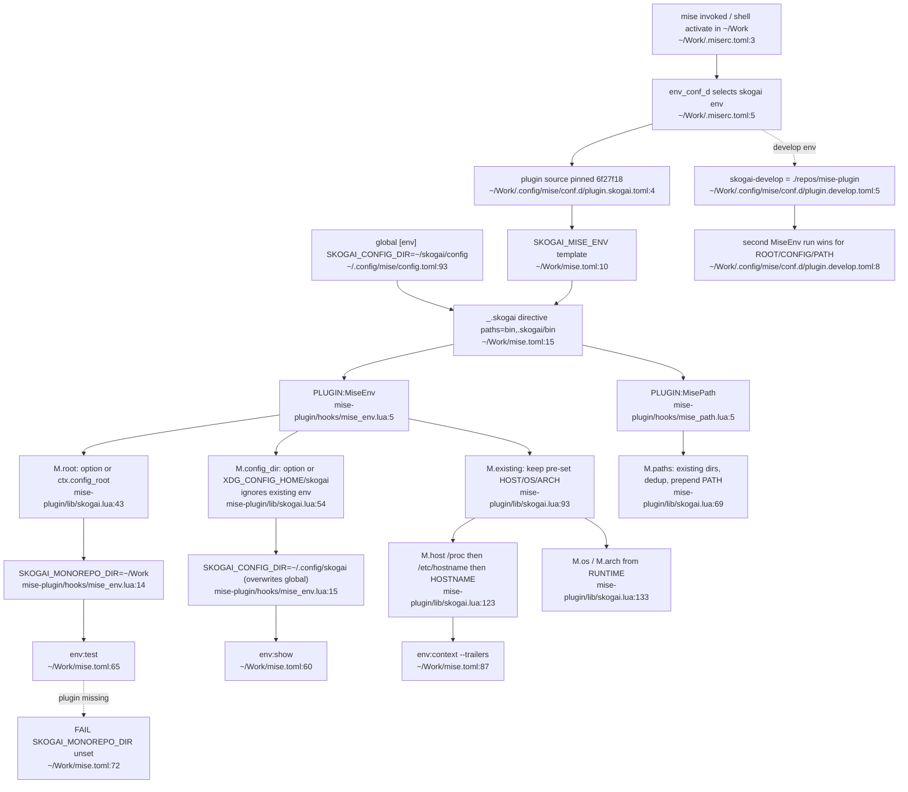
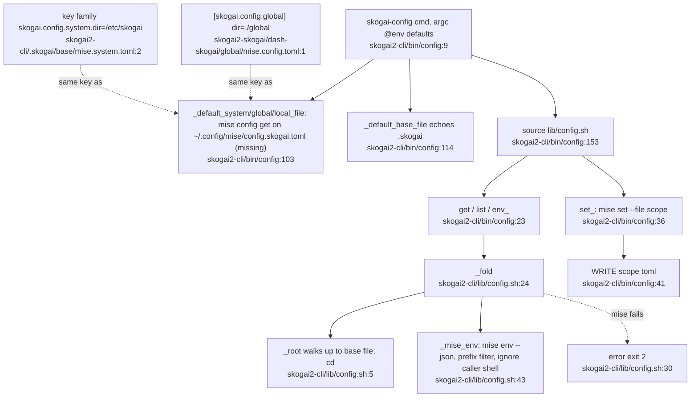
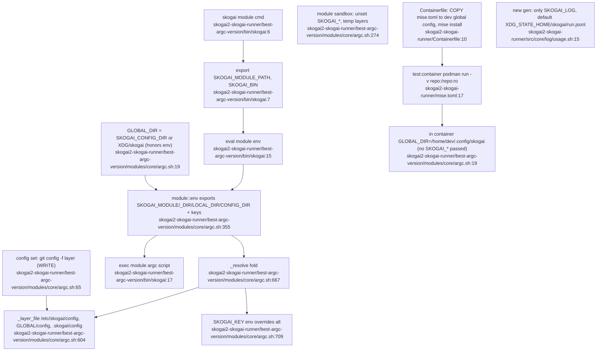
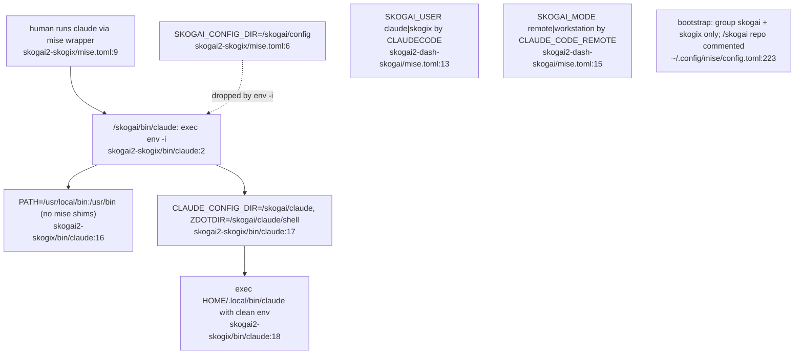
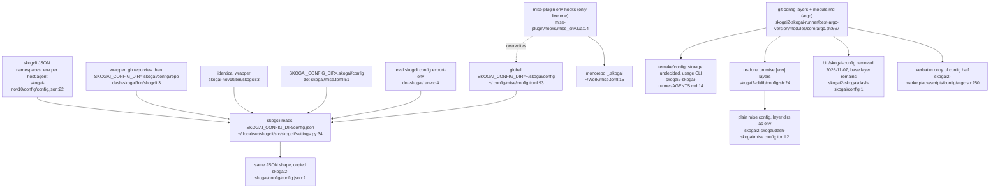

# S1 ENV: environment and settings plane (Phase 1 flowchart)

Thread: Pathfinder Phase 1, S1. This thread wrote only this file. Live checks were read-only: `mise env`, `mise run env:show`, `ls`, `id`, `getent` and `git log`. Nothing was trusted or installed; the report is the only intended write. These live observations were recorded by the initial pass, not repeated during handoff review.

## TL;DR

- **Seven independent settings implementations exist.** Four of them resolve `SKOGAI_CONFIG_DIR`, each with its own default:
  - mise-plugin
  - the global mise config
  - the runner/marketplace argc config
  - skogcli

  The others (skogai2-cli, skogai2-skogai's dash-skogai, skogai-core's userConfig) use other variable names or none at all.
- **On this workstation the same variable has two live values, depending on cwd:**
  - Outside `~/Work`: `SKOGAI_CONFIG_DIR=/home/skogix/skogai/config`, from global `~/.config/mise/config.toml:93`. That directory is empty.
  - Inside `~/Work`: `SKOGAI_CONFIG_DIR=/home/skogix/.config/skogai`. The plugin overwrites the global value, because `config_dir` is deliberately not read from env (`mise-plugin/README.md:54`).

  So skogcli, which does `mkdir -p "$SKOGAI_CONFIG_DIR"` and reads `config.json` there, gets a different store per directory.
- **The only live, end-to-end path is mise-plugin, through the monorepo's `mise.toml`.** Its only readers are the monorepo's own `env:*` tasks. No other repo declares `_.skogai`.
- **Two config CLIs are dormant:**
  - skogai2-cli `bin/config` is committed in a half-edited state: its defaults point at a nonexistent `~/.config/mise/config.skogai.toml`, and it is not installed.
  - The runner's config is being remade (`remake/config`), and storage is undecided.
- **The runner test-container command passes no explicit `SKOGAI_*` variables** (`skogai2-skogai-runner/mise.toml:20`). Its `Containerfile:10` copies the entire `mise.toml` (tools and tasks). If the old resolver runs without an override in that container, its global layer defaults to `/home/dev/.config/skogai`; this is a static inference, not a container execution result.
- **Agent-home launchers do not pass `SKOGAI_*` either.** They use `env -i`, `PATH=/usr/local/bin:/usr/bin` and `CLAUDE_CONFIG_DIR=/skogai/claude`, and `/skogai` does not exist on this machine.

---

## Sources consulted

| Path | Lines |
|---|---|
| `repos/PATHFINDER-2026-11-14/00-features.md` | 1–82 |
| `repos/PATHFINDER-2026-11-14/skogfences-reference.md` | 1–126 |
| `repos/mise-plugin/hooks/mise_env.lua` | 1–20 |
| `repos/mise-plugin/hooks/mise_path.lua` | 1–9 |
| `repos/mise-plugin/lib/skogai.lua` | 1–143 |
| `repos/mise-plugin/metadata.lua` | 1–21 |
| `repos/mise-plugin/README.md` | 1–92 |
| `repos/mise-plugin/mise.toml` | 1–22 |
| `repos/mise-plugin/test/run.sh` | 1–80 |
| `~/Work/mise.toml` (monorepo) | 1–132 |
| `~/Work/.miserc.toml` | 1–6 |
| `~/Work/.config/mise/conf.d/plugin.skogai.toml` | 1–4 |
| `~/Work/.config/mise/conf.d/plugin.develop.toml` | 1–13 |
| `~/Work/.config/mise/conf.d/t3.toml` | 1–74 |
| `~/Work/.config/mise/conf.d/termix.toml` | 1–2 |
| `~/Work/doc/mise.md` | 1–169 |
| `~/.config/mise/config.toml` (global, live; not in a repo, tracked by `mise dotfiles`) | 83–110, 131–231 (grep) |
| `~/.config/mise/conf.d/dotfiles-tracking.toml` | 1–96 |
| `repos/skogai2-cli/bin/config` | 1–161 |
| `repos/skogai2-cli/lib/config.sh` | 1–74 |
| `repos/skogai2-cli/docs/config.md` | 1–120 |
| `repos/skogai2-cli/.skogai/base/{mise.toml,mise.system.toml,config.md}` | all |
| `repos/skogai2-cli/test/config.bats` | grep |
| `repos/skogai2-cli/test/install.sh` | 1–17 |
| `repos/skogai2-cli/PKGBUILD` | 1–40 |
| `git show c3fd054` | |
| `repos/skogai2-marketplace/scripts/config/argc.sh` | 1–337 |
| `repos/skogai2-marketplace/scripts/config/module.md` | 1–36 |
| `repos/skogai2-marketplace/plugins/skogai-core/.claude-plugin/plugin.json` | 1–60 |
| `repos/skogai2-marketplace/plugins/skogai-core/scripts/settings.sh` | 1–40 |
| `repos/skogai2-skogai-runner/best-argc-version/bin/skogai` | 1–21 |
| `repos/skogai2-skogai-runner/best-argc-version/modules/core/argc.sh` | 1–24, 345–367, grep of the rest |
| `repos/skogai2-skogai-runner/Containerfile` | 1–12 |
| `repos/skogai2-skogai-runner/mise.toml` | 1–20 |
| `repos/skogai2-skogai-runner/src/core/log/usage.sh` | 1–60 |
| `repos/skogai2-skogai-runner/AGENTS.md` | 1–45 |
| `repos/skogai2-skogai-runner/TODO.md` | 1–45 |
| `repos/skogai2-skogai-runner/.harness/context_summary.md` | grep: config/mise/env |
| `repos/skogai2-skogai-runner/packaging/arch/skogai-runner.install` | |
| `repos/skogai2-skogai/dash-skogai/Argcfile.sh` | 1–19 |
| `repos/skogai2-skogai/mise.toml` | 1–24 |
| `repos/skogai2-skogai/dash-skogai/mise.config.toml` | 1–4 |
| `repos/skogai2-skogai/dash-skogai/{global,local,system}/mise.config.toml` | |
| `repos/skogai2-skogai/dash-skogai/config` | 1–15 |
| `repos/skogai2-skogai/dash-skogai/type/tool/mise.md` | 1–26 |
| `repos/skogai2-skogai/config/config.json` | 1–189 |
| `repos/skogai2-skogai/.skogai/scripts/whereami.sh` | 1–40 |
| `repos/skogai2-config/README.md` | 1–28 |
| `repos/skogai2-config/SKOGAI.md` | 1–80 |
| `repos/skogai2-config/mise/bootstrap.md` | 1–90 |
| `repos/skogai2-config/mise/secrets.md` | 1–60 |
| `repos/skogai2-config/secrets/fnox.md` | 1–70 |
| `repos/skogai2-config/bin/health` | 1–50 |
| `repos/skogai2-config/secrets/health` | grep |
| `~/.config/skogai` (the live checkout of skogai2-config, one commit ahead: `86e9813`) | |
| `repos/skogai2-skogix/mise.toml` | 1–20 |
| `repos/skogai2-skogix/bin/claude` | 1–18 |
| `repos/skogai2-skogix/mise.md` | 1–30 |
| `repos/skogai2-dash-skogai/mise.toml` | 1–36 |
| `repos/skogai-nov10/config/config.json` | 1–60, grep |
| `repos/skogai-nov10/config/claude-settings.json` | 30–45 |
| `repos/skogai-nov10/bin/skogcli` and `repos/dash-skogai/bin/skogcli` | 1–4 each (identical) |
| `repos/dot-skogai/mise.toml` | 40–54 |
| `repos/dot-skogai/.envrc` | 1–5 |
| `repos/core/Argcfile.sh` and `repos/skogai2-core/Argcfile.sh` | 7–18 (byte-identical) |
| `~/.local/src/skogcli/src/skogcli/settings.py` | 28–64 (outside `repos/`, but it is the main external reader) |
| `/etc/skogai/config`, `/etc/skogai/` listing | |
| `getent group skogai`, `id claude/dot/amy/goose`, `ls /skogai` | |

Repo-wide grep: `\bSKOGAI_[A-Z0-9_]+\b` over `repos/`, excluding `.git`, repomix, skogai2-docs and PATHFINDER, with counts. Plus targeted greps for `SKOGAI_CONFIG_DIR`, `SKOGAI_{MONOREPO_DIR,HOST,OS,ARCH,MISE_ENV}`, `_.skogai`, `CLAUDE_CODE_REMOTE`, `SKOGAI_{USER,MODE}`.

---

## 1. Implementations and their happy paths

### 1a. mise-plugin through the monorepo (LIVE, new generation)

Entry: any `mise` invocation, or mise shell activation, with cwd under `~/Work`.

1. **`.miserc.toml:3,5`** loads before any config: `env = ["skogai"]`, `env_conf_d = true`.
2. **`.config/mise/conf.d/plugin.skogai.toml:4`** loads in env `skogai` and gives the plugin source, pinned at `6f27f18`. mise clones the plugin on first use (side effects: network, a write to the mise data dir).
   - In env `develop`, **`plugin.develop.toml:5,8`** links `./repos/mise-plugin` as `skogai-develop` instead, and its `_.skogai-develop = {}` runs after the published plugin and wins.
3. **The global config `~/.config/mise/config.toml:93`** has already set `SKOGAI_CONFIG_DIR=/home/skogix/skogai/config`, `:102–106` sets the docs and XDG vars, and `:105–106` sets `XDG_SKOGAI_CONFIG_DIR` and `XDG_SKOGAI_DIR`. The global config loads first.
4. **`~/Work/mise.toml:10`** sets `SKOGAI_MISE_ENV` from a Tera template, because the plugin cannot see the env selected in `.miserc`.
5. **`~/Work/mise.toml:15`** `_.skogai = { paths = ["bin", ".skogai/bin"] }` calls the hooks:
   - `PLUGIN:MiseEnv` (`hooks/mise_env.lua:5`) returns:
     - `SKOGAI_MONOREPO_DIR = skogai.root(ctx)` (`:14`): the `root` option, else `ctx.config_root` (`lib/skogai.lua:43`).
     - `SKOGAI_CONFIG_DIR = skogai.config_dir(ctx)` (`:15`): the `config_dir` option, else `$XDG_CONFIG_HOME/skogai`, else `~/.config/skogai` (`lib/skogai.lua:54`). **It never reads the existing env**, so it overwrites step 3's value.
     - `SKOGAI_HOST`, `SKOGAI_OS` and `SKOGAI_ARCH` through `default()` (`:9–11,16–18`): an existing env value wins (`lib/skogai.lua:93`); otherwise `/proc/sys/kernel/hostname`, then `/etc/hostname`, then `$HOSTNAME` (`:123`), and `RUNTIME.osType/archType` (`:133,139`).
   - `PLUGIN:MisePath` (`hooks/mise_path.lua:5`) calls `skogai.paths` (`lib/skogai.lua:69`), which keeps existing dirs only and drops duplicates. **Side effect: `PATH` is prepended.**
6. **`~/Work/mise.toml:16`** sets `SKOGAI_MY_SETTING = "test"`, a test leftover.
7. **Terminal state:** the process env has the `SKOGAI_*` vars set. The readers are `env:show` (`:60`), `env:test` (`:65–85`) and `env:context` (`:87–106`), which also feeds the commit trailers.

The values are verified live in §3.

Error and fallback branches:
- The plugin is not installed and no source is loaded (for example `MISE_ENV=`): `WARN skipping env plugin skogai` (`doc/mise.md:55`), and no `SKOGAI_MONOREPO_DIR`. `env:test` then fails at `mise.toml:72–73`.
- The source is present but the install fails: mise fails hard.
- The host name is empty (macOS without `$HOSTNAME`): `env:test` fails at `:78`.

### 1b. skogai2-cli `bin/config` → `skogai-config` (DORMANT, mid-edit)

Design (`docs/config.md:14–34`): settings are `SKOGAI_*` vars in the `[env]` of mise env `MISE_ENV=skogai`, folded in mise's order: system, global, base `mise.skogai.toml` (committed, never written), then local `mise.skogai.local.toml`. The key `core.debug` maps to `SKOGAI_CORE_DEBUG`.

Code at HEAD `c3fd054`:
1. argc reads `@env` defaults (`bin/config:9–14`):
   - `MISE_ENV=skogai`, `SKOGAI_CONFIG_PREFIX=SKOGAI_`.
   - `SKOGAI_CONFIG_{SYSTEM,GLOBAL,LOCAL}_FILE` come from `_default_*_file` (`:103–122`). These run `mise config get --file=/home/skogix/.config/mise/config.skogai.toml skogai.config.<scope>.dir`, a hardcoded path that **does not exist**. The doc says the defaults follow `$MISE_SYSTEM_CONFIG_DIR` and `$MISE_CONFIG_DIR`; that code is commented out.
   - `SKOGAI_CONFIG_BASE_FILE` comes from `_default_base_file` (`:114`), which now echoes `.skogai`, not `mise.$MISE_ENV.toml`.
2. It sources `lib/config.sh` (`:153–160`), from `../lib/skogai/config.sh` when installed or `../lib/config.sh` in the repo.
3. `get`, `list` and `env_` call `_fold` (`lib/config.sh:24`):
   - `_root` (`:5`) walks up from `$ARGC_PWD` to the directory holding the base file, then `cd`s there.
   - `_mise_env --json` (`:43`) runs `mise env --json | yq`, keeps only the prefixed vars, and **ignores `SKOGAI_*` from the calling shell**.
   - `--redacted` marks secrets, and the origin comes from `mise set`.
4. `set_` (`bin/config:36`) runs `mise set -q --file <scope file> SKOGAI_<KEY>=<value>`. **Side effect: it writes a TOML file.** `unset_` (`:47`) runs `mise unset`.
5. A debug command `skogix` and `_choice_example` (`:52–65`) are committed WIP.
6. The packaging (`PKGBUILD:31–39`) installs `bin/*` as `/usr/bin/skogai-*`, `lib/*` into `/usr/lib/skogai/`, and the base into `/usr/share/skogai/base/`. It is **not installed** on this machine: `which skogai-config` finds nothing, and `pacman -Q skogai` reports the package is not found.
7. Related key: `.skogai/base/mise.system.toml:1–3` declares `[skogai] config.system.dir = "/etc/skogai"`. That is the same `skogai.config.<scope>.dir` key family that `_default_*_file` reads, and that skogai2-skogai `dash-skogai/global/mise.config.toml:1–2` declares.

Errors: when mise cannot resolve the env, `_fold` exits 2 (`lib/config.sh:30`). With the defaults as committed, every command errors at argc `@env` evaluation (inferred, not run).

### 1c. Runner `best-argc-version` core config and the marketplace copy (FROZEN reference; the copy is DORMANT)

1. `best-argc-version/bin/skogai:6–9` exports `SKOGAI_MODULE_PATH` (appending `<root>/modules`) and `SKOGAI_BIN`.
2. When the first argument is a module name (`:14–17`), it runs `argc --argc-run core module env <m>` and `eval`s the result. That is `module::env` (`modules/core/argc.sh:355`), which exports:
   - `SKOGAI_MODULE` and `SKOGAI_MODULE_DIR`
   - `SKOGAI_LOCAL_DIR` (absolute)
   - `SKOGAI_CONFIG_DIR=$GLOBAL_DIR`
   - every resolved `<module>.*` key as `SKOGAI_<MODULE>_<KEY>`

   Then it `exec`s the module's argc script. **This is the only place a SkogAI tool injects env into a child.**
3. Resolving `GLOBAL_DIR` (`argc.sh:19`): `${SKOGAI_CONFIG_DIR:-${XDG_CONFIG_HOME:-$HOME/.config}/skogai}`. This one **honors the existing env**, unlike the plugin.
4. `_resolve` (`argc.sh:667`; byte-identical to `skogai2-marketplace/scripts/config/argc.sh:250`) folds, later wins:
   1. `config:` in each `module.md`
   2. the git-config files `$SKOGAI_SYSTEM_DIR/config` (`/etc/skogai/config`), `$GLOBAL_DIR/config` and `$SKOGAI_LOCAL_DIR/config` (`.skogai/config` at the git root) (`_layer_file`, `argc.sh:604`)
   3. `module.local.md`
   4. `--file X.md` and `X.local.md`
   5. last, any `SKOGAI_<KEY>` already in env (`argc.sh:709` and marketplace `:292`)
5. `set` runs `git config -f <layer>` (`argc.sh:65`, marketplace `:60`). **Side effect: it writes a git-config file.**
6. `module::sandbox` (`argc.sh:274`, `:291–324`) prints env lines that unset every `SKOGAI_*` and point `SKOGAI_{SYSTEM,CONFIG,LOCAL}_DIR` at a temp tree.

Live state on this machine:
- `/etc/skogai/config` exists, with `[system] path = /etc/skogai/config`.
- `~/.config/skogai/config` is missing.
- `~/skogai/.skogai/config` is missing. `TODO.md:43` says it is a directory, which is stale.

The marketplace copy `scripts/config/argc.sh` (`module.md:12`: "copied out as is") was last touched on 2026-10-24. Nothing invokes it: grep finds no caller outside its own directory.

### 1d. The runner's new generation (`src/`, usage CLI): NO CONFIG YET

- `AGENTS.md:14–16`: config, module install, run and contract were deleted on 2026-11-07, and config storage is undecided pending `.skogai/research/mise.md`.
- Decided (`.harness/context_summary.md:8,33–37,42`):
  - Precedence: module defaults < system < global < local < override < params < env.
  - Control vars live in a reserved `config.*` section (`SKOGAI_CONFIG_GLOBAL`, …).
  - Modules get config by calling each other, not by env injection.
  - The mise mapping was verified: `{{ get_env(name='K', default='v') }}` lets the caller's env win.
- The only env read in `src/` is `SKOGAI_LOG` (`src/core/log/usage.sh:15,34`), defaulting to `$XDG_STATE_HOME/skogai/run.jsonl`.

### 1e. skogai2-skogai `dash-skogai`: "config is plain mise config" (DESIGN ONLY)

- `dash-skogai/Argcfile.sh:3–5`: no commands; config is meant to be `mise config` used directly.
- `dash-skogai/mise.config.toml:1–4` sets `SKOGAI_CONFIG_{SYSTEM,LOCAL,GLOBAL}_DIR` to `./system`, `./local` and `./global`. **`mise.config.toml` is not a filename mise discovers** (inferred from mise's config-name list; I couldn't test, because the repo's `mise.toml` is untrusted and I did not trust it). These vars have no reader anywhere in the repos.
- `global/mise.config.toml:1–2` has `[skogai.config.global] dir = "./global"`. `mise config get --file=global/mise.config.toml skogai.config.global.dir` returns `./global` (verified live). The `local` and `system` files are commented out.
- `dash-skogai/config:1–15` is a git-config "base layer", in the 1c format, with `stage/commit/merge on-stop` and `event.log-path`.
- `type/tool/mise.md:26`: `bin/skogai-config`, the 1c-style wrapper, was removed on 2026-11-07 and is recoverable from `80e3e9b`.
- `config/config.json:1–20` is skogcli's namespaced JSON, mapping `SKOGAI_CONFIG_DIR` to `.skogai/config/<project>` per project.

### 1f. skogcli (external: `~/.local/src/skogcli`, `skogai/skogcli`; not in `repos/`)

- `settings.py:34–38`: if `SKOGAI_CONFIG_DIR` is set, it does `mkdir -p` on that directory. **Side effect: it creates a directory.** Then it reads `config.json` there (`:63`).
- Its feeders:
  - Global mise `:93` → `~/skogai/config`
  - The old wrapper `dash-skogai/bin/skogcli:2–4` and its identical copy `skogai-nov10/bin/skogcli`: they run `gh repo view` (network) to set `SKOGAI_CONFIG_DIR=.skogai/config/<repo>`, then `uv tool run git+https://github.com/skogai/cli.git`
  - `dot-skogai/mise.toml:50–51` → `.skogai/config` (relative)
  - `skogai-nov10/config/config.json:33–34` → `/home/skogix/skogai/config`
  - `skogai-nov10/config/claude-settings.json:39` → the same, injected into the Claude Code env
- Reverse direction: `dot-skogai/.envrc:3–4` runs `eval "$(skogcli config export-env --namespace skogai,dot-skogai)"`. skogcli is a **source** of env as well as a reader.

### 1g. skogai-core hook settings (LIVE, S6 side)

`plugin.json:8–60` declares `userConfig`. Claude Code exports it as `CLAUDE_PLUGIN_OPTION_<KEY>`. `scripts/settings.sh:14–36` maps that to `SKOGAI_ENABLED/EVENTS/LOG/JOURNAL/STATE`, and the event scripts read those. This is a separate, Claude-owned settings plane. Its `SKOGAI_LOG` (the hook log `.skogai/logs/skogai-core/log.jsonl`) **collides by name** with the runner's `SKOGAI_LOG` (`run.jsonl`).

### 1h. Agent homes, the workstation side (skogai2-skogix, skogai2-dash-skogai)

- `skogai2-skogix/bin/claude:2–18` runs `exec env -i` with:
  - `HOME`, `USER`, `TERM`, display and SSH socket
  - `PATH=/usr/local/bin:/usr/bin`, so no mise shims
  - `ZDOTDIR=/skogai/claude/shell`
  - `CLAUDE_CONFIG_DIR=/skogai/claude`

  **No `SKOGAI_*` survives** unless the zsh in `ZDOTDIR` activates mise. `bin/agy:30` is the same pattern.
- `skogai2-skogix/mise.toml:2,6,9` sets `CLAUDE_CONFIG_DIR=/skogai/claude` and `SKOGAI_CONFIG_DIR=/skogai/config`, and wraps `claude` with `/skogai/bin/claude`.
- `skogai2-dash-skogai/mise.toml:11,13,15`:
  - `_.path = {{config_root}}/bin`
  - `SKOGAI_USER` is `claude` if `CLAUDECODE` is set, else `skogix`
  - `SKOGAI_MODE` is `remote` if `CLAUDE_CODE_REMOTE == 'true'`, else `workstation`
  - FNOX_PROFILE and `[secrets.fnox]` are commented out
- Live:
  - `/skogai` does **not exist**.
  - The group `skogai` (gid 959) has claude, dot, skogix, amy, goose and codex.
  - The agent users exist, uid 956–959.
  - The global mise `[bootstrap]` declares only the group and skogix (`config.toml:223–231`). `/skogai` and `~/.skogai` are commented out (`:206–212`). See also `skogai2-config/mise/bootstrap.md:22,27–32`.

### 1i. Machine config: skogai2-config (LIVE docs and health; no `SKOGAI_*` definitions)

- `README.md:13–18` splits the machine into four stores:
  - dotfiles: in place, tracked by `mise dotfiles` (`~/.config/mise/conf.d/dotfiles-tracking.toml`)
  - machine state: global mise `[bootstrap]`
  - knowledge: this repo
  - secrets: fnox + age
- Secrets (`secrets/fnox.md:68–70`, `mise/secrets.md:21–36`):
  - `/etc/skogai/fnox.toml` holds ciphertext, root-owned. Live it is `root:skogix` 0644; `secrets/health:41–56` expects owner root, so check the group.
  - Values reach mise through `[bootstrap.secrets]` with `secret()` templates, or through a project-only `[secrets.fnox]` plus a per-task `secrets=[...]`.
  - `SKOGAI_OLLAMA_API_KEY` in `~/.config/mise/ollama.secret.env` is still waiting: its `_.file` line is commented out at global `:94`.
- Health: `bin/health:16–50` runs each `<group>/health` read-only, plus `check-routes`. `SKOGAI_HEALTH_ROOT` is its only `SKOGAI_*` var.
- The checkout at `~/.config/skogai` is the same repo as `repos/skogai2-config`, one commit ahead (`86e9813`). **`~/.config/skogai` is also exactly where the plugin's default `SKOGAI_CONFIG_DIR` points.** So the plugin points "the SkogAI config dir" at the skogai2-config git checkout.

### 1j. Older generation: skogai-nov10 `config/` (DORMANT archive)

- `config/config.json` is skogcli's namespaced JSON per host and agent:
  - `laptop`/`uv` → `UV_*`
  - `skogai` → git identity, `SKOGAI_CONFIG(_DIR)`, `SKOGAI_{SRC,DOT_HOME,CLAUDE_HOME,AMY_HOME,GOOSE_HOME,WORKTREE_PATH,LORE,REPO_*}` (`:22–54`)
  - per agent: `SKOGAI_AGENT_NAME` (`:61–84`)
- Also there:
  - `claude-settings.json`, `claude-agents.json`, `claude-auto.json`: Claude `settings.json` variants that set `SKOGAI_CONFIG_DIR` at `:39`
  - `codex-config.toml`, `litellm-config.yaml`, `mcp*.json`, `worktrunk-config.toml`, `gitconfig*`
- None of them is symlinked to live paths: `~/.claude/settings.json`, `~/.codex/config.toml` and `~/.config/worktrunk/config.toml` are regular files, and the live `~/.claude/settings.json` has no `SKOGAI_` key. The last commit was 2026-10-24.

### 1k. Remote containers

- `skogai2-skogai-runner/Containerfile:3–12`: Arch, user `dev`, and `COPY mise.toml → /home/dev/.config/mise/config.toml`, so the runner's `[tools]` become the container's **global** mise config. It runs `mise install` and puts the shims on `PATH`. No `ENV SKOGAI_*`, and no plugin.
- `mise.toml:17–20` (`test:container`) runs `podman run --rm -v {{config_root}}:/repo:ro`. So inside the container, `GLOBAL_DIR` resolves to `/home/dev/.config/skogai`. **Side effects: a podman build and a podman run.**
- The cloud and remote side is detected only by `skogai2-dash-skogai/mise.toml:15` (`SKOGAI_MODE`) and `skogai2-skogai/.skogai/scripts/whereami.sh:9–40`, which checks container and VM presence.
- The podman quadlets (S7) use `EnvironmentFile`/`Environment` with no `SKOGAI_*`.

---

## 2. Diagrams

### 2a. LIVE: mise-plugin in the monorepo

### 2b. DORMANT: skogai2-cli `skogai-config` on mise layers

### 2c. FROZEN: runner core config, with the env reaching the module and the container

### 2d. Agent homes and the workstation launcher (env stripped)

### 2e. Old → new: how the copies relate

Arrows between implementations indicate observed similarity or a candidate evolution, not proven chronological ancestry. The owner has not selected a single successor and hopes the implementations can work together at different levels; only explicitly described identical copies were compared.

---

## 3. One variable traced: `SKOGAI_CONFIG_DIR`

| # | Definer | Value | file:line | Honors pre-set env? |
|---|---|---|---|---|
| D1 | global mise | `/home/skogix/skogai/config` (empty dir) | `~/.config/mise/config.toml:93` | n/a (plain value) |
| D2 | mise-plugin | option `config_dir`, else `$XDG_CONFIG_HOME/skogai` → `~/.config/skogai` | `mise-plugin/lib/skogai.lua:54`, `hooks/mise_env.lua:15` | **no**: overwrites D1 |
| D3 | runner core / marketplace | `${SKOGAI_CONFIG_DIR:-$XDG/skogai}` | `best-argc-version/modules/core/argc.sh:19`, `skogai2-marketplace/scripts/config/argc.sh:21` | yes |
| D4 | runner `module::env` | re-exports D3 into the module's child | `argc.sh:361` | — |
| D5 | runner sandbox | the temp dir `global` | `argc.sh:291,324` | resets |
| D6 | skogai2-skogix | `/skogai/config` (missing) | `skogai2-skogix/mise.toml:6` | n/a |
| D7 | dot-skogai | `.skogai/config` (relative) | `dot-skogai/mise.toml:51` | n/a |
| D8 | old skogcli wrapper ×2 | `.skogai/config/<gh repo name>` | `dash-skogai/bin/skogcli:3`, `skogai-nov10/bin/skogcli:3` | no |
| D9 | skogcli JSON | `.skogai/config/<ns>` per namespace | `skogai2-skogai/config/config.json:4–19`, `skogai-routing/.skogai/config/dot-skogai/config.json:4–19`, `skogai-nov10/config/default-skogcli-config.json:4–19` | — |
| D10 | nov10 Claude settings | `/home/skogix/skogai/config` | `skogai-nov10/config/claude-settings.json:39` (+ `claude-agents.json:39`, `claude-auto.json:39`) | — |
| D11 | nov10 config.json | `/home/skogix/skogai/config` | `skogai-nov10/config/config.json:34` | — |

| Reader | Uses it for | file:line |
|---|---|---|
| skogcli | `mkdir -p` + `config.json` | `~/.local/src/skogcli/src/skogcli/settings.py:34–38,63` |
| runner core config | global layer `$dir/config`, module install dir `$dir/modules` | `argc.sh:19,456,607` |
| marketplace config copy | same | `scripts/config/argc.sh:21,152,190` |
| runner tests | isolation | `best-argc-version/modules/core/tests/helper.bash:18`, `core.bats:86–456` |
| monorepo `env:show` | display | `~/Work/mise.toml:63` |
| mise-plugin test | assert | `mise-plugin/test/run.sh:46,56,66` |

**Live result, verified:**
- `cd /tmp && mise env` gives `SKOGAI_CONFIG_DIR=/home/skogix/skogai/config`.
- `cd ~/Work && mise run env:show` gives `/home/skogix/.config/skogai`.

The same skogcli command therefore reads and creates config in two different places depending on cwd. The runner's config (D3) would follow the same split, because it honors whatever mise left in env.

The sibling variable families, all resolving "where SkogAI config lives", are:
- `SKOGAI_CONFIG` (dot-skogai, nov10)
- `XDG_SKOGAI_CONFIG_DIR` and `XDG_SKOGAI_DIR` (global `:105–106`)
- `SKOGAI_{SYSTEM,LOCAL}_DIR` (runner)
- `SKOGAI_CONFIG_{SYSTEM,GLOBAL,BASE,LOCAL}_FILE` (skogai2-cli)
- `SKOGAI_CONFIG_{SYSTEM,GLOBAL,LOCAL}_DIR` (skogai2-skogai)
- the planned `SKOGAI_CONFIG_{GLOBAL,LOCAL}` (runner remake)

---

## 4. Side effects summary

| Effect | Where |
|---|---|
| Network: plugin clone | mise on first load of `plugin.skogai.toml:4` |
| Network: `gh repo view` | old skogcli wrapper `:2` |
| Network: `uv tool run git+https…` | old skogcli wrapper `:4` |
| Network: `mise install` | Containerfile `:11` |
| `PATH` mutation | `mise_path.lua:8` (plugin) |
| `PATH` replaced | `skogai2-skogix/bin/claude:16` |
| `_.path` added | `skogai2-dash-skogai/mise.toml:11` |
| Env mutation | plugin hooks; runner `module::env` eval (`bin/skogai:15`); `dot-skogai/.envrc:4`; `env -i` strips all of it (`skogai2-skogix/bin/claude:2`) |
| File writes | `skogai-config set` (mise toml, `bin/config:41`); runner and marketplace `config set` (git-config file, `argc.sh:65`, `scripts/config/argc.sh:60`), `module.local.md` and `.local.md` frontmatter (`scripts/config/argc.sh:53–55`); skogcli `mkdir -p` (`settings.py:36`) |
| Process spawns | runner `exec argc --argc-run` (`bin/skogai:17`); podman build and run (`skogai2-skogai-runner/mise.toml:10,20`); `mise env`/`mise set` subprocesses (skogai2-cli) |
| Unix users and permissions | read only here: group `skogai` (959), agents uid 956–959, `/etc/skogai/fnox.toml` root:skogix 0644 |

---

## 5. External dependencies: S1 ↔ other systems

- **S1 → S2 RUN:**
  - The runner's `module::env` is the env-injection point (`argc.sh:355`).
  - The runner remake waits on S1's storage decision (`AGENTS.md:16`).
  - The container copies the full runner `mise.toml`; `[tools]` installs tools, not `SKOGAI_*` settings. The test invocation passes no explicit `SKOGAI_*` env (`Containerfile:10–12`, `mise.toml:20`).
  - `SKOGAI_MODULE_PATH` and `SKOGAI_BIN` are S1-style vars owned by S2.
- **S1 → S3 DASH:**
  - `/skogai/config`, `/skogai/claude` and `ZDOTDIR` paths are hardcoded by skogai2-skogix, but `/skogai` is absent.
  - `SKOGAI_USER` and `SKOGAI_MODE` (skogai2-dash-skogai) decide who and where.
  - Agent users and the group come from the global mise `[bootstrap]` (S1, through skogai2-config).
- **S1 ↔ S4 DOT:**
  - The local layer is `.skogai/config` (runner) or `.skogai` as the base marker (skogai2-cli).
  - `dot-skogai/mise.toml:51` and `.envrc` feed and consume skogcli.
  - `.skogai/bin` is on `PATH` through the plugin (`~/Work/mise.toml:15`).
- **S1 → S5 FLEET:** core and skogai2-core carry hardcoded `@env` defaults for the repo and worktree dirs and the marketplace (`core/Argcfile.sh:7–18`).
- **S1 ↔ S6 PLUGINS:**
  - skogai-core `userConfig` maps to `CLAUDE_PLUGIN_OPTION_*` and then to `SKOGAI_ENABLED/LOG/JOURNAL/STATE` (`settings.sh:31–36`), a parallel plane.
  - The global mise sets `CLAUDE_CODE_PLUGIN_STORE_DIR` and the `SKOGAI_CLAUDE_CODE_DOCS*` vars, used by S6 skogdocs.
- **S1 → S7 SERVICES:**
  - The `TERMIX_URL` and `T3*` env come from monorepo conf.d.
  - Quadlets use `EnvironmentFile`s only.
  - The cloudflared token is waiting to move into fnox (`mise/secrets.md:51`).

---

## 6. Duplication seen

| # | Concern | Copies (file:line) | Read |
|---|---|---|---|
| 1 | **Layered key/value settings CLI** (get/set/unset/list/env/files, `--show-origin`) | `skogai2-skogai-runner/best-argc-version/modules/core/argc.sh:37–130`; `skogai2-marketplace/scripts/config/argc.sh:32–131`; `skogai2-cli/bin/config:23–100`; removed `skogai2-skogai bin/skogai-config` (`80e3e9b`, per `dash-skogai/type/tool/mise.md:26`); skogcli `config get/set/export-env` (`skogai-nov10/scripts/set.sh:3`, `dot-skogai/.envrc:4`) | **Accidental.** Each generation re-implemented it. The marketplace copy is a verbatim fork. skogai2-cli is the "on mise" rewrite. The runner remake is a fourth attempt. |
| 2 | **`_resolve`/`_frontmatter` fold engine** | `argc.sh:667` ≡ `scripts/config/argc.sh:250`; `argc.sh:655` ≡ `scripts/config/argc.sh:238` (diff-verified identical) | **Accidental**: a copy with no caller. |
| 3 | **`SKOGAI_CONFIG_DIR` definition** | the 11 definers in §3 (e.g. `~/.config/mise/config.toml:93`, `mise-plugin/lib/skogai.lua:54`, `argc.sh:19`, `skogai2-skogix/mise.toml:6`, `dot-skogai/mise.toml:51`) | **Accidental, and actively conflicting** (§3). |
| 4 | **Key ↔ env-name mapping** | `argc.sh:645` / `scripts/config/argc.sh:228` (`-` dropped: `stage.on-stop` → `SKOGAI_STAGE_ONSTOP`); `skogai2-cli/lib/config.sh:56,61` (`-` kept; `_` ↔ `.` round-trip); `dash-skogai/config:2` (`a.b-c` → `SKOGAI_A_BC`); skogai-core `settings.sh:15` (`CLAUDE_PLUGIN_OPTION_<KEY>`) | **Accidental.** The two rules disagree on `-`: `SKOGAI_STAGE_ON_STOP` (11 hits) and `SKOGAI_STAGE_ONSTOP` (13 hits) both exist in the repos. |
| 5 | **Host/OS/arch detection** | `mise-plugin/lib/skogai.lua:123–143`; `~/Work/mise.toml:82` (`uname -n` cross-check); `skogai2-skogai/.skogai/scripts/whereami.sh:16–21`; `skogai2-dash-skogai/mise.toml:15` (`SKOGAI_MODE`); `skogai-nov10/.projects/claude-settings/.envrc:1` | **Partly legitimate.** whereami adds container and VM detection, and `SKOGAI_MODE` adds remote detection, but the naming differs (`machine.arch=x86_64` vs `SKOGAI_ARCH=x64`). It should be one source. |
| 6 | **Scope-dir pointers as config keys** | `skogai2-cli/.skogai/base/mise.system.toml:2` (`skogai.config.system.dir`); `skogai2-skogai/dash-skogai/global/mise.config.toml:1`; `skogai2-skogai/dash-skogai/mise.config.toml:2–4` (`SKOGAI_CONFIG_*_DIR`); `skogai2-cli/bin/config:11–14` (`SKOGAI_CONFIG_*_FILE`); runner `SKOGAI_{SYSTEM,LOCAL}_DIR` (`argc.sh:10–12`); the planned `config.global`/`SKOGAI_CONFIG_GLOBAL` (`context_summary.md:8`) | **Accidental**: five names for three layer locations. |
| 7 | **`SKOGAI_LOG` name** | `skogai2-marketplace/plugins/skogai-core/scripts/settings.sh:34` (hook event log); `skogai2-skogai-runner/src/core/log/usage.sh:15` (run log) | **Accidental collision.** Different files, same var. |
| 8 | **Per-agent env and config dirs** | `skogai2-skogai/config/config.json:22–47` (`SKOGAI_AGENT_NAME`); `skogai-nov10/config/config.json:61–84`; `skogai2-skogix/bin/claude:17` (`CLAUDE_CONFIG_DIR`); `skogai2-dash-skogai/mise.toml:13` (`SKOGAI_USER`) | **Accidental drift.** skogfences says identity is the unix user (`id -un`). These re-derive it from env. |
| 9 | **skogcli wrapper** | `dash-skogai/bin/skogcli:1–4` ≡ `skogai-nov10/bin/skogcli:1–4` | **Accidental**, both dormant. |
| 10 | **Marketplace/plugin path `@env` block** | `core/Argcfile.sh:7–18` ≡ `skogai2-core/Argcfile.sh:7–18` ≡ `core/bin/skogai:10–18` ≡ `skogai2-core/bin/skogai`; also `dash-skogai/bin/argc/dash-skogai` | **Accidental**: hardcoded `/home/skogix/...` defaults. These belong in S1 (mise env), not argc. |
| 11 | **Claude/Codex settings files** | `skogai-nov10/config/claude-settings.json`, `claude-agents.json`, `claude-auto.json` (three variants, same `env` block, `SKOGAI_CONFIG_DIR` at `:39` each); live `~/.claude/settings.json`; `skogai2-skogix` `/skogai/claude` via `CLAUDE_CONFIG_DIR` | **Accidental**: an archive versus live, with no sync. |
| 12 | **Plugin source declaration** | `~/Work/.config/mise/conf.d/plugin.skogai.toml:4` vs `plugin.develop.toml:5` | **Legitimate.** Published vs develop, documented in `doc/mise.md:107–124`. |

---

## 7. Confidence and gaps

**Mixed.** The initial pass recorded source reads and live values from `mise env` and `env:show`. Handoff review re-read the plugin resolver, launcher and container sources and corrected the container description and an uncited diagram node. Runtime status is a snapshot, not newly revalidated. Duplication classifications below are technical interpretations, not owner-confirmed intent; neither dormant status nor chronological lineage is established by similarity alone.

| Gap | Status |
|---|---|
| Whether mise discovers `mise.config.toml` | **Inferred**, not tested: the repo is untrusted and I didn't trust it. |
| What skogai2-cli does with the committed defaults | **Inferred**; I didn't run it. |
| How the ZDOTDIR shell `/skogai/claude/shell` activates mise | Not read: the path is absent on this host. |
| `skogai2-skogai-runner/.skogai/research/mise.md` | Not read in full; it holds the pending storage research. |
| `best-argc-version/modules/{runner,memory,type}` | Only grepped. |
| skogcli internals beyond `settings.py:28–64` | Not traced. |
| The global `~/.config/mise/config.toml` | Not in any repo. It is tracked through `mise dotfiles` history only (`dotfiles-tracking.toml:56`), so it is S1's most important file but sits outside the catalog. |
| nvim-omarchy | Checked: it has no `SKOGAI_*` and only mise TOML LSP plugins. It is a personal leaf. |

---

## 8. Owner answers and remaining uncertainties

Owner answers received on 2026-11-14:

- **Implementation choice:** "whatever helps us out in the end is what we will use. hopefully they all can work together at different levels." No single canonical implementation is selected. Evaluate useful composition at different levels; overlapping implementations alone do not establish accidental duplication or a replacement plan.
- **SKOGAI_CONFIG_DIR meaning:** "whatever you set it to." The path is configurable, not fixed to one of the candidate directories. This answer does not specify the exact precedence between a pre-set environment variable and plugin options/defaults; the differing observed resolver behavior remains documented above.
- **Questions:** "this is enough for this question time thank you". No further owner questions are requested for this phase. Unresolved details remain evidence gaps, not blockers requiring another interview.

The original questions are retained below for traceability, not as renewed requests:

1. **Which `SKOGAI_CONFIG_DIR` is canonical?**
   - `~/.config/skogai`: the plugin default, which is also the skogai2-config checkout.
   - `~/skogai/config`: global mise, used by skogcli, and an empty dir.
   - `/skogai/config`: skogai2-skogix, for the agent-shared store.

   Should the plugin honor a pre-set value, as the runner does?
2. Is **skogcli** (`~/.local/src/skogcli`, `skogai/skogcli`, not in `mani.yaml`) dead, or still a live config reader? `dot-skogai/.envrc` and the global `SKOGAI_CONFIG_DIR` exist only for it.
3. **skogai2-cli `bin/config` at HEAD** (hardcoded `~/.config/mise/config.skogai.toml`, the `skogix` debug command): is this deliberate WIP toward reading layer locations from `skogai.config.*.dir` keys, as in skogai2-skogai's `global/mise.config.toml`? Or should it go back to the documented defaults?
4. **Which of these is the config going forward?** skogai2-cli (mise `[env]` layers), the runner remake (undecided storage), or skogai2-skogai "plain `mise config`". Is skogai2-cli the result of the runner's `remake/config`, or a separate track?
5. Should the **runner container** receive the S1 env (plugin plus `SKOGAI_*`), or stay hermetic with only `[tools]`?
6. Is `env -i` in `skogai2-skogix/bin/claude` meant to drop mise entirely? If so, should agents get `SKOGAI_*` from their own home's mise config (skogfences: "the ai's environment is its own responsibility")?
7. On `-` in keys: `SKOGAI_STAGE_ONSTOP` or `SKOGAI_STAGE_ON_STOP`?

Questions 1 and 4 are addressed by the owner answers above to the extent stated. Historical lineage, exact precedence, and the remaining implementation details are unresolved; no additional answers are assumed.
