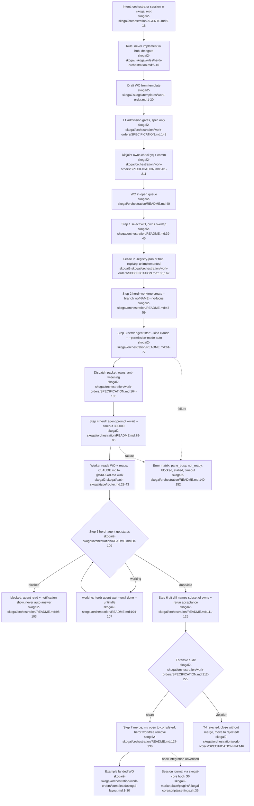
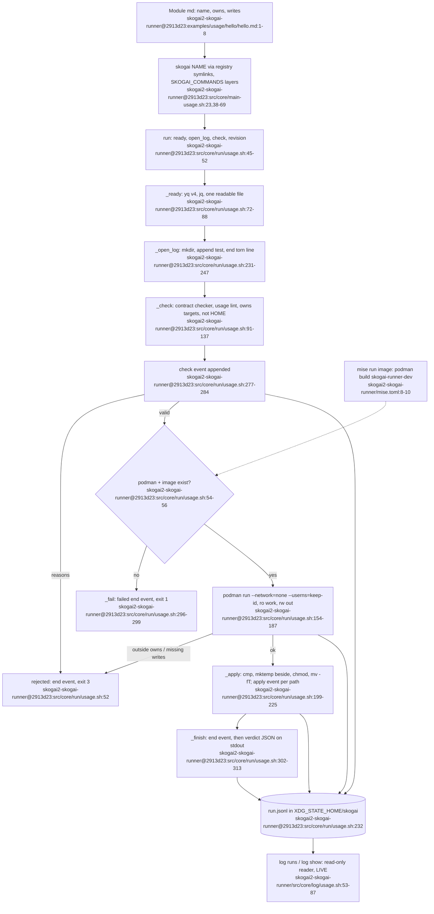
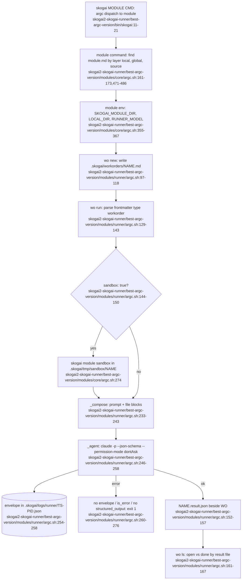
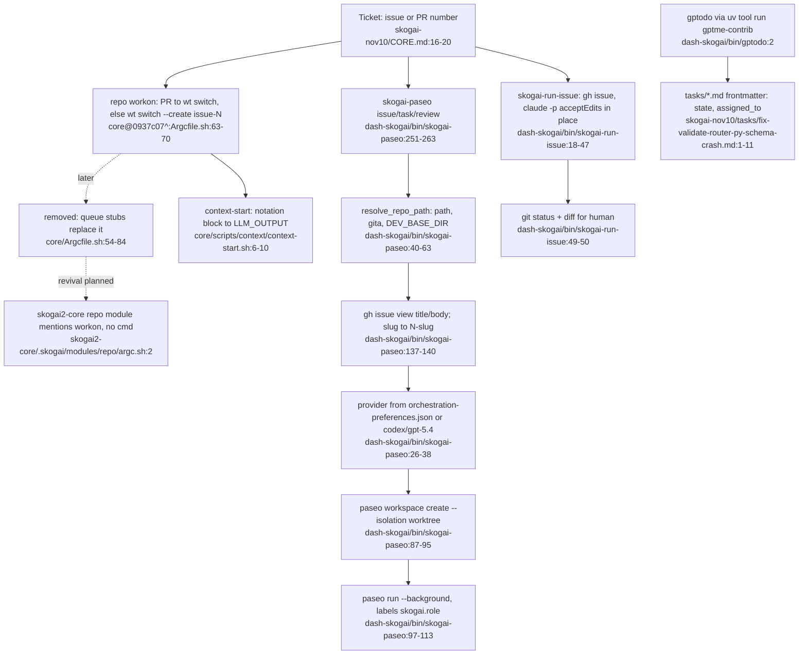
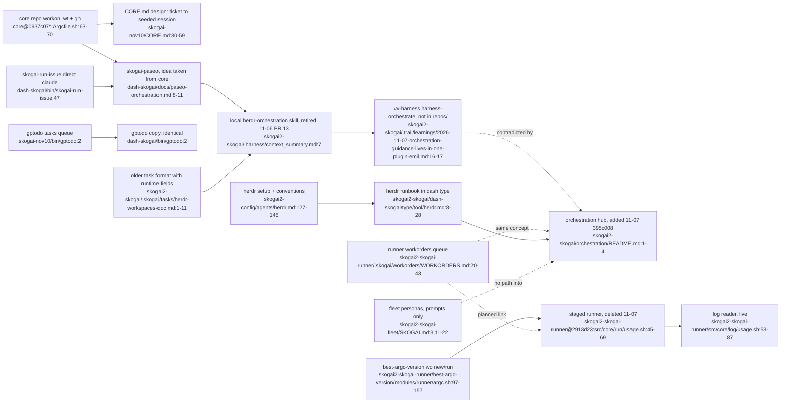
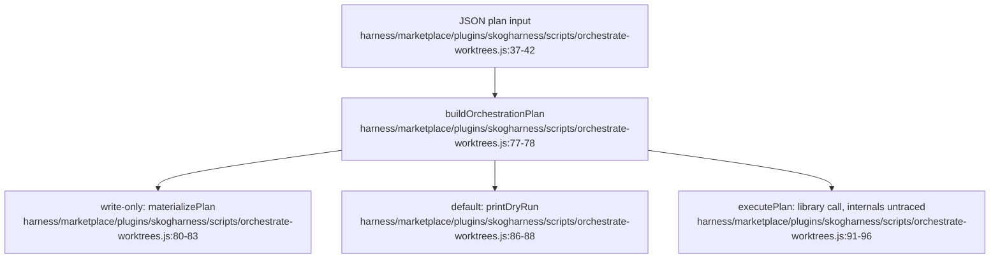

# S2 RUN: the execution plane

Phase 1 flowchart. Read-only pass over all repos, 2026-11-14.

Question traced: how one unit of work moves from **intent** to **routed**, then to a **work order**, a **spawned agent**, and a **result or journal**, and which generation does each step.

## TL;DR

**Owner correction (2026-11-14):** In response to the canonical-orchestration question, Skogix pointed to `/home/skogix/Work/repos/harness/`. Treat that repository as the canonical source pointer. The earlier comparison below omitted it and is therefore incomplete. This does not establish that either older runbook should be deleted.

- **No generation runs the whole path end to end.** The furthest-built path was the staged runner in skogai2-skogai-runner, which ran check → podman → apply → JSONL log. It was deleted on 2026-11-07 (it survives at commit `2913d23`). Today the runner repo holds only the **read-only log reader** (`src/core/log/usage.sh`).
- **The live "intent → agent" path is a document, not code.** `skogai2-skogai/orchestration/README.md` is a runbook of native `herdr` commands that an orchestrator agent carries out by hand. Nothing implements its lifecycle: the T1 admission gate, the registry lease, the T3 diff audit, the move to `completed/`.
- **Three active work-order formats, two queues, and a third orchestration source.** The runner's `.skogai/workorders/` and skogai2-skogai's `orchestration/work-orders/` are the same concept (name/reads/owns, disjoint owns, `wo/<name>` branch) with different rules. Separately, the vv-harness plugin skill `/vv-harness:harness-orchestrate` was declared the single orchestration source on 11-06. The herdr hub was added the next day.
- **Routing is a manual step today.** The runbook's only "routing" is telling the worker to read the work order and its `reads`. The router type (`dash-skogai/type/router.md`) and its checker (`workflows/skogai.md`, run via `mise run dash:check`) define the walk, but nothing runs it before dispatch.
- **Old generation:**
  - Ticket-first: `gh issue` → worktree → agent, with no work-order file.
  - dash-skogai's `skogai-paseo` and `skogai-run-issue` are both complete and runnable.
  - core's `repo workon` was implemented and has since been removed.
  - gptodo tasks are a GitHub-less task queue with frontmatter state.
- **Personas (skogai2-skogai-fleet)** are prompts only, with no spawn mechanism. `treehouse.toml` is a stock config with nothing calling it.

---

## Sources consulted

| Repo | Path | Lines |
|---|---|---|
| skogai2-skogai-runner | `AGENTS.md` | 1-75 |
| | `mise.toml` | 1-20 |
| | `src/core/log/usage.sh` | 1-91 (all) |
| | `.skogai/workorders/WORKORDERS.md` | 1-51 (all) |
| | `.skogai/workorders/done/run-events.md` | 1-40 |
| | `.skogai/TODO.md` | 1-25 |
| | `.harness/context_summary.md` | 1-80 |
| | `packaging/arch/PKGBUILD` | 1-32 |
| | `packaging/arch/skogai-runner.install` | 1-9 |
| | `git show 2913d23:src/core/run/usage.sh` | 1-320 |
| | `git show 2913d23:src/core/main-usage.sh` | 1-80 |
| | `git show 2913d23:src/core/module/usage.sh` | 1-40 |
| | `git show 2913d23:examples/usage/hello/hello.md` | 1-29 |
| | `best-argc-version/bin/skogai` | 1-21 |
| | `best-argc-version/modules/runner/module.md` | 1-80 |
| | `best-argc-version/modules/runner/argc.sh` | 1-40, 87-170, 233-280 |
| | `best-argc-version/modules/core/argc.sh` | 159-175, 349-367, 447-500 |
| skogai2-skogai | `orchestration/README.md` | 1-152 |
| | `orchestration/AGENTS.md` | 1-47 |
| | `orchestration/work-orders/SPECIFICATION.md` | 1-222 |
| | `orchestration/work-orders/completed/skogai-layout.md` | 1-30 |
| | `.skogai/templates/work-order.md` | 1-30 |
| | `.skogai/tasks/herdr-workspaces-doc.md` | 1-25 |
| | `.skogai/rules/herdr-orchestration.md` | 1-21 |
| | `.skogai/rules/runner-conventions.md` | 1-26 |
| | `.skogai/memory/fleet-persona-not-roleplay.md` | all |
| | `mise.toml` | 1-24 |
| | `AGENTS.md` | 7-18 |
| | `.harness/context_summary.md` | 7, 21 |
| | `.trail/learnings/2026-11-07-orchestration-guidance-lives-in-one-plugin-emil.md` | 1-19 |
| | `.trail/README.md` | 1-16 |
| | `dash-skogai/SKOGAI.md` | 1-33 |
| | `dash-skogai/Argcfile.sh` | 1-19 |
| | `dash-skogai/type/{task,router,trigger,type,tool}.md` | all |
| | `dash-skogai/type/tool/{herdr,skogai,wt}.md` | 1-40 |
| | `dash-skogai/workflows/skogai.md` | 1-49 |
| | `git log` | over `orchestration`, `.skogai/rules`, `.skogai/tasks`, `type/tool/herdr.md` |
| skogai2-skogai-routing | `skills/skogai-routing/SKILL.md` | 1-13 |
| | `docs/intentions.md` | 1-33 |
| skogai-routing | `CONTEXT.md` | 1-43 |
| | `docs/adr/0001-routing-file-requires-caps-naming.md` | all |
| | `docs/concepts/ownership-routing-model.md` | 1-40 |
| | `.old/workflows/route-information.md` | 1-31 |
| | `.old/references/routing-framework.md` | 1-60 |
| skogai2-skogai-fleet | `SKOGAI.md` | 1-22 |
| | `AGENTS.md` | all |
| | `TODO.md` | 1-20 |
| | `treehouse.toml` | 1-41 |
| | `crew/.PERSONAS-INDEX.md` | 1-30 |
| | `crew/frigate-captain.md` | 1-25 |
| skogai2-config | `agents/herdr.md` | 1-152 |
| | `bin/check-routes` | located only, not read |
| dash-skogai | `bin/skogai-paseo` | 1-265 |
| | `bin/skogai-run-issue` | 1-50 |
| | `bin/gptodo` | 1-2 |
| | `bin/check-skogai-routes` | 1-40 |
| | `docs/paseo-orchestration.md` | 1-66 |
| | `mise.toml` | 15-30 |
| skogai-nov10 | `CORE.md` | 1-100 |
| | `tasks/fix-validate-router-py-schema-crash.md` | 1-25 |
| | `tasks/` | listing: 21 files |
| | `bin/gptodo` | diffed: identical to dash-skogai's |
| core | `Argcfile.sh` | 29-170 (`@cmd` list), 54-84 |
| | `git show 0937c07^:Argcfile.sh` | 59-91 |
| | `scripts/context/context-start.sh` | 1-12 |
| skogai2-core | `.skogai/modules/repo/argc.sh` | `@cmd` list and the line-2 describe |
| skogai2-marketplace | `plugins/skogai-core/scripts/settings.sh` | 1-35 |
| | `plugins/skogai-core/hooks/hooks.json` | 1-40 |

---

## The unit of work, step by step, per generation

| Step | gen 1, Aug–Sep (core, skogai-nov10) | gen 2, Sep–Oct (dash-skogai) | gen 3a, Oct–Nov (runner `best-argc-version`) | gen 3b, Nov (runner `src/core`, deleted 11-07) | gen 3c, Nov, **live doc** (skogai2-skogai) |
|---|---|---|---|---|---|
| **Intent** | GitHub issue/PR number (`CORE.md:16-20`); gptodo task file (`tasks/*.md` frontmatter `state`/`assigned_to`) | GitHub issue number or literal task text (`skogai-paseo:11-13`, `skogai-run-issue:2`) | `wo new` writes a workorder (`runner/argc.sh:97`) | hand-written `.skogai/workorders/open/*.md` (`WORKORDERS.md:20-29`) | hand-written `orchestration/work-orders/open/*.md` (`SPECIFICATION.md:17-67`) |
| **Routed** (which repo, what context) | gita resolves the repo (`CORE.md:34`); context = `tmp/context/CONTEXT.md` from `scripts/context/*` (`CORE.md:39-41`) | path → gita → `$DEV_BASE_DIR` (`skogai-paseo:40-63`); prompt says "follow the repo's AGENTS/CLAUDE/SKOGAI.md" (`:151`) | files inlined as `<file>` blocks, worker gets no tools (`runner/argc.sh:233-243`) | the module `.md` frontmatter *is* the route: `owns` and `writes` (`2913d23 run/usage.sh:91-113`) | worker told to read the WO + `reads` (`README.md:79-86`); router walk defined (`type/router.md`) but not run |
| **Gate** | none | none | `type: workorder` check (`runner/argc.sh:135`) | contract checker + `usage lint` + owns targets (`run/usage.sh:91-137`) | T1 schema/disjoint/depends gates **specified only** (`SPECIFICATION.md:143`); manual `yq`/`comm` snippet (`:201-211`) |
| **Isolation** | `wt switch --create` worktree (`core@0937c07^ Argcfile.sh:63-70`) | `paseo workspace create --isolation worktree` (`skogai-paseo:87-95`) | optional `skogai module sandbox` (`runner/argc.sh:144-150`) | podman `--network=none`, repo `ro`, `/out` staging (`run/usage.sh:158-160`) | `herdr worktree create --no-focus` → `~/.herdr/worktrees/<repo>/<branch>` (`README.md:47-59`) |
| **Spawn** | `-x claude` after `wt switch` (`CORE.md:41-43`) | `paseo run --background --provider` (`skogai-paseo:97-113`), or `claude -p --permission-mode acceptEdits` (`skogai-run-issue:47`) | `claude -p --json-schema --permission-mode dontAsk` (`runner/argc.sh:246-258`) | the module command `usage bash /work/<name>.sh` in the container; **no LLM** | `herdr agent start --kind claude -- --permission-mode auto` + `herdr agent prompt --wait` (`README.md:61-86`) |
| **Supervise** | none | Paseo owns the lifecycle (`paseo-orchestration.md:56-60`) | synchronous; envelope checked for `is_error` and `structured_output` | synchronous | `herdr agent get/wait/read`; blocked → `notification show` (`README.md:88-109`) |
| **Verify** | none | human reads `git diff` (`skogai-run-issue:49-50`) | JSON schema match | staged path ⊆ `owns`, every `writes` present (`run/usage.sh:168-183`) | `git diff --name-only ⊆ owns` + re-run acceptance (`README.md:111-125`), manual |
| **Land** | `repo pr` (`CORE.md:53`) | "do not commit" (`skogai-paseo:151`) | `--apply` patch, or `<name>.result.json` (`runner/argc.sh:154-156`) | atomic `mv -fT` per owned file (`run/usage.sh:199-225`) | merge to master, `mv open/ → completed/`, `herdr worktree remove` (`README.md:127-136`) |
| **Result / journal** | PR body carries `tmp/context/*` (`CORE.md:58-59`) | Paseo labels `skogai.role`, `skogai.control_repo` (`skogai-paseo:109-110`) | envelope JSON in `.skogai/logs/runner/<ts>-<pid>.json` (`runner/argc.sh:254-258`) | JSONL events in `$XDG_STATE_HOME/skogai/run.jsonl` (`run/usage.sh:231-275`), read back by `log runs/show` (`src/core/log/usage.sh:53-87`, **still live**) | worker's final report packet (`SPECIFICATION.md:93-99`); session text goes to `.skogai/journal.md` through the skogai-core hook (S6, `settings.sh:35`) |

---

## Diagram 1: gen 3c, the herdr hub (skogai2-skogai). Live, but procedural only.

Every node is a step an orchestrator agent performs by hand. Nothing in the repo executes these steps.



**Side effects:**
- git: a worktree under `~/.herdr/worktrees/<repo>/<branch>`, a branch `wo/<name>`, a merge into master, and a `git mv` of the WO file.
- Processes: a herdr workspace and pane, plus a claude or codex process in auto mode.
- UI: a herdr toast.
- Unix user: none. The worker runs as the human's user, with `CLAUDE_CONFIG_DIR=/skogai/claude` (`type/tool/herdr.md:28`). That is the S3 tie-in.

---

## Diagram 2: gen 3b, the staged runner (skogai2-skogai-runner). The furthest-built executor, deleted 11-07.



**Side effects:**
- Files: atomic writes to owned files only. The log is append-only, and its parent directory is created.
- Processes: a podman container with no network.
- No git operations. The workorder → run link (`run-workorder-link`) was the next planned step (`WORKORDERS.md:17`) and never landed.

**Current state** (`AGENTS.md:12-16`): only `src/core/log/usage.sh` and `tests/log.bats` remain. `packaging/arch/PKGBUILD:29-31` still installs the deleted `src/core/main.sh`, so `makepkg` fails. The post-install text tells the user to run `argc --argc-run /usr/share/skogai/core/main.sh sync` (`skogai-runner.install:1-6`).

## Diagram 3: gen 3a, `best-argc-version` workorder → claude (reference target, "deleted once converted")



**Side effects:**
- Process: claude with no tools by default.
- Files: the log envelope, `result.json`, and a sandbox directory that is kept after the run.
- Writes nothing outside `.skogai/` unless `improve --apply` is used.

## Diagram 4: gen 1–2, the ticket-first launchers (core, dash-skogai, skogai-nov10)



**Side effects:**
- `wt` and `paseo` create worktrees, and a background agent process starts.
- `skogai-run-issue` edits the target repo **in place**, with no worktree, under acceptEdits.
- Network calls to GitHub and to the gptme-contrib git URL.

## Diagram 5: the routing walk as an execution step

```mermaid
flowchart TD
  CC["Claude loads CLAUDE.md, which is only @SKOGAI.md<br/>skogai2-skogai/dash-skogai/type/router.md:35-43"]
  RT["routes block: @path loaded, plain path on demand<br/>skogai2-skogai/dash-skogai/type/router.md:13-33"]
  OW["one-step ownership, exactly one owner<br/>skogai2-skogai/dash-skogai/type/type.md:29,35-40"]
  OLDO["old: one or more owners, non-transitive<br/>skogai-routing/CONTEXT.md:17-41"]
  CAPS["old ADR: router recognised by ALL-CAPS name<br/>skogai-routing/docs/adr/0001-routing-file-requires-caps-naming.md:1-8"]
  RI2["old route-information: classify where next / steps / known / shape / run<br/>skogai-routing/.old/workflows/route-information.md:7-21"]
  SK["skill entry routes to dash, dot, skogfences refs<br/>skogai2-skogai-routing/skills/skogai-routing/SKILL.md:7-13"]
  CHK["dash:check: claude -p runs workflows/skogai.md check<br/>skogai2-skogai/mise.toml:11-20"]
  WF["check steps: okn validate, owners, tags; plan/apply unwritten<br/>skogai2-skogai/dash-skogai/workflows/skogai.md:7-49"]
  PY["check-skogai-routes: parse routes, resolve targets<br/>dash-skogai/bin/check-skogai-routes:16-40"]
  CR["check-routes, second copy<br/>skogai2-config/bin/check-routes"]

  SK --> CC --> RT --> OW
  OLDO -. superseded? .-> OW
  CAPS -. kept as SKOGAI.md/CLAUDE.md .-> CC
  RI2 -. authoring, not runtime .-> RT
  CHK --> WF --> OW
  PY -. old checker .-> RT
  CR -. parallel checker .-> RT
```

The walk is executed **by the agent's own reading**: Claude Code loads `CLAUDE.md` and follows `@` lines. The only tooling *runs* a checker over the routing tree (`dash:check` uses an LLM, `check-skogai-routes` uses Python). Nothing selects routes for a work order. The runner's `best-argc-version` `send` inlines files instead (`runner/argc.sh:233-243`), which skips the walk entirely.

## Diagram 6: how the copies relate, old to new



---

## External dependencies

**S2 calls into:**
- **S1 ENV:**
  - mise provides tools and tasks (`skogai2-skogai-runner/mise.toml`, `skogai2-skogai/mise.toml`).
  - The runner's config remake waits on mise layering (`.harness/context_summary.md`, Active Context).
  - `best-argc-version` `module env` is its own S1 implementation (`core/argc.sh:355-367`).
  - herdr is installed through mise (`skogai2-config/agents/herdr.md:12-16`).
- **S3 DASH:**
  - Workers run with `CLAUDE_CONFIG_DIR=/skogai/claude`, and the herdr hook lives at `/skogai/claude/hooks/herdr-agent-state.sh` (`type/tool/herdr.md:28,40`).
  - No generation spawns the worker as a **separate unix user**, so the skogfences intent is not yet met on the execution path.
  - `skogai-paseo` hardcodes `/home/skogix/.local/src` (`:4`).
- **S4 DOT:**
  - `.skogai/workorders/`, `.skogai/logs/runner/`, `.skogai/templates/work-order.md` and `.skogai/tasks/` all live in the dot.
  - The router type and the `skogai check` workflow live in skogai2-skogai's `dash-skogai/` (`type/router.md`, `workflows/skogai.md`).
- **S5 FLEET:**
  - Repo resolution goes through gita (`skogai-paseo:47-53`, `CORE.md:34`).
  - core's `repo workon` / `repo review` were S5 commands; skogai2-core's `repo` module plans the revival (`modules/repo/argc.sh:2`).
  - The herdr hub uses `herdr worktree` rather than any registry.
- **S6 PLUGINS:**
  - The skogai-core hooks write `.skogai/journal.md` and `.skogai/logs/skogai-core/log.jsonl` (`settings.sh:34-35`). These are configured destinations; hook activation for herdr workers and actual journal writes were not verified.
  - The runner's run-event envelope was modelled on that log (`.harness/context_summary.md`, "Evidence starts from…").
  - The orchestration source of truth is claimed by the vv-harness plugin (`.trail/learnings/...:17`).
- **S7 SERVICES:** podman as the runner's isolation (`run/usage.sh:158`, `mise.toml:8-10`).

**Called by:** the inspected entry points accept human or lead-agent invocation. No automated caller was identified in this pass; absence across all deployments was not established.

---

## Duplication seen

The classifications below are source-based hypotheses, not owner decisions. “Accidental”, “dormant”, and generational arrows do not establish current deployment or intended retirement. Canonical ownership remains pending the owner answers.

| # | Concern | Copies (file:line) | Read |
|---|---|---|---|
| D1 | **Work-order format** | `skogai2-skogai-runner/.skogai/workorders/WORKORDERS.md:20-29` (owns path base unresolved: `:49`); `skogai2-skogai/orchestration/work-orders/SPECIFICATION.md:17-67` (file-only owns, forbidden runtime keys); `skogai2-skogai-runner/best-argc-version/modules/runner/module.md:47-60` (`type: workorder`, `schema`, `tools`, `allow`, `sandbox`, `files`); `skogai2-skogai/.skogai/tasks/herdr-workspaces-doc.md:1-11` (has `workspace`, `branch`, `agent` fields that the spec forbids) | **Accidental.** Four shapes for one concept. The SPECIFICATION even quotes a runner workorder (`contract-yq-flavor`) as its example (`SPECIFICATION.md:36-46`), so it was derived from the runner's version and then diverged. |
| D2 | **WO queue + lifecycle dirs** | runner `open/` + `done/` (`WORKORDERS.md:15-16`); hub `open/` + `completed/` (+ `rejected/`, which doesn't exist) (`SPECIFICATION.md:127-137`); `best-argc-version` flat dir + `.result.json` (`runner/argc.sh:161-167`); gptodo `state:` frontmatter (`skogai-nov10/tasks/*.md:6`) | **Accidental.** `done` and `completed` name the same state. |
| D3 | **Disjoint-owns check** | `src/core/contract/usage.sh check` (deleted, cited at `WORKORDERS.md:36`); hand-written `yq`+`comm` snippet (`SPECIFICATION.md:201-211`); a second, different `grep -v -F` snippet (`README.md:40-45`) | **Accidental.** Even within the hub, README and SPECIFICATION disagree. The only real checker was deleted. |
| D4 | **Dispatch prompt** | `WORKORDERS.md:41`; `SPECIFICATION.md:164-185`; `README.md:82-85`; `skogai-paseo:143-151,190-194`; `skogai-run-issue:31-37` | **Accidental.** Same anti-widening plus "follow the repo's routing" text, written five times. |
| D5 | **Orchestration guidance source** | `/vv-harness:harness-orchestrate` declared the single source (`.trail/learnings/2026-11-07-orchestration-guidance-lives-in-one-plugin-emil.md:16-17`, `.harness/context_summary.md:21`); new hub (`orchestration/README.md:1-4`, `.skogai/rules/herdr-orchestration.md:21` "authoritative"); runbook (`dash-skogai/type/tool/herdr.md:8-28`); setup and conventions (`skogai2-config/agents/herdr.md:127-145`) | **Accidental, and contradictory.** The hub (11-07 22:43, `395c008`) came after the "one plugin copy only" decision (11-06 PR #13). `herdr.md` in skogai2-config is legitimately separate: it covers machine setup and keybindings. The conventions overlap with the hub, and they also *conflict*: config says "worktrees only when asked" (`:135-137`), while the hub requires a worktree per task. |
| D6 | **Worktree isolation backend** | `wt` (`core@0937c07^:Argcfile.sh:63-70`); `paseo workspace` (`skogai-paseo:87-95`); `herdr worktree` (`README.md:47-59`); treehouse pool config (`skogai2-skogai-fleet/treehouse.toml:1-2`); `.claude/worktrees` used by runner workers (`.harness/context_summary.md`, Gotchas); `.skogai/worktrees/` scaffold (`skogai-layout.md:13`) | **Mostly generational, not concurrent.** wt → paseo → herdr. treehouse and `.skogai/worktrees` are unexplained leftovers. |
| D7 | **Agent invocation** | `claude -p --json-schema --permission-mode dontAsk` (`runner/argc.sh:246-258`); `claude -p --permission-mode dontAsk` with an allowlist (`skogai2-skogai/mise.toml:16-19`); `claude -p --permission-mode acceptEdits` (`skogai-run-issue:47`); `herdr agent start -- --permission-mode auto` (`README.md:65-69`); `paseo run --provider` (`skogai-paseo:104-112`) | **Partly legitimate.** Headless typed calls and interactive supervised workers are different modes. The permission-mode choice is ad hoc, though: dontAsk, acceptEdits and auto all appear. |
| D8 | **Run/result log** | runner `run.jsonl` (`2913d23 run/usage.sh:231-275`, reader `src/core/log/usage.sh:34`); `.skogai/logs/runner/*.json` (`runner/argc.sh:254-258`); skogai-core `.skogai/logs/skogai-core/log.jsonl` (`settings.sh:34`); **the env name `SKOGAI_LOG` is used for both** run.jsonl (`src/core/log/usage.sh:15`) and the hook log (`settings.sh:34`, not exported) | The run log extending the hook envelope is **legitimate** (stated decision). The **`SKOGAI_LOG` name collision is accidental.** It is harmless only while `settings.sh` doesn't `export`. |
| D9 | **Module dispatcher / registry** | `best-argc-version/bin/skogai:11-21` + `core/argc.sh:471-486` (layered module dirs); `2913d23 main-usage.sh:38-69` (`SKOGAI_COMMANDS` symlink layers); `2913d23 module/usage.sh:1-17` (mise conf.d copy); `skogai2-skogai/dash-skogai/Argcfile.sh:8-10` (`bin/skogai-<fn>`); `runner-conventions.md:4-26` (hierarchical usage spec, `~/.skogai/modules/`) | **Accidental, mid-remake.** Five models for "how a module is found and run". The owner is rebuilding config-first (`AGENTS.md:12-16`). |
| D10 | **Routing ownership rule** | exactly one owner (`skogai2-skogai/dash-skogai/type/type.md:29,37-38`); one *or more* owners (`skogai-routing/CONTEXT.md:18`, `docs/concepts/ownership-routing-model.md:36-37`) | **Possibly intentional evolution, possibly drift.** Needs an owner answer. |
| D11 | **Routing-tree checker** | `dash-skogai/bin/check-skogai-routes:16-40` (Python, mise `check-routes` `mise.toml:21-23`); `skogai2-config/bin/check-routes` + `tests/check-routes.test.sh`; `skogai2-skogai/dash-skogai/tmp/routing/scripts/validate_router.py`; LLM `dash:check` (`skogai2-skogai/mise.toml:11-20`); installed-skill `validate_router.py`, copied to skillshare, opencode and harness (`skogai-nov10/tasks/fix-validate-router-py-schema-crash.md:21-23`) | **Accidental.** At least four checkers. The nov10 task explicitly copied one fix into three places. |
| D12 | **gptodo wrapper** | `dash-skogai/bin/gptodo:2`; `skogai-nov10/bin/gptodo:2` (byte-identical) | **Identical copy; intent and current use unconfirmed.** |
| D13 | **Ticket → worktree → agent** | `core@0937c07^:Argcfile.sh:63-91`; `skogai-paseo:115-249`; `skogai-run-issue:1-50`; CORE.md design `:30-59` | **Generational.** paseo states it took the idea from core (`paseo-orchestration.md:8-11`). The ticket-first entry has **no gen-3 equivalent**: herdr WOs are hand-authored, and no `gh issue` path exists. |
| D14 | **Docs about the runner** | `AGENTS.md:28,59` refers to `best-version-so-far/`; the directory is `best-argc-version/` | **Stale name.** The S2 prompt uses the current directory name correctly. |

---

## Confidence and gaps

Recovery review: the saved report was preserved after the prior provider stopped. The source table records that prior pass; this recovery checked the inventory, skogfences reference, orchestration README lines 1–50, and hook settings lines 31–48. It corrected the queue node citation and qualified unsupported integration/intent claims. It did not rerun agents or validate Mermaid rendering.

- **High:** runner (current and `2913d23`), `best-argc-version` runner, the hub docs, and paseo/run-issue. All were read in source.
- **Medium:**
  - core `repo workon` (read one historical revision, `0937c07^`; earlier revisions with `-x`/CONTEXT.md generation were not traced, and `CORE.md` describes more than that revision does).
  - Whether the hub runbook has actually been executed: there is one completed WO (`skogai-layout`), and how it was dispatched is not recorded.
- **Not read:**
  - `skogai2-config/bin/check-routes` (only located).
  - The vv-harness `harness-orchestrate` skill itself. Owner subsequently identified `repos/harness/`; `.gitmodules:1-6` points to `skogai/skogharness` and `skogai/skills`. Both submodules are uninitialized, so their pinned contents were not read. No submodules were initialized during this read-only pass.
  - `best-argc-version` `journal harvest` path.
  - fleet `references/*` doctrine (the Nelson workflow, design-only).
  - `.harness/` hooks (`enforce-scope.sh` etc., the gate S2 relies on for lead-owned files).
- **Assumed, not verified:** none of the herdr commands were run. Their behaviour comes from `type/tool/herdr.md`, which was verified live on 11-06 against herdr 0.9.5.

## Open questions for owner

Question 1 received the owner pointer `@~/Work/repos/harness/`. Questions 2–6 remain open findings.

1. **Canonical orchestration source.** On 11-06 the local herdr skill was retired in favour of `/vv-harness:harness-orchestrate`, as "one plugin copy only". On 11-07 `orchestration/README.md` + `SPECIFICATION.md` were added, and they call themselves authoritative. Which one is canonical, and should the other be removed or turned into a pointer? *Answer: owner points to `repos/harness/`. Its `skogharness` and `skills` submodules are uninitialized in this checkout; the exact relationship to the historical vv-harness skill remains unverified.*
2. **One work-order format?** The runner's `.skogai/workorders/` and skogai2-skogai's `orchestration/work-orders/` overlap. Is the spec meant to replace the runner's queue, or is the runner's queue the executable future that the hub will call? *pending*
3. **Is the ticket-first entry dead?** That covers `skogai-paseo`, `skogai-run-issue`, gptodo, and core `repo workon`. Or should gen 3 keep an issue → WO step? (skogai2-core's `repo` module still mentions `workon`.) *pending*
4. **Workers as unix users.** skogfences says agents are unix users. Should a spawned worker run as `claude` or `amy` rather than as skogix with `CLAUDE_CONFIG_DIR=/skogai/claude`? *pending*
5. **Routing ownership.** Is it one owner (dash `type.md`) or one-or-more (skogai-routing `CONTEXT.md`)? *pending*
6. **treehouse.toml, `.skogai/worktrees/`, and the fleet personas.** Are these intended S2 parts or parked experiments? *pending*

## Owner-directed harness follow-up

Sources consulted: `harness/AGENTS.md:1-11`, `harness/SKOGAI.md:1-11`, `harness/.gitmodules:1-6`, `harness/marketplace/plugins/skogharness/AGENTS.md:1-70`, and `harness/marketplace/plugins/skogharness/scripts/orchestrate-worktrees.js:1-100`. `git submodule status` reports uninitialized `skogharness` at `5f2ed998f795120a64edb730f5bb4848ff314492` and `skills` at `f5bd0bf5922230c5f962d432347539bb4d28eb95`.

The checked-out marketplace copy contains executable orchestration: `main` loads a JSON plan, calls `buildOrchestrationPlan`, defaults to a dry-run preview, supports `--write-only` through `materializePlan`, and dispatches `--execute` through `executePlan`. The library implementation and terminal result collection have not yet been traced. This invalidates treating the earlier inventory as exhaustive; it does not prove this marketplace copy is the canonical implementation within the owner-selected repository.


