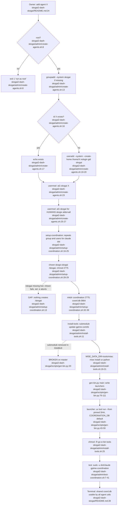
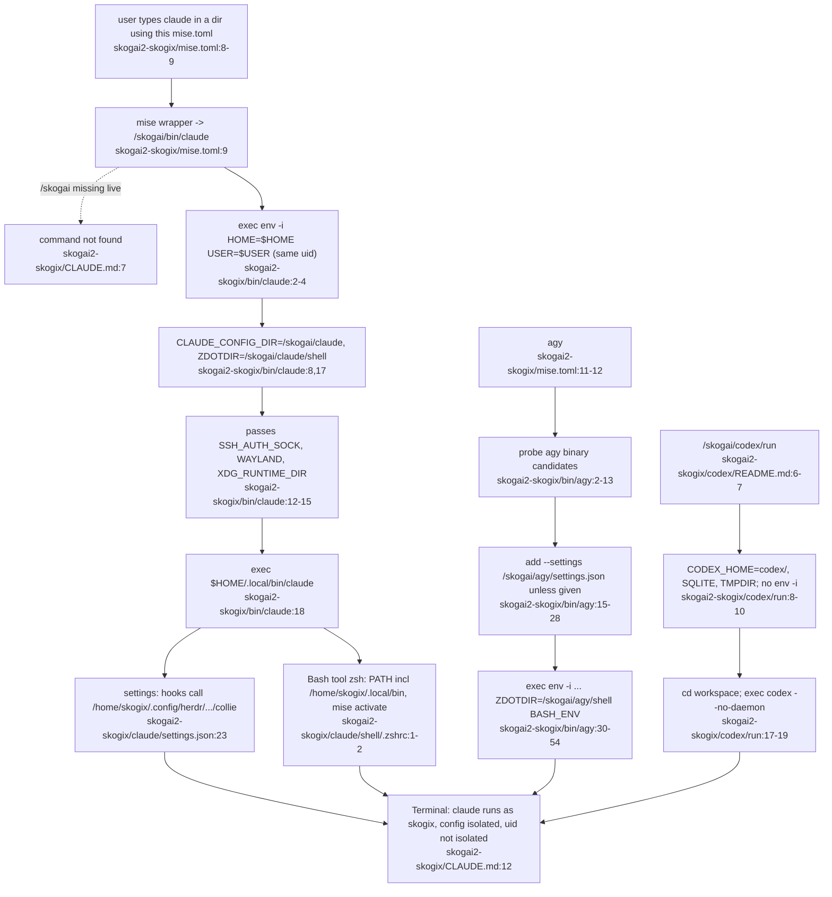
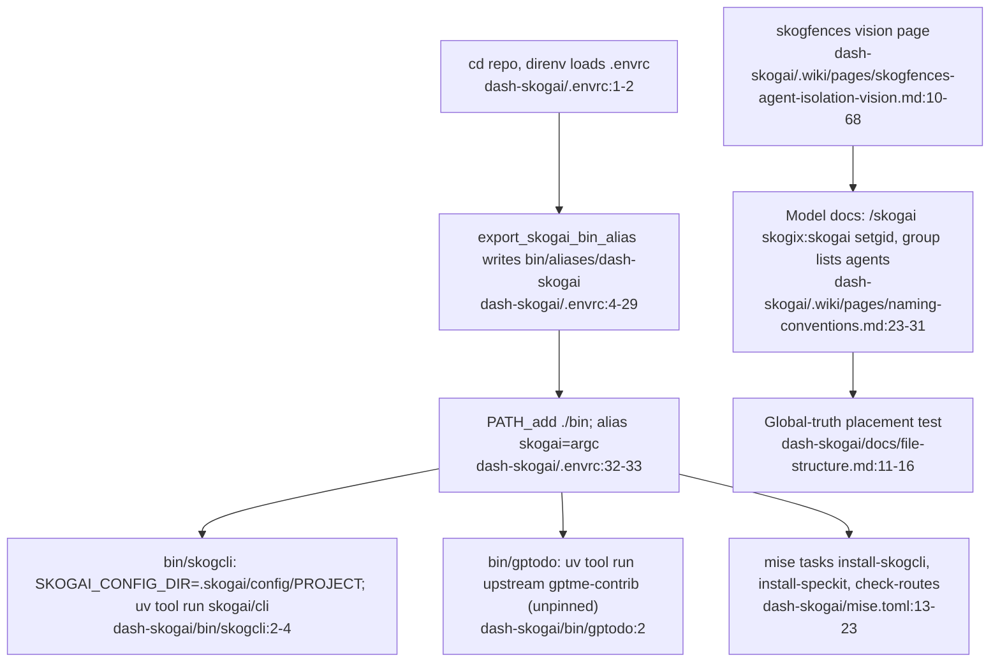
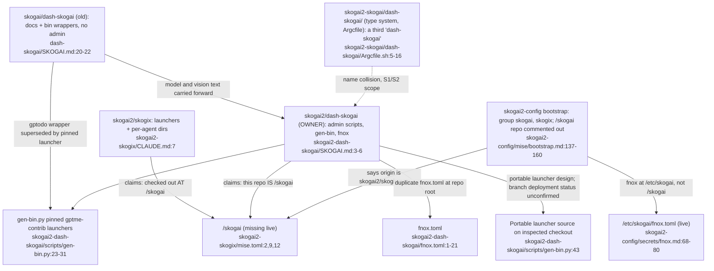

# S3 DASH: `/skogai` shared ground and agent homes (skogfences)

Phase 1 flowchart. Read-only trace, 2026-11-14. Owner decision going in: **skogai2-dash-skogai owns `/skogai`**.

## Actual local usage check (2026-11-14)

**Classification: dormant local implementation, not an active dependency of the observed setup.** This supersedes the earlier usage-unverified status for this machine. No restoration or migration is required to finish this map.

- `/skogai` is absent, so its documented coordination database and absolute-path launchers are not deployed here.
- Process inspection found no gptme/gptodo coordination process. Matches containing these checkout names were code-review-graph watchers, not deployed agents.
- Searches of live mise, fish, systemd configuration and local bin entrypoints found no coordination wiring or references to `/skogai/bin/claude`, `/skogai/bin/agy`, or the checkout launchers. Hidden configuration files were included in the follow-up search.
- `command -v gptme-coordination gptodo` found neither on this session's PATH. `mise which claude` resolves to `/home/skogix/.local/share/mise/installs/claude/latest/claude`; the PATH `claude` entry is a mise dispatcher symlink, not the repo shell wrapper. `/home/skogix/.local/bin/claude` separately links to the installed Claude version. `agy` resolves to a standalone executable at `/home/skogix/.local/bin/agy`, not the repo wrapper.
- The user service manager was queried successfully with its runtime bus environment. No coordination service was listed. The surviving `dev.mise.gptme-server.service` is **inactive and disabled**; its ExecStart targets a user-installed gptme-server, not the coordination scripts.
- Live `/home/skogix/.config/mise/config.toml:22` still declares `pipx:gptme`; that declaration alone does not demonstrate coordination-stack use. Herdr and T3 agent services are running, but are distinct from these scripts.

Evidence: read-only `ps`, `command -v`, `mise which`, `ls`, `file`, targeted `rg`, and `systemctl --user list-units/show`. This is sufficient to classify the documented local deployment as dormant. It does not claim that nobody ever runs a relocated copy or that another machine was checked. Keep the diagrams as source/history traces, not live runtime diagrams; no owner decision about unfamiliar implementation names is needed.

## TL;DR

- **No happy path is complete today.** "Add an agent" is split across three repos and a hand step, and the final step (the agent actually running as its unix user) is missing from the inspected production launchers (the coordination test does switch users).
- **Live machine:** the group `skogai` (gid 959) and the users claude, dot, amy, goose and codex exist, each with a `0700` home. **`/skogai` does not exist.** Nothing that hard-codes `/skogai/...` can work right now.
- **The launchers (`skogai2-skogix/bin/claude`, `bin/agy`) run as the human.** They pass `HOME="$HOME"` and `USER="$USER"` through `env -i`, so isolation is env-only: a redirected `CLAUDE_CONFIG_DIR`/`ZDOTDIR`, with no uid switch. The `claude` unix user is never used by any launcher.
- **The human's `$HOME` is not structurally protected.** skogix's primary group is `skogai` and `/home/skogix` is `0755` with umask `022`, so agent users can list/traverse the home directory; readability of individual descendants depends on their own modes and ACLs. `~/.ssh` was observed as `0700`; this was not a recursive access audit.
- **skogai2-dash-skogai's master is internally broken.** `admin/install-tools.sh:11` and `scripts/gen-bin.py:20` need the `gptme-contrib` submodule, which commit `02e86c9` removed. README and SKOGAI.md still describe `knowledge/`, `fish/`, `config.defaults.json`, `default/` and `gptme-contrib/`, all deleted (`ecd9d25`, `02e86c9`).
- **Three places claim `/skogai` is a skogai2-skogix checkout.** These need correcting, see [The "/skogai = skogai2-skogix" claim](#the-skogai--skogai2-skogix-claim-to-be-corrected).

## Sources consulted

| Path | Lines |
|---|---|
| `skogai2-dash-skogai/README.md` | 1–79 |
| `skogai2-dash-skogai/SKOGAI.md` | 1–25 |
| `skogai2-dash-skogai/mise.toml` | 1–36 |
| `skogai2-dash-skogai/fnox.toml` | 1–21 |
| `skogai2-dash-skogai/.gitignore` | 1–5 |
| `skogai2-dash-skogai/admin/create-agents.sh` | 1–29 |
| `skogai2-dash-skogai/admin/setup-coordination.sh` | 1–52 |
| `skogai2-dash-skogai/admin/install-tools.sh` | 1–26 |
| `skogai2-dash-skogai/admin/install-coordination.sh` | 1–18 |
| `skogai2-dash-skogai/admin/test-coordination.sh` | 1–45 |
| `skogai2-dash-skogai/scripts/gen-bin.py` | 1–115 |
| `skogai2-dash-skogai/scripts/claude/hooks/{herdr-agent-state,rtk-suggest,worktree-create}.sh` | heads, 1–40 |
| `skogai2-dash-skogai` git history | `git log --stat -8`; `git log --all -- knowledge fish config.defaults.json default gptme-contrib`; `diff master origin/feat/portable-launchers` |
| `skogai2-skogix/bin/claude` | 1–18 |
| `skogai2-skogix/bin/agy` | 1–54 |
| `skogai2-skogix/mise.toml` | 1–18 |
| `skogai2-skogix/CLAUDE.md` | 1–72 |
| `skogai2-skogix/claude/{.gitignore,settings.json,shell/.zshrc}` | all |
| `skogai2-skogix/agy/{.gitignore,shell/.bashrc,shell/.zshrc}` | all |
| `skogai2-skogix/codex/{.gitignore,run,config.toml,README.md}` | all |
| `skogai2-skogix/.skogai/decisions/0005-dash-and-dot-skogai.md` | 1–52 |
| `skogai2-skogix/.skogai/decisions/0007-knowledge-and-memory.md` | `git grep` hits only |
| `dash-skogai/SKOGAI.md` | 1–39 |
| `dash-skogai/bin/SKOGAI.md` | 1–18 |
| `dash-skogai/bin/{skogcli,gita,gptodo,install-skogcli}` | all |
| `dash-skogai/mise.toml` | 1–23 |
| `dash-skogai/.envrc` | 1–45 |
| `dash-skogai/SKOGIX.md`, `todo.list` | all |
| `dash-skogai/docs/file-structure.md` | 1–60 |
| `dash-skogai/.wiki/pages/skogfences-agent-isolation-vision.md` | 1–68 |
| `dash-skogai/.wiki/pages/naming-conventions.md` | 18–32 |
| `skogai2-config/secrets/fnox.md` | 60–100 |
| `skogai2-config/PROJECT.md` | 36–50 |
| `skogai2-config/mise/bootstrap.md` | 108–165 |
| `skogai2-config/mise/SKOGAI.md` | 110–120 |
| Live `~/.config/mise/config.toml` | 185–232 |
| `skogai2-skogai/.skogai/memory/claude-tool-allowlist.md` | 12 (grep) |
| `skogai2-skogai/.harness/context_summary.md` | 25 (grep) |
| `/home/skogix/Work/mani.yaml` | 87–146 (grep) |

Live checks, all read-only: `ls -ld /skogai`, `getent group skogai`, `getent passwd claude dot amy goose codex skogix aldervall`, `ls -ld /home/{claude,dot,amy,goose,codex,skogix}`, `ls -ld ~/.local ~/.ssh ~/.config ~/.claude`, `ls -la /etc/skogai`, `cat /etc/skogai/config`, `id`, `umask`.

## Live machine vs what the scripts would create

| Item | What scripts and config would create | Live (2026-11-14) | Match? |
|---|---|---|---|
| Group `skogai` | system group (`create-agents.sh:13`, `setup-coordination.sh:16`, live mise `[bootstrap.groups.skogai]` L223) | `skogai:x:959:claude,dot,skogix,amy,goose,codex` | yes |
| Agent users | `useradd --system --create-home --shell /usr/bin/nologin --gid skogai` for claude, dot, amy, goose, codex (`create-agents.sh:11,19-20`) | all five exist; uid 952–959, primary gid 959 | yes, except claude |
| claude shell | `/usr/bin/nologin` | `/usr/bin/bash`, changed by hand for the 2026-10-14 ssh tests (`skogai2-config/mise/bootstrap.md:138`) | **drift** (deliberate) |
| Agent homes | `/home/<a>`, useradd default mode | all `drwx------ <a> skogai` | yes |
| Human `aldervall` | added to the group if present (`create-agents.sh:10,26`) | no such user, so skipped | n/a |
| skogix membership | `usermod -aG skogai skogix` | **primary** gid is `skogai`; mise sets `group = "skogai"` (live config L227) | stronger than the scripts ask for |
| `/skogai` | `chown skogix:skogai; chmod 2775` (`setup-coordination.sh:28-29`) | **missing** | **no** |
| `/skogai/coordination`, `coord.db 0664` | `setup-coordination.sh:32-39` | missing | no |
| `/skogai/bin`, `/skogai/tools` (`755`) | `install-tools.sh:13-25` | missing | no |
| `/skogai/claude`, `/skogai/agy`, `/skogai/codex` | expected by `skogai2-skogix/bin/claude:8,17`, `bin/agy:27,35-36`, `codex/README.md:6` | missing | no |
| fnox config | `skogai2-dash-skogai/fnox.toml` (meant to land at `/skogai/fnox.toml`) vs `/etc/skogai/fnox.toml` (decision in `skogai2-config/secrets/fnox.md:68-80`) | `/etc/skogai/fnox.toml` exists, `root:skogix 0644` | the `/etc` decision is live |

## Happy path: "add a new agent", as the code can do it today

Entry: the owner wants agent `X`. Terminal state per skogfences: `X` is a unix user with a home, in group `skogai`, launched by a clean-env launcher under its own uid, with a config dir it owns and no read access to `/home/skogix`.

1. `sudo bash admin/create-agents.sh X` (`skogai2-dash-skogai/admin/create-agents.sh:2`)
   - Root check (`:8`).
   - `groupadd --system skogai` if missing (`:13`).
   - `useradd --system --create-home --home-dir /home/X --shell /usr/bin/nologin --gid skogai X` (`:19-20`).
   - `usermod -aG skogai X` (`:23`), then each human in `HUMANS` (`:25-27`).
2. `sudo bash admin/setup-coordination.sh` (`setup-coordination.sh:2`)
   - Same group/user work again, but only for claude and dot (`:11-25`).
   - `/skogai` gets `skogix:skogai 2775` (`:28-29`). **Fails today: the script `chown`s `/skogai` without first creating it, and `set -e` aborts the run.**
   - `/skogai/coordination` is `2775` and `coord.db` is pre-created at `0664` (`:32-39`). `setfacl -k` clears an old default ACL (`:42`).
3. `bash admin/install-tools.sh`, as skogix (`install-tools.sh:3`)
   - `git submodule update --init gptme-contrib` (`:11`). **Fails today: the submodule was removed in `02e86c9`.**
   - `MISE_DATA_DIR=$ROOT/tools/mise; mise install uv python` (`:19-21`).
   - `gen-bin.py` writes one bash launcher per gptme/gptme-contrib console script into `bin/` (`gen-bin.py:76-111`). Each launcher sets `MISE_DATA_DIR` and `COORDINATION_DB`, then runs `exec uv tool run --from <pinned SHA spec>` (`:43-59`).
   - `chmod -R go-w` (`:25`).
4. `sudo bash admin/test-coordination.sh`: `sudo -u dot|claude /skogai/bin/gptme-coordination ...` (`test-coordination.sh:7-41`). **This is the only place in any repo that executes something as an agent uid.**
5. Launcher and config dir: **no step creates them.** `skogai2-skogix` ships `claude/`, `agy/` and `codex/` as tracked template dirs that assume the repo *is* `/skogai` (`skogai2-skogix/CLAUDE.md:7`). mise wrappers route `claude` to `/skogai/bin/claude` (`skogai2-skogix/mise.toml:8-12`).
6. Launch: `/skogai/bin/claude` runs `exec env -i HOME="$HOME" USER="$USER" ... CLAUDE_CONFIG_DIR=/skogai/claude ZDOTDIR=/skogai/claude/shell "$HOME/.local/bin/claude"` (`skogai2-skogix/bin/claude:2-18`). This runs **as the invoking human**, with the human's `HOME`, the human's `SSH_AUTH_SOCK` (`:15`), and a binary from the human's `~/.local/bin` (`:18`).
7. Bash tool shell: `ZDOTDIR=/skogai/claude/shell/.zshrc` adds `/home/skogix/.local/bin` to `PATH` and activates the human's mise (`claude/shell/.zshrc:1-2`).

So the path ends at env-isolated-but-same-uid. The skogfences end state (`sudo -u X`, ssh `X@host`) is named as "end goal ... not designed yet" in `skogai2-config/mise/bootstrap.md:143-146`.

### Side effects

| Step | Kind | Effect |
|---|---|---|
| create-agents | unix | `groupadd`, `useradd` (creates `/home/X`; mode depends on host defaults, observed homes are `0700`), `usermod -aG` for agents and humans. A human must log in again to pick up the group (`setup-coordination.sh:48`) |
| setup-coordination | unix, files | `chown`/`chmod 2775` on `/skogai` and `coordination/`; creates `coord.db` only if absent (preserves existing contents); `chmod 664`; `setfacl -k` |
| install-tools | git, network, files | submodule init (network); mise downloads uv and python into `tools/mise`; writes `bin/*`; `chmod -R` |
| gen-bin launchers (first call per user) | network, files | `uv tool run` builds the package into **that user's** uv cache (README:42-45). An agent user with a `0700` home and no uv needs `tools/mise` (`gen-bin.py:47-52`) |
| test-coordination | process, files | `sudo -u` spawns; writes `coord.db`, `-wal` and `-shm` as the agent users; an interactive prompt truncates the DB (`:43-45`) |
| bin/claude, bin/agy | env, process | `env -i` wipes the env; `exec` claude or agy as the same uid; writes credentials, sessions and plugins into `/skogai/claude` (gitignored, `claude/.gitignore:1-6`) |
| codex/run | env, files | `CODEX_HOME`, `CODEX_SQLITE_HOME` and `TMPDIR` under `codex/`; `mkdir workspace tmp state`; `cd workspace`; `codex --no-daemon` (`codex/run:5-19`). It does **not** use `env -i`, and its config inherits all env (`config.toml:7-9`) |
| mise.toml env (skogai2-dash-skogai) | env | `SKOGAI_USER` is derived from `CLAUDECODE` (`mise.toml:13`), not from the uid; `SKOGAI_MODE` from `CLAUDE_CODE_REMOTE` (`:15`); `bin` goes on `PATH` (`:11`) |

### Error and fallback branches

- `create-agents.sh:8` and `setup-coordination.sh:9` exit when not run as root. An existing user takes the "exists" branch and only gets its group membership (`create-agents.sh:16-17`). A missing human prints "skip human" (`:26`), while `setup-coordination.sh:25` has no guard and would abort under `set -e`.
- `install-tools.sh:10` exits when mise is missing. The final `gptme-coordination --help` is a smoke test (`:26`).
- In each launcher, `mise which uv` falls back to `uv` on `PATH` (`gen-bin.py:52`), and `COORDINATION_DB` defaults to `$ROOT/coordination/coord.db` (`:57`).
- The README hook pattern tries `$SKOGAI_BIN/...`, then `command -v`, then `exit 0` (README:56-59).
- `bin/agy` probes five candidate binary paths before `/usr/bin/agy` (`bin/agy:2-13`), and injects `--settings /skogai/agy/settings.json` unless the caller passed one (`:15-28`).
- `codex/run` exits 127 when `codex` is not on `PATH` (`codex/run:12-15`).

## Diagram 1: skogai2-dash-skogai bootstrap (the owner of `/skogai`)

## Diagram 2: skogai2-skogix implemented launch path (blocked here by missing `/skogai`)

## Diagram 3: old dash-skogai (`skogai/dash-skogai`, last commit 2026-09-20)

There are no unix-user or permission scripts in this repo. Its S3 content is **documentation of the model** plus per-project tool wrappers.

## Diagram 4: how the copies relate (old → new) and who claims `/skogai`

## The "/skogai = skogai2-skogix" claim (to be corrected)

Every place found that says or assumes `/skogai` is a skogai2-skogix checkout:

1. `skogai2-skogix/CLAUDE.md:7`: "On the owner's machine it is checked out at **`/skogai`**". The same assumption appears at `:11`, `:18` ("registers it as a directory marketplace at `/skogai`"), `:20` and `:39`.
2. `skogai2-skogix/mise.toml:2,6,9,12`: `CLAUDE_CONFIG_DIR=/skogai/claude`, `SKOGAI_CONFIG_DIR=/skogai/config`, and the wrappers pointing at `/skogai/bin/{claude,agy}`, which are this repo's own `bin/`.
3. `skogai2-skogix/bin/claude:8,17` and `bin/agy:27,35,36`: `/skogai/claude`, `/skogai/agy`. `claude/shell/.zshrc:1` puts `/skogai/bin:/skogai/claude/bin` on `PATH`.
4. `skogai2-skogix/codex/README.md:3,6,7,26,32` and `codex/config.toml:18` (`[projects."/skogai"]`).
5. `skogai2-config/mise/bootstrap.md:158-160`: "`/skogai` (dash-skogai; its origin is `skogai2/skogix` now)".
6. `skogai2-config/PROJECT.md:47-49`: "commented out 2026-10-31: not a checkout / origin is `skogai2/skogix` now".
7. Live `~/.config/mise/config.toml:206-212`: the comment "/skogai's origin is skogai2/skogix now", above a commented-out entry that still points at `skogai2/dash-skogai.git`.
8. Indirectly: `skogai2-skogai/.skogai/memory/claude-tool-allowlist.md:12` ("the clean claude env in /skogai (`bin/claude`, `CLAUDE_CONFIG_DIR=/skogai/claude`)") and `skogai2-skogai/.harness/context_summary.md:25` (transcripts at `/skogai/claude/projects`).
9. History: `skogai2-skogix/.skogai/decisions/0005-dash-and-dot-skogai.md:17-19` records `/skogai` and `~/.local/src/dash-skogai` as two separate checkouts. That is consistent with `/skogai` having held skogix at that time.

Correcting these means moving `bin/claude`, `bin/agy`, `claude/`, `agy/` and `codex/` into skogai2-dash-skogai, or changing their hard-coded paths to `/skogai/<agent>` paths that dash-skogai provides. That needs an owner decision (Q1, Q2).

## External dependencies

| Direction | System | How |
|---|---|---|
| S3 → **S1 ENV** | mise | `install-tools.sh:19-22` (`MISE_DATA_DIR`, `mise install`); each launcher calls `mise which uv` (`gen-bin.py:52`); `mise.toml` derives `SKOGAI_USER`/`SKOGAI_MODE` (`skogai2-dash-skogai/mise.toml:13,15`); the skogai2-skogix mise wrappers (`mise.toml:8-12`); the agent zshrc runs `mise activate` (`claude/shell/.zshrc:2`) |
| S3 ↔ **S1 ENV** | fnox secrets | `skogai2-dash-skogai/fnox.toml` uses per-identity profiles (skogix, claude, shared), while the decided location is `/etc/skogai/fnox.toml` (`skogai2-config/secrets/fnox.md:68-80`). skogai2-config's bootstrap declares the group and the human user (live config L223-231) |
| S3 → **S2 RUN** | herdr and collie | `claude/settings.json:23-90` hooks call herdr/collie from skogix's home; `bin/agy:46-52` passes `HERDR_*`; the herdr hook script is copied into two repos (see below). `worktree-create.sh` calls `wt switch --create` |
| S3 → **S2 RUN** | gptme coordination | the shared `coord.db` lets agents claim work (`work-claim`, `test-coordination.sh:19-20`); `gptodo --skip-claimed` (`gen-bin.py:54`) |
| S3 ↔ **S4 DOT** | knowledge | decision 0007 says global knowledge and memory live in `/skogai/knowledge`, `/skogai/memory` (`skogai2-skogix/.skogai/decisions/0007-knowledge-and-memory.md:53-58`). skogai2-dash-skogai *had* `.skogai/knowledge/` and deleted it in `02e86c9`. Old dash-skogai's `SKOGAI_CONFIG_DIR=.skogai/config/<project>` (`bin/skogcli:3`) |
| S3 → **S6 PLUGINS** | marketplaces | `claude/settings.json:92-125` (enabledPlugins, extraKnownMarketplaces pointing into `/home/skogix/...`); `skogai2-skogix/.claude-plugin/marketplace.json` registered at `/skogai` |
| S5 FLEET → S3 | mani | `mani.yaml:87-142` lists `dash-skogai`, `skogai2-dash-skogai` and `skogai2-skogix` at `repos/<name>`; none points at `/skogai` |

## Duplication seen

| Concern | Locations | Read |
|---|---|---|
| Create the group and agent users | `skogai2-dash-skogai/admin/create-agents.sh:13-27` (5 agents + 2 humans); `skogai2-dash-skogai/admin/setup-coordination.sh:16-25` (2 agents + 1 human, no human guard); `skogai2-config` live mise `[bootstrap.groups.skogai]`/`[bootstrap.users.skogix]` (config L223-231), which used to declare the agent users too (`skogai2-config/mise/bootstrap.md:137-140`) | **Accidental.** `setup-coordination.sh` predates `create-agents.sh` and was never trimmed. mise bootstrap is the declarative competitor; owner rule "mise before custom" points at it |
| `/skogai` dir permissions | `skogai2-dash-skogai/admin/setup-coordination.sh:28-39`; `install-tools.sh:13-25`; `install-coordination.sh:12-17` (`2775` on bin/tools, versus README.md:66 specifying `2755` and install-tools.sh:17 requesting `755`); formerly mise `[bootstrap.directories]` (`skogai2-config/mise/bootstrap.md:125-128`, removed 2026-10-31) | **Accidental.** `install-coordination.sh` is superseded (README:26 says "replaces") but still tracked, with conflicting modes |
| Default agent list | `create-agents.sh:5` comment and `README.md:24` (4 agents) vs `create-agents.sh:11` (5, incl. codex) vs `setup-coordination.sh:12` (2) vs `naming-conventions.md:25` (4) | Accidental drift |
| Agent identity | unix uid (`create-agents.sh`) vs `SKOGAI_USER` from `CLAUDECODE` (`skogai2-dash-skogai/mise.toml:13`) vs fnox profile `FNOX_PROFILE` from `CLAUDECODE` (`mise.toml:18`, commented) vs launchers keeping `USER=$USER` (`skogai2-skogix/bin/claude:4`) | **Conflicting models.** The env-var identity exists *because* agents run as skogix. Pick one: unix uid is the skogfences answer |
| Clean-env launcher | `skogai2-skogix/bin/claude:2-18`; `bin/agy:30-54` (bigger allowlist, incl. HERDR/COLLIE); `codex/run:8-19` (no `env -i`, inherits all) | Partly legitimate (per-CLI flags), but the env allowlist is copy-paste with divergence. One shared launcher template parameterised per agent would fix it |
| Per-agent shell rc | `skogai2-skogix/claude/shell/.zshrc:1-2` (hard-codes `/home/skogix/.local/bin`); `agy/shell/.zshrc:1-6`; `agy/shell/.bashrc:1-6` | Accidental; the claude copy has also drifted to depend on the human's home |
| herdr hook script | `skogai2-dash-skogai/scripts/claude/hooks/herdr-agent-state.sh:1-6`; `skogai2-skogix/scripts/claude/hooks/herdr-agent-state.sh` (byte-identical, `diff -q` silent); both referenced as `/skogai/claude/hooks/...` (`skogai2-skogix/claude/settings.json:33`) | Accidental (herdr-generated, copied); it belongs with whichever repo owns `/skogai/claude` |
| fnox config | `skogai2-dash-skogai/fnox.toml:1-21`; `/etc/skogai/fnox.toml` (`skogai2-config/secrets/fnox.md:68-80`, which explicitly rejects `/skogai` as unsafe: `2775` without the sticky bit allows rename attacks) | **Conflict.** The `/etc` decision is reasoned and live. The dash copy holds example secrets only |
| gptme-contrib launchers | `skogai2-dash-skogai/scripts/gen-bin.py:23-31` (pinned fork SHA); `dash-skogai/bin/gptodo:2` (upstream, unpinned); `admin/install-coordination.sh:9-16` (venv from `$HOME/claude/...`) | Old → new evolution; the older paths overlap; retirement requires owner confirmation |
| `SKOGAI_CONFIG_DIR` | `skogai2-skogix/mise.toml:6` (`/skogai/config`); `dash-skogai/bin/skogcli:3` (`.skogai/config/<project>`) | S1 concern; two scopes, global vs per project. Could be legitimate layering, but undocumented |
| "What /skogai is" docs | `skogai2-dash-skogai/README.md:3-5`, `SKOGAI.md:3-6`; `dash-skogai/SKOGAI.md:20-22`, `docs/file-structure.md:11-16`, `.wiki/pages/naming-conventions.md:23-31`; `skogfences-reference.md`; `skogai2-skogix/CLAUDE.md:7` (contradicts the others) | Accidental, one of them wrong |
| A repo named "dash-skogai" | `skogai/dash-skogai`; `skogai2/dash-skogai`; `skogai2-skogai/dash-skogai/` (subdir with Argcfile and a type system) | Naming collision; the subdir is S1/S2 scope but confuses ownership |

## Confidence and gaps

- **High:** script behaviour (read in full), live group/user/home state, the `/skogai` absence, the launchers running as the same uid, the location of the `/skogai = skogix` claims, and the duplicate hook (diffed).
- **Medium:** that `setup-coordination.sh:28` fails without `/skogai`. Inferred from `chown` on a missing path under `set -e`; not run (needs sudo).
- **Gaps:**
  - I can't read `/home/<agent>` contents (`0700`) or `/etc/sudoers.d`, since `sudo -n` needs a password. Unknown whether agents have any dotfiles or sudo rules.
  - I didn't check if `/skogai` exists on other machines (the owner rule says not to touch other machines).
  - I didn't read the 257-line `.skogai/logs/hook-tap/log.jsonl` beyond its head.
  - The prompt listed `config.defaults.json`, `default/`, `fish/` and `knowledge/` in skogai2-dash-skogai; they exist only in history (`ecd9d25`, `02e86c9`), not on master.
  - The `origin/feat/portable-launchers` and `origin/add-default-gitignore` branches are not traced in detail.

## Open questions for the owner

1. **Should launchers run as the agent's uid?** Should `claude` launch as unix user `claude` (`sudo -u claude` / systemd `User=`, home `/home/claude`), or is the current same-uid `env -i` + `CLAUDE_CONFIG_DIR` the intended design for now?
2. **Where do per-agent config dirs live?** `/skogai/<agent>` (move `claude/`, `agy/`, `codex/`, `bin/claude` and `bin/agy` from skogai2-skogix into skogai2-dash-skogai), `/home/<agent>`, or something else?
3. **Is the gptme-coordination stack live or dead?** That covers `gen-bin.py`, `install-tools.sh`, `setup-coordination.sh`, `test-coordination.sh` and `coord.db`. The submodule it needs was removed on master.
4. **Which fnox config is canonical?** Is `skogai2-dash-skogai/fnox.toml` an example to delete, given `/etc/skogai/fnox.toml` is decided and live?
5. **Who creates the agent users: mise `[bootstrap.users]` or `admin/create-agents.sh`?**
6. **Is skogix's home exposure intended?** skogix's primary group is `skogai` and `/home/skogix` is `0755`, so agents can list/traverse the home directory, with descendant access depending on individual permissions. Is that intended, or should the home go to `0750` with a private group?

### Answers

Owner already specified: skogai2-dash-skogai owns `/skogai`; agents are intended to have Unix users and private homes. Follow-up asked in this thread whether gptme coordination is active or retired, and whether same-user launchers are transitional. Owner response: does not recognize these implementation names and tentatively expects unused code not to be intended for use. This is not confirmation that these specific scripts are unused or retired, nor approval of the same-user launchers as transitional. Intended lifecycle remains unknown; assess actual usage from evidence rather than asking the owner to classify unfamiliar code.

## Continuation verification and qualifications

The continuation re-read `skogai2-dash-skogai/admin/create-agents.sh:1–29`, `admin/setup-coordination.sh:1–52`, `admin/install-coordination.sh:1–18`, `admin/install-tools.sh:1–26`, `admin/test-coordination.sh:1–45`, `scripts/gen-bin.py:1–115`, `README.md:1–79`, `SKOGAI.md:1–25`; `skogai2-skogix/bin/claude:1–18`, `bin/agy:1–54`, `codex/run:1–19`, `CLAUDE.md:1–72`; `dash-skogai/.envrc:1–45`; and `skogai2-config/mise/bootstrap.md:154–218`. Earlier source inventory above records the prior pass. Paths are relative to `/home/skogix/Work/repos/` unless stated otherwise.

- Repeated live `ls -ld` and `getent` checks confirm missing `/skogai`, five agent accounts with `0700` homes, and `/home/skogix` mode `0755`. These are observations, not tests executed as agent users.
- `test-coordination.sh:4` uses `set -u`, not `set -e`; failures, expected denial, and concurrent-write counts are printed rather than asserted. Its terminal node describes intended success, not a proven outcome. No provisioning, launcher, or database test was executed.
- `gen-bin.py:77–85` creates/replaces core launchers before scanning contrib packages at `:88`. With the missing submodule, direct execution can generate only core launchers without an explicit missing-package error; the installer instead fails at its submodule step (`install-tools.sh:11`). Generation deletes previously generated regular files (`:78–82`) and replaces claimed symlinks (`:69–73`).
- Diagrams connect separately invoked admin commands in documented order; they are not one automatic orchestration function. Launchers run as the invoking uid, which is skogix only when skogix invokes them.
- S7: no direct service provisioning call was established in the inspected S3 launch path. General system services and any remote deployments remain outside this trace.
- Duplication classifications are analytical judgments, not owner-confirmed retirement decisions. Config relocation suggestions are options, not an approved migration plan.

### Owner clarification after handoff

The owner did not identify gptme coordination as an intended current dependency or describe the same-user launchers as a planned transition. Their response was tentative: if code is unused, it is probably not intended to be used. Classify these as **present in source; current usage not established**. The missing `/skogai` blocks the documented absolute-path deployment on this machine, but does not establish retirement or rule out other installations. The Unix-user/home model remains the stated architectural intent.
