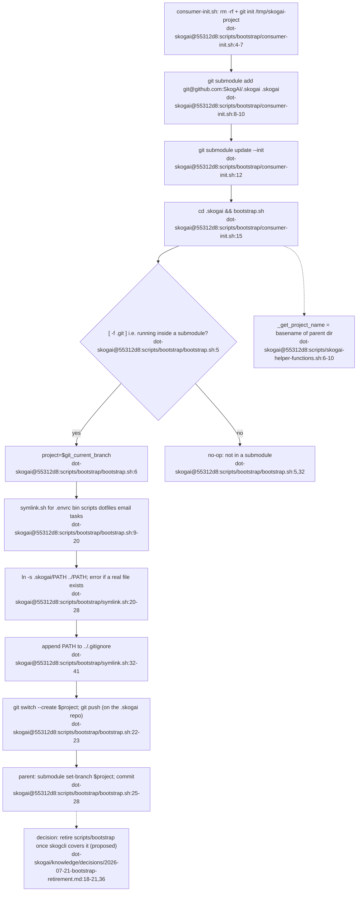
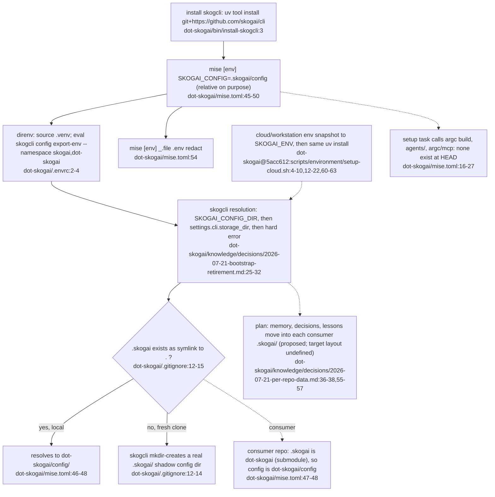
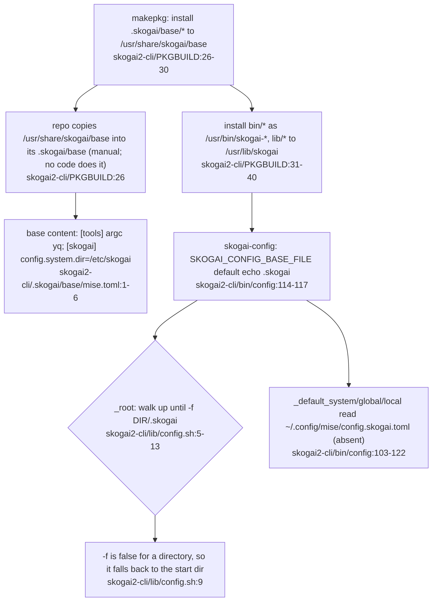
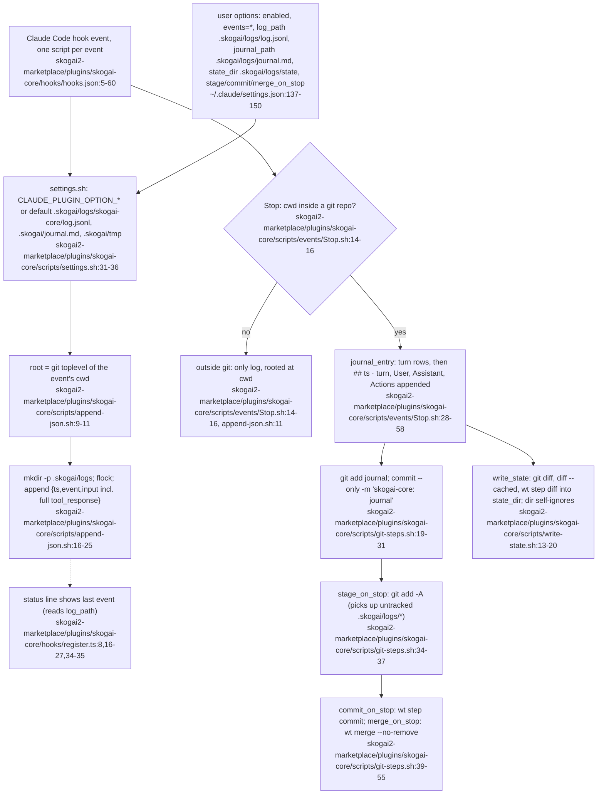
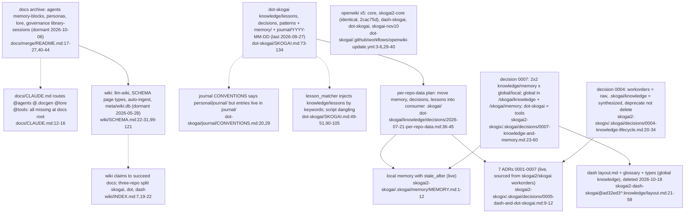

# S4 DOT: `.skogai` base config, project bootstrap, knowledge

Phase 1 flowchart. Read-only on every repo. The original survey and a continuation review were performed on 2026-11-14. Runtime observations from the original survey are historical snapshots, not fresh verification. Repository-relative paths resolve under `/home/skogix/Work/repos/`. `file@sha:line` means the file was recovered from git history because it is deleted or dangling at HEAD.

## Owner-confirmed architectural intent

The owner supplied the concatenated dash-skogai, dot-skogai and skogfences references in response to the bootstrap/schema question. Source consulted: `/home/skogix/.t3/userdata/attachments/mcp-e91e5dac-f4a4-4e63-aa91-db1e3785baf0-0576184f-6752-4913-bad0-2d144faa7b7f-md.md:1-125`.

- **DOT:** `.skogai` is the base configuration and a submodule used to bootstrap projects (attachment:30-36). Retain this as the intended architecture. The broken historical bootstrap implementation does not make the submodule intent obsolete.
- **DASH:** `/skogai` is shared system-wide ground, owned by `skogix:skogai` with setgid inheritance (attachment:9-19). This describes the target, not verified host permissions.
- **Agent homes:** each agent has its own Unix user and home; sharing is explicit and the human’s home, credentials and environment remain private (attachment:49-67,81-87,93-106).
- **Schema:** these references establish boundaries and purpose, but do not prescribe the deleted `knowledge/layout.md` directory tree. Its canonical status remains unspecified.

Treat skogcli and package-copy designs as historical implementation alternatives, not owner-approved replacements for the submodule architecture. These references do not prohibit using CLI tooling to implement that architecture.

## TL;DR

1. **No working end-to-end bootstrap was verified.** No `.skogai/` folder in the 32 repos is a submodule. None is a symlink to dot-skogai, Copy provenance is unknown; hooks can create directories on first write.
2. **Three bootstrap designs exist, and none is live:**
   - **A. Submodule + symlink-upward + branch-per-project.** The old dot-skogai design (`consumer-init.sh`, `bootstrap.sh`, `symlink.sh`). It was recovered from `@55312d8`; at HEAD these scripts are dangling symlinks. This is what skogfences/skogai-routing still describes.
   - **B. skogcli writes into the consumer's own `.skogai/`.** dot-skogai's 2026-07-21 decisions, all `status: proposed`. Half-wired: `mise.toml` `SKOGAI_CONFIG=.skogai/config` and `.envrc` → `skogcli config export-env`.
   - **C. Copy `/usr/share/skogai/base` into `.skogai/base`.** From skogai2-cli `PKGBUILD:26-30`. The package is not installed. `bin/config` has the base file hard-coded as `.skogai`, which `_root` can never find with `-f`.
3. **skogai2-dot-skogai is an empty placeholder.** Its whole content is `SKOGAI.md:3-5`: "meant to hold the `.skogai` convention … the intent, not the current state". Its history shows it once held skogai-cli build output (`tmp/skogai/…`, removed in 8658907).
4. **The declared schema was deleted.** `skogai2-dash-skogai/knowledge/layout.md` (the "one layout" every `.skogai` instantiates) moved into `.skogai/knowledge/` in ad32ed3 and was deleted in 02e86c9 (2026-10-18). `README.md:36` still links it. `/skogai` itself does not exist on this workstation.
5. **What actually shapes `.skogai/` today is the skogai-core hook.**
   - It runs from skogai2-marketplace, with the user overrides in `~/.claude/settings.json:137-150`.
   - It `mkdir -p`'s `.skogai/logs/` under the git root of the hook event’s `cwd` (or `cwd` outside Git), when enabled and the event is selected.
   - Today's read-only Pathfinder threads left untracked `.skogai/logs/log.jsonl` in 15 repos. Those files hold full tool stdout, and 5 of the repos had no `.skogai/` before.
   - With `stage_on_stop`, `commit_on_stop` and `merge_on_stop` all on, a session that *ends* inside one of those repos would `git add -A` and commit them.
6. **The knowledge stores are split four ways:**
   - dot-skogai `knowledge/` + `memory/` + `journal/`: old generation, last commit 2026-09-27.
   - skogai2-skogai `.skogai/memory/` (28 files) and skogai2-skogix `.skogai/decisions/` (7 ADRs): live, in OKF style.
   - wiki: llm-wiki stubs, dormant since 2026-05-28.
   - docs archive: personas, memory blocks, lore, governance. Dormant.
   - In addition, 5 `openwiki/` copies regenerate daily and **fail every day** with `OPENAI_API_KEY is required`.

---

## Sources consulted

| Path | Lines |
|---|---|
| PATHFINDER-2026-11-14/00-features.md | 1-82 |
| PATHFINDER-2026-11-14/skogfences-reference.md | 1-126 |
| `find repos -maxdepth 2 -name .skogai` + per-folder `find`/`git ls-files` (17 folders + /home/skogix/Work/.skogai) | inventory |
| dot-skogai/mise.toml | 1-54 |
| dot-skogai/SKOGAI.md | 1-217 |
| dot-skogai/CLAUDE.md, INDEX.md, .envrc, .gitignore | all; .gitignore:12-15,42-46 |
| dot-skogai/bin/install-skogcli | 1-3 |
| dot-skogai/knowledge/decisions/2026-07-21-{bootstrap-retirement,per-repo-data,dot-core,set-aside-items}.md | all |
| dot-skogai/docs/file-structure.md | 1-18 |
| dot-skogai/journal/CONVENTIONS.md | 1-30 |
| dot-skogai `git ls-files -s` (225 symlinks, 221 dangling → `~/.local/src/skills/extras/…`) | — |
| dot-skogai@55312d8:scripts/bootstrap/{consumer-init,bootstrap,symlink}.sh | 1-16, 1-32, 1-41 |
| dot-skogai@55312d8:scripts/skogai-helper-functions.sh | 1-11 |
| dot-skogai@5afaef1:scripts/install-skogcli.sh | 1-3 |
| dot-skogai@5acc612:scripts/environment/setup-cloud.sh | 1-63 |
| dot-skogai/.skogai/config/config.json (keys only; created 19:36 today, untracked) | — |
| skogai2-dot-skogai/SKOGAI.md, .gitignore, git log --stat | all |
| skogai2-dash-skogai/SKOGAI.md, README.md | 1-25, 1-104 |
| skogai2-dash-skogai@ad32ed3^:knowledge/layout.md | 1-77 |
| skogai2-skogix/.skogai/decisions/0004, 0005, 0007 | 1-41, 1-52, 1-75 |
| skogai2-skogix/.gitmodules (7 submodules under `.skogai/repos/`) | all |
| skogai2-skogai/.skogai/README.md | 1-32 |
| skogai2-skogai/.skogai/memory/MEMORY.md, temporary-paths.md | 1-12, 1-20 |
| skogai2-skogai/.skogai/scripts/get-project-name.sh, claude-code-documentation.sh | 1-10, 1-8 |
| skogai2-marketplace/plugins/skogai-core/hooks/hooks.json | 1-60 |
| …/skogai-core/scripts/settings.sh | 1-48 |
| …/skogai-core/scripts/events/Stop.sh | 1-75 |
| …/skogai-core/scripts/append-json.sh | 1-25 |
| …/skogai-core/scripts/git-steps.sh | 14-40 |
| …/skogai-core/scripts/write-state.sh | 1-20 |
| …/skogai-core/hooks/register.ts | 1-40 |
| …/skogai-core/.claude-plugin/plugin.json (grep) | 4-45 |
| ~/.claude/settings.json | 135-150 |
| /home/skogix/Work/.gitignore | 15 |
| skogai2-cli/PKGBUILD, bin/config, lib/config.sh, .skogai/base/* | 23-40, 103-122, 165-174, all |
| skogai-routing/.skogai/config/dot-skogai/config.json (keys only) | — |
| skogai-nov10/.skogai/tasks/*.md (frontmatter sample) | 1-10 |
| wiki/SCHEMA.md, INDEX.md, concepts/dot-skogai-*.md, dash-skogai-as-shared-root.md | 1-130, 1-52, all |
| docs/CLAUDE.md, merge/README.md, todo/memory/README.md, todo/memory/skogai-memory-system.d, merge/principles/context-control-principle.md | 1-16, 1-60, 1-50, 1-40, 1-25 |
| {core,skogai2-core,dash-skogai,dot-skogai,skogai-nov10}/openwiki + .github/workflows/openwiki-update.yml | tree, 1-40 |
| `gh run list/view` for openwiki-update.yml on 5 remotes | last 3 runs |

---

## 1. De-facto `.skogai/` schema vs declared

### Declared layouts (three, mutually inconsistent)

| Entry | dash `layout.md`@ad32ed3^:27-40 (deleted) | skogai2-skogai `.skogai/README.md:7-20` | dot-skogai `SKOGAI.md:28-41` (repo-root tree; the repo *is* `.skogai` under design A) |
|---|---|---|---|
| SKOGAI.md / ROUTES.md router | ✓ / ✓ | — | ✓ (SKOGAI.md) |
| knowledge/ | ✓ (OKF bundle) | — | ✓ (lessons/decisions/patterns) |
| memory/ | ✓ | ✓ | ✓ |
| bin/ | ✓ | — | ✓ (generated shims) |
| scripts/ | ✓ | ✓ | ✓ |
| config/ | ✓ | ✓ | — (config/ via `.skogai -> .`) |
| state/ | ✓ | ✓ (ignored, durable) | — |
| workorders/ | ✓ (to be defined) | ✗ explicitly: "stay in `orchestration/work-orders/`" (:32) | — |
| logs/ | ✓ | ✓ | — |
| worktrees/ | ✓ | ✓ | — |
| rules/, skills/, tasks/, templates/, workflow/, tmp/ | — | ✓ | agents/, tools/, argc/, projects/, docs/ |

### De-facto (what exists on disk today, 17 repo folders + monorepo)

| Entry | Repos that have it | Writer |
|---|---|---|
| `logs/…/log.jsonl` | effectively **every repo touched by an agent**: 8 committed or pre-existing, plus 10 created today by Pathfinder threads (core, dash-skogai, dot-skogai, podman, systemd, skogai2-cli, skogai2-core, skogai2-skogai-fleet, skogai-nov10, skogai-routing) | skogai-core hook `append-json.sh:11-25` |
| `journal.md` (`.skogai/` root) | cloudflare, skogai2-aliasflare, skogai2-marketplace, skogai2-skogai-runner, skogai2-skogai, skogai2-skogix, skogai2-skogpunk, monorepo | skogai-core `Stop.sh:36-58` (plugin default path) |
| `logs/journal.md`, `logs/state/` | monorepo only (committed as "skogai-core: journal") | same hook with user override `~/.claude/settings.json:143,145` |
| `tmp/git-diff*`, `wt-step-diff` | monorepo, skogai2-skogai | `write-state.sh:13-20` |
| `config/` | dot-skogai (untracked skogcli shadow), skogai-routing (`config/dot-skogai/config.json`, tracked), skogai2-skogix (`script_metadata.json`), skogai2-skogai (empty), skogai2-skogai-fleet (**a file**, an atuin git-config stanza) | skogcli / manual |
| `memory/` | skogai2-skogai only (28 notes, `stale_after` per 0007) | agents, by hand |
| `decisions/` | skogai2-skogix only (0001-0007) | agents + owner |
| `knowledge/` | **none** (dash had it until 02e86c9) | — |
| `workorders/` | skogai2-skogai-runner (`open/`, `done/`, `WORKORDERS.md`), skogai2-marketplace (`0001-skogai-events.md`) | agents |
| `tasks/` | skogai-nov10 (21, gptodo frontmatter), skogai2-skogai (1) | gptodo / agents |
| `TODO.md` / `todo.list` / `handover.md` | skogai2-config, skogai2-skogai-runner, skogai2-skogix / skogix / skogai2-config | by hand |
| `rules/`, `scripts/`, `templates/` | skogai2-skogai | by hand |
| `repos/` (git submodules) | skogai2-skogix (7: aube, demand, usage, hk, pitchfork, skogai-runner, skogai-routing) | `.gitmodules` |
| `repo/repos.toml`, `modules/repo` | skogai2-core (S5 registry) | by hand |
| `base/` | skogai2-cli (the design C template) | by hand |
| `research/`, `tests/` | skogai2-skogai-runner, monorepo | agents |
| `SKOGAI.md` / `ROUTES.md` | **none** | — |

**Read:** the only entry every repo agrees on is `logs/`, which is disposable by the owner's own rule (`skogai2-skogai/.skogai/memory/temporary-paths.md:8-20`). Second place goes to `journal.md`, and both are side effects of one plugin. The declared spine (router, knowledge/, bin/) appears nowhere. The de-facto schema is "**whatever the skogai-core hook writes, plus per-repo ad-hoc folders**".

---

## 2. Flowcharts

### 2a. Design A: historical submodule bootstrap implementation (submodule intent retained)

Side effects: `rm -rf /tmp/skogai-project`, network clone, symlinks and a `.gitignore` in the parent, **a new branch pushed to the shared `.skogai` origin per project**, and a commit in the parent. The branch-per-project design means every consumer forks the base config.

### 2b. Design B: skogcli + `.skogai -> .` self-symlink (dot-skogai HEAD, half-wired)

Side effects: a network install (uv tool), `tmp/skogai.env` written by `setup-cloud.sh:60-61`, a shadow `.skogai/config/` created in place, and `.env` secrets loaded into the environment. Error branch: `mise run setup` fails (BX), because `argc build` and `npm --prefix agents/...` have nothing to build.

### 2c. Design C: package base copy (skogai2-cli, not installed)

Status: `pacman -Q skogai` reports not found. `~/.config/mise/config.skogai.toml` is missing (observed in another thread's log). The WIP in `bin/config:52-65` (`skogix` test cmd) shows this is mid-edit. This design overlaps S1.

### 2d. Live de-facto path: how a `.skogai/` gets populated today (skogai-core hook)

Observed outputs of this path:
- In the monorepo, `.skogai/journal.md` (older default path) and `.skogai/logs/journal.md` (override) both exist, so the config changed mid-life.
- `/home/skogix/Work/.gitignore:15` ignores only `/.skogai/logs/log.jsonl`.
- In the 15 repos, the logs are untracked `??` and **not ignored**. Only skogai2-skogai-routing ignores `.skogai/logs/` (`.gitignore:1-2`).

### 2e. Knowledge stores: how the old and new copies relate

---

## 3. Side effects (all paths)

| Effect | Where |
|---|---|
| `mkdir -p .skogai/logs/…` in the event cwd’s git repo when logging is enabled; appends full tool I/O (incl. stdout) | `append-json.sh:16-25` |
| Appends `.skogai/journal.md` (or `logs/journal.md`) and commits it as "skogai-core: journal" | `Stop.sh:36-58`, `git-steps.sh:24-27` |
| `git add -A`, `wt step commit`, `wt merge` on Stop (enabled by the user config) | `git-steps.sh:34-40`, `~/.claude/settings.json:148-150` |
| Writes diff snapshots, self-ignoring dir | `write-state.sh:13-20` |
| Shadow `.skogai/config/` dir (skogcli) | `dot-skogai/.gitignore:12-14` |
| `uv tool install` from GitHub (network) | `dot-skogai/bin/install-skogcli:3` |
| Design A: submodule clone, symlinks in parent, `.gitignore` edits, per-project branch push to shared origin | `bootstrap.sh:9-28` |
| Design C: files under `/usr/share/skogai`, `/usr/bin/skogai-*` (pacman) | `PKGBUILD:26-40` |
| GitHub Actions: daily OpenWiki run, opens PRs with `contents: write` (currently fails before writing) | `openwiki-update.yml:3-10` |
| Unix perms: none in S4 itself; global knowledge was meant to sit in setgid `/skogai` (S3) | `0007:53-56` |

---

## 4. External dependencies

| System | Direction | Through |
|---|---|---|
| **S1 ENV** | S4 → S1 | `SKOGAI_CONFIG=.skogai/config` (`dot-skogai/mise.toml:49-50`), skogcli `export-env` (`.envrc:3-4`), skogai2-cli base file = `.skogai` (`bin/config:114-117`). The `.skogai/config/` dir is S1's per-project scope. |
| **S2 RUN** | S2 → S4 | Workorders in `.skogai/workorders/` (runner, marketplace) vs `orchestration/work-orders/` (skogai2-skogai README:32). gptodo tasks in `.skogai/tasks/` (nov10). Decision 0004 makes workorders the raw knowledge layer. |
| **S3 DASH** | S4 ↔ S3 | 0007:53-56: global knowledge and memory live in `/skogai`, and dot-skogai holds the tools. The declared layout lived in dash. `/skogai` is absent on this host. |
| **S5 FLEET** | S5 → S4 | The registry lives *inside* `.skogai/` (`skogai2-core/.skogai/repo/repos.toml`). skogai2-skogix keeps `.skogai/repos/` submodules. The monorepo's `mani.yaml` repos list in `.gitignore:20-45`. |
| **S6 PLUGINS** | S6 → S4 | **The dominant writer.** skogai-core writes journal, logs and state. dot-core plugin incubator (decision `2026-07-21-dot-core.md`). 100 dangling skills in dot-skogai/skills. A CC docs fetcher exists in two copies (see below). |
| **S7 SERVICES** | — | No direct coupling found. OpenWiki runs on GitHub Actions (external CI and the OpenAI API). |

---

## 5. Duplication seen

| # | Concern | Copies (file:line) | Read |
|---|---|---|---|
| 1 | **Project bootstrap** | A `dot-skogai@55312d8:scripts/bootstrap/bootstrap.sh:5-28`; B `dot-skogai/mise.toml:45-50` + `.gitignore:12-14`; C `skogai2-cli/PKGBUILD:26-30`; D placeholder `skogai2-dot-skogai/SKOGAI.md:3-5` | Potential duplication; intent unconfirmed. Three generations of one idea; none is complete. Decision 0005:39-40 says outright "no dot-skogai installer exists yet". |
| 2 | **Declared `.skogai` layout** | `skogai2-dash-skogai@ad32ed3^:knowledge/layout.md:27-40`; `skogai2-skogai/.skogai/README.md:7-20`; `dot-skogai/SKOGAI.md:28-41` | Potential duplication; intent unconfirmed. They disagree on workorders, knowledge and the router. One declared layout was deleted; canonical status awaits the owner. |
| 3 | **Knowledge/memory model** | `dot-skogai/SKOGAI.md:73-134` (lessons/decisions/patterns + memory every 3 turns); `skogai2-skogix/.skogai/decisions/0007:23-60` (2×2 + stale_after); `docs/merge/README.md:13,40` + `docs/todo/memory/skogai-memory-system.d:20-33` (semantic graph, memory blocks); `wiki/SCHEMA.md:22-31` (entity/concept/decision pages) | Likely overlap; intent unconfirmed. 0007 is the newest and owner-verified. dot-skogai's lesson auto-injection and docs' per-agent memory blocks have no live equivalent (see §6). |
| 4 | **Decision/ADR stores** | `dot-skogai/knowledge/decisions/2026-07-21-*.md` (13, date-prefixed, all `proposed`); `skogai2-skogix/.skogai/decisions/0001-0007` (numbered, stable); `wiki/decisions/adr-001…012` (**adr-002 used twice**); `docs/merge/governance/library-sessions/*` | Potential duplication; intent unconfirmed. Four numbering schemes, none cross-referenced. |
| 5 | **Journal** | `dot-skogai/journal/YYYY-MM-DD/slug.md` (CONVENTIONS.md:20 says `personal/journal/`, which is drift); `Stop.sh:54-58` → `.skogai/journal.md`; same hook → `.skogai/logs/journal.md` via `~/.claude/settings.json:143`; the monorepo has **both** files | Potential duplication; intent unconfirmed. The path changed via user config, and the old file was never migrated. Putting the durable journal under `logs/` contradicts `temporary-paths.md:14-20`. |
| 6 | **Event log path** | `settings.sh:34` default `.skogai/logs/skogai-core/log.jsonl` (cloudflare, aliasflare, runner, skogpunk); override `.skogai/logs/log.jsonl` (`~/.claude/settings.json:141`); `skogai2-dash-skogai/.skogai/logs/hook-tap/log.jsonl` (older hook-tap) | Accidental, from config drift plus a predecessor hook. |
| 7 | **Work items** | `.skogai/workorders/` (`skogai2-skogai-runner/.skogai/workorders/WORKORDERS.md`, `skogai2-marketplace/.skogai/workorders/0001`); `skogai2-skogai/.skogai/README.md:32` → `orchestration/work-orders/`; `skogai-nov10/.skogai/tasks/*.md:1-10` (gptodo); `TODO.md`/`todo.list` ×4 | Partly legitimate (old vs new generation); the live split between runner and skogai2-skogai is accidental. Owned by S2. |
| 8 | **OpenWiki** | `core/openwiki` ≡ `skogai2-core/openwiki` (same commit 2cac75d); `dash-skogai/openwiki`, `dot-skogai/openwiki`, `skogai-nov10/openwiki`; 5 workflow copies, which differ from each other | Potential duplication; intent unconfirmed. Copied with the repo forks. All dead in practice: missing secret, daily failures. |
| 9 | **Project-name helper** | `dot-skogai@55312d8:scripts/skogai-helper-functions.sh:6-10` (parent dirname); `skogai2-skogai/.skogai/scripts/get-project-name.sh:6-8` (`gh repo view`); `dot-skogai/scripts/get-project-name.sh` (dangling) | Accidental; they return different answers. |
| 10 | **Claude Code docs fetcher** | `skogai2-skogai/.skogai/scripts/claude-code-documentation.sh:1-8`; `dot-skogai/scripts/claude-code-documentation.sh` (dangling) | Accidental (S6's F14 also lists it). |
| 11 | **Skogcli config namespace files** | `dot-skogai/.skogai/config/config.json` (shadow, untracked); `skogai-routing/.skogai/config/dot-skogai/config.json` (tracked, namespaces dash-skogai/dot-skogai/skogai/harness/claude/dot) | Potential duplication; intent unconfirmed. A shadow dir got committed in skogai-routing (f510fc8). |
| 12 | **Global vs local split** | the wiki concept `dash-skogai-as-shared-root.md:37`; `0007:53-56`; `skogfences-reference.md:200-206` (dot-skogai = base config + submodule) | Revision 1 explicitly retains the submodule as owner intent. Older documents do not establish that this intent was superseded. |

## 6. Concepts in the archives that the live system lacks

From docs, wiki and old dot-skogai:
- **Keyword-matched lesson injection** (`dot-skogai/SKOGAI.md:49-51,90-105`). There is no live equivalent; claude-mem fills a similar role outside the repo tree.
- **Per-agent memory blocks and profiles** (`docs/merge/agents/*/memory-blocks`, `profile.md`). These fit S3's agent homes ("agent persistence", skogfences-reference.md:139), but no live home holds them.
- **Global memory read-marker** (`0007:37-40`, `layout.md:55` `state/`). Specified but never implemented.
- **Memory maintenance routine / triage** (`0007:74-75`, "not designed yet").
- **Governance phases** (docs `merge/governance/phases/skogai-0.1-dictator.md`, `0.2-democracy.md`). Related to 0005:41-44's "agent-approved PRs with a skogix veto".
- **Context control: knowledge/ include, dump.md exclude, session.md handoff** (`docs/merge/principles/context-control-principle.md:17-22`). The live system's closest equivalent is the skogai-core "diff as handover".
- **Tool-owned slices** (`bin/wt`, `scripts/wt/`, `state/wt/`, `config/wt/`; `layout.md:60-73`), "not defined yet".

---

## Confidence and gaps

- **High:** the inventory, the hook write path (code read and outputs observed), the dangling symlinks (`find -xtype l`), the deleted layout (git show), the OpenWiki failures (`gh run view`), and the fact that no folder is a submodule or symlink (`git ls-files -s`, `.gitmodules`).
- **Medium:** design B's runtime behaviour. skogcli source was not read: it is not in `repos/`, it lives in `~/.local/src/skogcli*`, which is out of scope. The "shadow dir" claim rests on the `.gitignore` comment plus the observed `config.json`.
- **Gaps:**
  - The content of the 221 dangling scripts and skills. They exist only at `~/.local/src/skills/extras`, which is missing on this host; earlier blobs are in git history, and only 4 were recovered.
  - The skogai2/skogai workorders 0019/0020 that the decisions cite. They are not in `skogai2-skogai/.skogai/`; they may be in `orchestration/` or deleted.
  - Who created `.skogai/` in cloudflare, aliasflare and skogpunk (journal and logs committed): presumably skogai-core with `journal` on, before the path override.
  - `knowledge/glossary.md` and `types.md`@ad32ed3^ were not read.

## Open questions for owner

1. **Bootstrap — answered:** the owner supplied the dash/dot/skogfences references. `.skogai` remains base configuration plus a project-bootstrap submodule; CLI/copy experiments do not supersede that intent. See the owner-confirmed intent section above.
2. **Declared layout — still unspecified:** the supplied references do not define a directory schema or establish whether deleted `dash layout.md` is canonical. Preserve it as a historical declaration.
3. **skogai/dot-skogai (old):** is it archive-only? Do its knowledge, memory and journal migrate (per `2026-07-21-per-repo-data`), or are they frozen?
4. **skogai-core side effect:** is it intended that read-only agent sessions create untracked `.skogai/logs/log.jsonl` (with full tool output) in every repo they touch, with stage/commit/merge-on-stop enabled globally?
5. **OpenWiki:** revive it (add the `OPENAI_API_KEY` secret) or remove the 5 workflows and `openwiki/` dirs?

## Continuation review: evidence limits and refreshed inventory

The hook resolves the event `cwd`, not each path mentioned in a tool command (`skogai2-marketplace/plugins/skogai-core/scripts/append-json.sh:8-14`). Consequently, log presence alone does not prove which Pathfinder operation created it. Original counts and CI failure observations above are survey snapshots. Last commit dates do not establish that a repository is abandoned. Archive/live labels describe observed activity, not an owner decision.

Historical bootstrap error paths: `dot-skogai@55312d8:scripts/bootstrap/symlink.sh:6-25` rejects missing arguments, missing sources and existing non-symlink destinations. Its caller lacks `set -e`, so a failure need not stop later Git operations. `bootstrap.sh:3-6` also depends on a source path and pre-existing branch variable; the diagram describes intended execution, not a successful run.

Hook error paths: disabled/unselected events exit without logging (`append-json.sh:13-14`); absent prompt/log yields empty journal rows (`events/Stop.sh:28-33`); journal commit, `wt step commit` and merge failures are recorded (`scripts/git-steps.sh:23-55`). Journal and state writes are independently gated (`events/Stop.sh:61-73`).

OpenWiki’s workflow permits partial progress after a failed generation, attempts a PR, then propagates failure (`dot-skogai/.github/workflows/openwiki-update.yml:33-81`). Failure alone does not prove that no pages were written. CI was not re-queried in this continuation.

Current immediate-child inventory (read-only filesystem enumeration; runtime directories may change during parallel work):

| Repository | `.skogai/` immediate entries |
|---|---|
| cloudflare | `journal.md`, `logs/` |
| core | `logs/` |
| dash-skogai | `logs/` |
| docs | `logs/` |
| dot-skogai | `config/`, `logs/` |
| harness | `plans/` |
| mise-plugin | `logs/` |
| podman | `logs/` |
| skogai-nov10 | `logs/`, `tasks/` |
| skogai-routing | `config/`, `logs/` |
| skogai2-aliasflare | `journal.md`, `logs/` |
| skogai2-cli | `base/`, `logs/` |
| skogai2-config | `TODO.md`, `handover.md`, `logs/` |
| skogai2-core | `.gitignore`, `logs/`, `modules/`, `repo/` |
| skogai2-dash-skogai | `logs/` |
| skogai2-marketplace | `CLAUDE.md`, `journal.md`, `logs/`, `tmp/`, `workorders/` |
| skogai2-skogai | `README.md`, `config/`, `journal.md`, `logs/`, `memory/`, `rules/`, `scripts/`, `state/`, `tasks/`, `templates/`, `tmp/`, `workflow/`, `worktrees/` |
| skogai2-skogai-fleet | `config`, `logs/` |
| skogai2-skogai-routing | `logs/` |
| skogai2-skogai-runner | `TODO.md`, `journal.md`, `logs/`, `research/`, `workorders/` |
| skogai2-skogix | `TODO.md`, `config/`, `decisions/`, `docs/`, `journal.md`, `logs/`, `personal/`, `repos/` |
| skogai2-skogpunk | `journal.md`, `logs/` |
| skogix | `todo.list` |
| systemd | `logs/` |
| wiki | `logs/` |
| monorepo | `journal.md`, `logs/`, `research/`, `state/`, `tests/`, `tmp/` |
