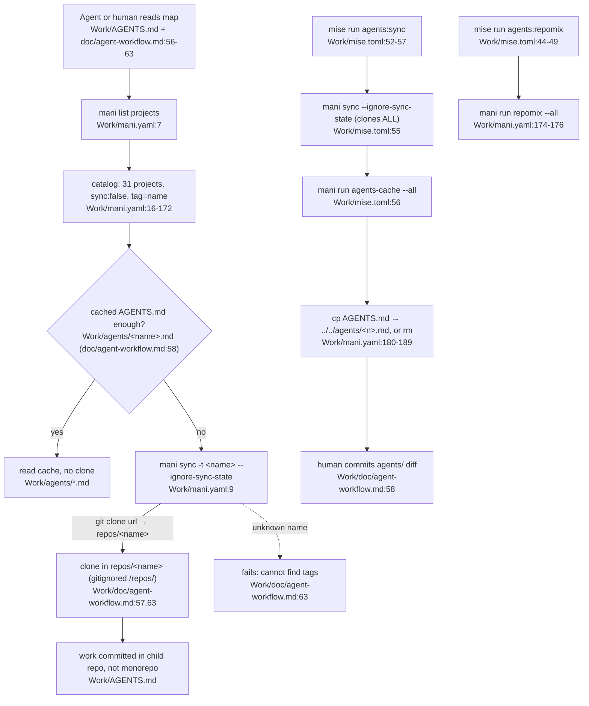
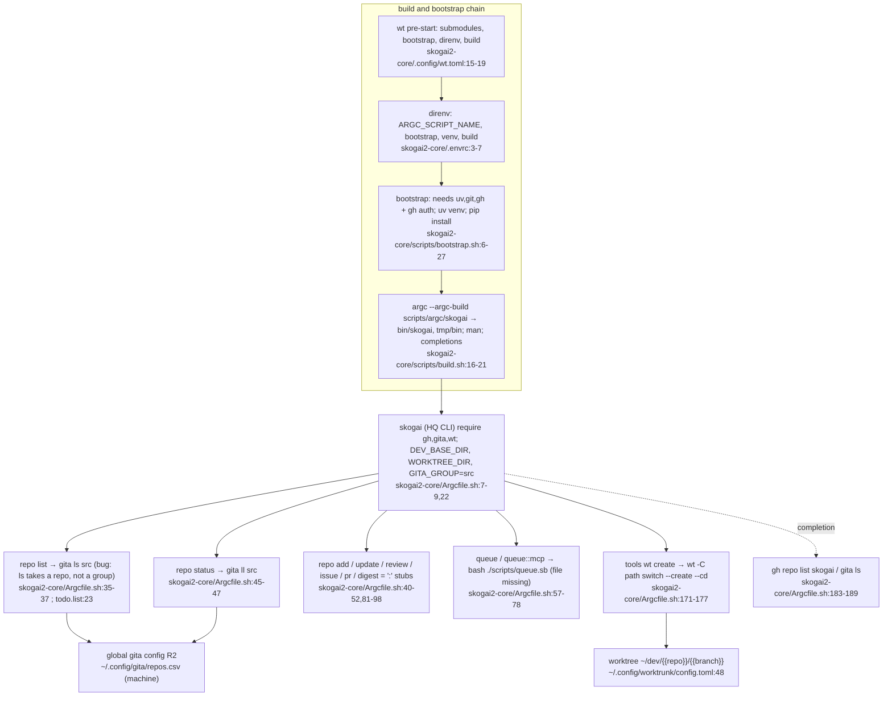
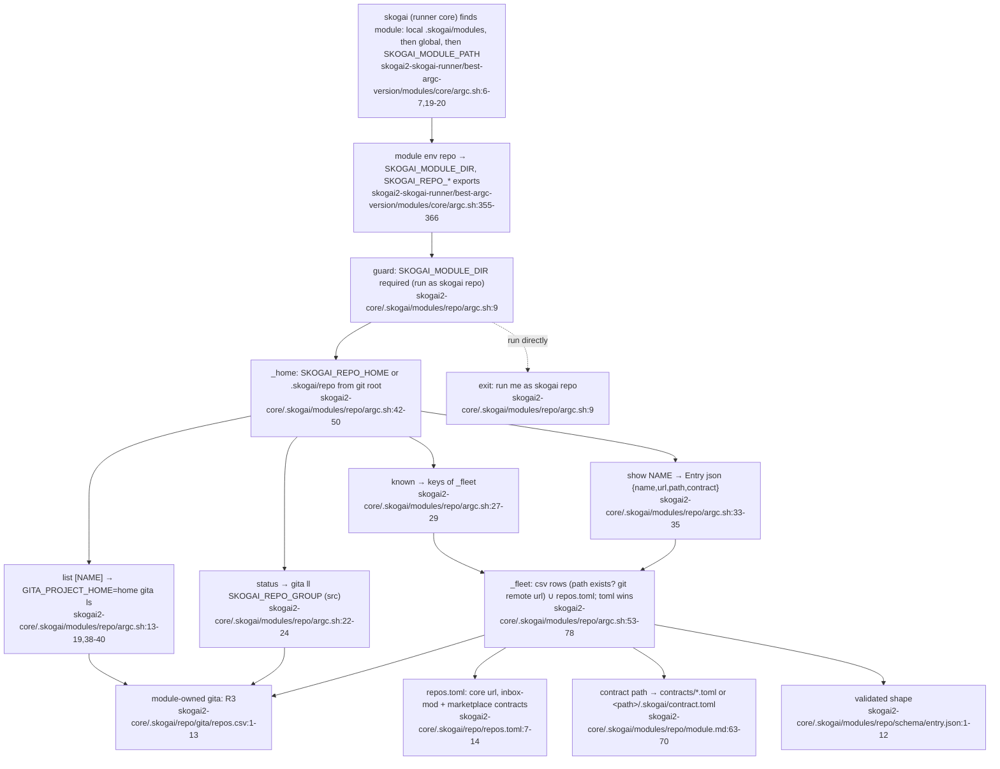
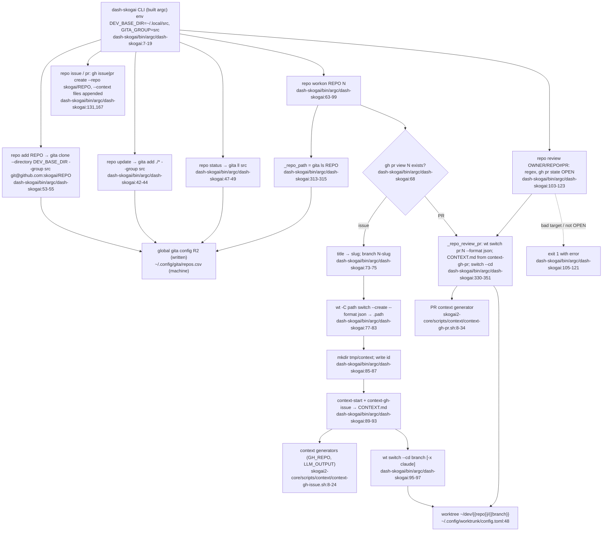
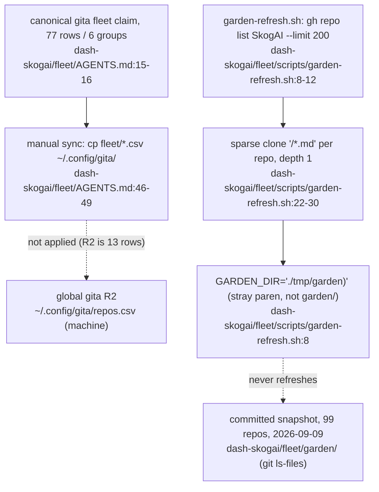
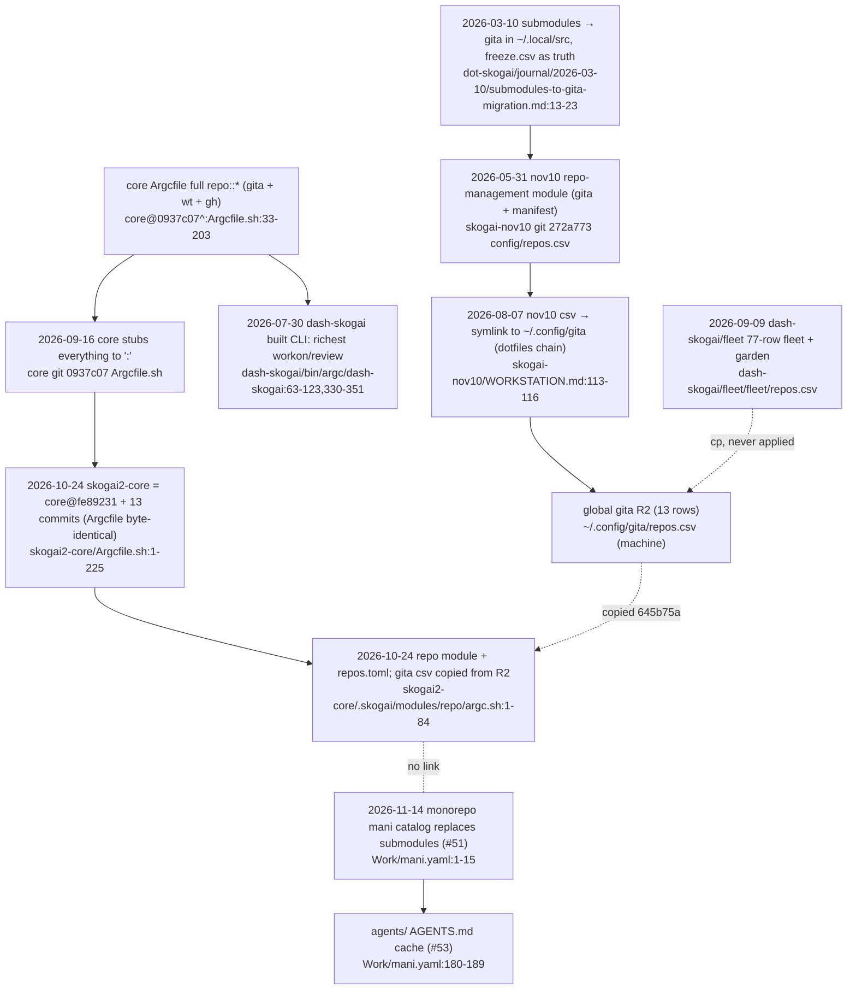

# S5 FLEET: repo registry and control plane (Phase 1 flowchart)

Thread: S5. Read-only on every repo. Written 2026-11-14 from source read in this session. Line numbers refer to the working trees under `~/Work/repos/` at the time of reading. Machine facts (`~/.config/...`, `~/.local/src`) hold for skogix-workstation only.

## TL;DR

- **The answer to the key question is not 4 registries but 6 files across 3 formats.** Only one of them is read by anything that runs today: `~/Work/mani.yaml`.
- **mani.yaml is the live catalog** (31 projects, lazy clones into `repos/`, AGENTS.md cache). It is read by `mani` and by the two mise tasks `agents:sync` and `agents:repomix`, and nothing else. It has no control plane: no status, worktree, review or PR.
- **gita is the old registry, and every control-plane implementation is built on it.** The workstation's global gita config (`~/.config/gita/repos.csv`, 13 rows, 4 of them missing on disk) is read by plain `gita`. It is also read by the `repo::list` and `repo::status` of core and skogai2-core, the full `dash-skogai` CLI, and `skogai-nov10/bin/gita`. `skogai-nov10/config/{repos,groups}.csv` are **symlinks to that global file**, so nov10 has no registry of its own.
- **skogai2-core forked the global gita file on 2026-10-24** into `.skogai/repo/gita/` and added `repos.toml` for url and contract. Only its `repo` module reads that copy. The module only runs through a `skogai` built by the runner (`skogai2-skogai-runner/best-argc-version`), and no such `skogai` is on PATH on this machine.
- **dash-skogai/fleet** (`fleet/repos.csv`, 77 rows, 67 of them missing on disk) is a frozen 2026-09-09 snapshot. It is synced by hand with `cp` to `~/.config/gita`, and that has not been done: the live global file is the 13-row one. Its `garden-refresh.sh` is broken (`GARDEN_DIR="./tmp/garden)"`, line 8).
- **The most complete control-plane code is not in core.** It sits in the built `dash-skogai/bin/argc/dash-skogai` (2026-07-30): `repo::workon` with a slugged branch, `wt --format json`, and a seeded `tmp/context/CONTEXT.md`. core and skogai2-core have had every `repo::*` body except `list`/`status` stubbed to `:` since `core@0937c07` (2026-09-16).
- **There are 3 worktree roots and no shared one.** `wt` uses `~/dev/{{repo}}/{{branch}}` (user config), herdr uses `~/.herdr/worktrees/<repo>/<branch>` (S2), and mani clones into `~/Work/repos/<name>`. The S5→S2 coupling ("the registry feeds worktrees and work orders") is **not wired**: herdr never consults any registry.

---

## Sources consulted

| Path | Lines | What |
|---|---|---|
| `skogai2-core/Argcfile.sh` | 1-225 | HQ CLI source; identical to `core/Argcfile.sh` (`diff` empty) |
| `skogai2-core/bin/skogai` | 1-225, 225+ | argc-built bundle of the above (`# ARGC-BUILD` at 225), same in core |
| `skogai2-core/scripts/{build,bootstrap}.sh`, `scripts/argc/skogai` (symlink → `../../Argcfile.sh`), `.envrc`, `.config/wt.toml`, `mise.toml` | all | build and bootstrap chain; identical in core |
| `skogai2-core/.skogai/modules/repo/{argc.sh,module.md,schema/entry.json,tests/repo.bats}` | all (84, 77, 12, 89) | the new `repo` module |
| `skogai2-core/.skogai/repo/repos.toml` | 1-14 | registry extras |
| `skogai2-core/.skogai/repo/gita/{repos,groups}.csv` | 1-13, 1-3 | module-owned gita config |
| `skogai2-core/contracts/{inbox-mod,marketplace}.toml` | all | draft per-repo contracts |
| `skogai2-core/scripts/context/context-{start,gh-issue,gh-pr}.sh` | all | context generators |
| `skogai2-core/HANDOVER.md` 1-160, `PLAN.md` 1-65, `todo.list` 1-23, `.ai/cactus/q9,q10,q14,q15,q18` | all | intent and decisions |
| `core` git history: `git show 0937c07^:Argcfile.sh` | 26-330 | last full `repo::*` implementation in core |
| `dash-skogai/bin/argc/dash-skogai` | 1-376 (source part), 377+ build | richest `repo::workon` / `review` |
| `dash-skogai/bin/gita` | 1-3 | `uv tool run gita` (byte-identical to nov10's) |
| `dash-skogai/fleet/{AGENTS.md, fleet/repos.csv, fleet/groups.csv, scripts/garden-refresh.sh}` | all | 77-repo fleet and garden |
| `dash-skogai/fleet/skills/skogai-gita/{SKILL.md 1-40, config/*.csv}` | | 18-row skill-embedded gita config |
| `skogai-core/todo/skills/skogai-gita/SKILL.md` | (diff only) | another copy of the gita skill |
| `skogai-nov10/{bin/gita, config/repos.csv, config/groups.csv, config/worktrunk-config.toml}` | all | the csvs and wt config are symlinks |
| `skogai-nov10/CORE.md` 20-105, `WORKSTATION.md` 105-130 | | keystone `workon` description; dotfiles gita chain |
| `skogai2-skogai-runner/best-argc-version/modules/core/argc.sh` | 1-20, 345-366 | module discovery and `module env` |
| `skogai2-skogai/orchestration/README.md:22`, `AGENTS.md:14-46` | | herdr worktree provisioning |
| `dot-skogai/journal/2026-03-10/submodules-to-gita-migration.md` | 1-30 | origin of the gita registry |
| `~/Work/mani.yaml` 1-189, `~/Work/mise.toml` 44-57, `~/Work/doc/agent-workflow.md` 1-74, `~/Work/AGENTS.md` | | monorepo catalog |
| `~/Work/agents/*.md` vs `repos/*/AGENTS.md` | cmp | cache freshness |
| Machine: `~/.config/gita/{repos,groups}.csv`, `~/.config/worktrunk/config.toml:48,66-104`, `ls ~/.local/src ~/dev ~/.herdr/worktrees`, `command -v gita wt mani skogai` | | what consumers actually see |

---

## 1. The registries: fields, sizes and readers

| # | File | Format and fields | Rows | On disk here | Last change | Who reads it (verified) |
|---|---|---|---|---|---|---|
| R1 | `~/Work/mani.yaml:16-172` | mani YAML: `name → {path: repos/<name>, url, sync: false, tags: [<name>]}` | 31 | clone on demand; 31 of 31 cloned now | 2026-11-14 | `mani sync/run/list`; `mise run agents:sync` (`mise.toml:52-57`), `agents:repomix` (`mise.toml:44-49`); agents by instruction (`AGENTS.md`, `doc/agent-workflow.md:56-63`) |
| R2 | `~/.config/gita/repos.csv` + `groups.csv` (machine, global) | gita CSV: `path,name,type,flags`. **No url.** Groups: `src`, `forks`, `home` | 13 | 9 exist, 4 missing (`dot`, `skogai-git-workflow`, `skogai-routing`, `skogai-cli`) | 2026-10-24 / 11-08 | plain `gita`; core and skogai2-core `repo::list`/`status` (`Argcfile.sh:36,46`) and `_choice_local_repositories` (`:188`); the `dash-skogai` CLI (`bin/argc/dash-skogai:43,48,54,314`); `skogai-nov10/bin/gita:3` |
| R2′ | `skogai-nov10/config/{repos,groups}.csv` | **symlinks** → R2 | (R2) | | symlinked, committed 2026-08-07 | same as R2; the committed history (`272a773`, 2026-05-31) once held real content |
| R3 | `skogai2-core/.skogai/repo/gita/{repos,groups}.csv` | gita CSV, a copy of R2 | 13 | same 9/4 as R2 | 2026-10-24 (`645b75a`) | only the `repo` module, through `GITA_PROJECT_HOME` (`modules/repo/argc.sh:38-40`) |
| R3+ | `skogai2-core/.skogai/repo/repos.toml:7-14` | TOML `[name] url?, contract?` | 3 (`core`, `inbox-mod`, `marketplace`) | n/a | 2026-10-24 | only the `repo` module `_fleet` (`argc.sh:71-74`) |
| R4 | `dash-skogai/fleet/fleet/repos.csv` + `groups.csv` | gita CSV. 6 groups (`foundations`, `argc`, `agents`, `system`, `docs`, `forks`) | 77 | 10 exist, 67 missing | 2026-09-09 | **nothing automatic.** Manual `cp` to R2 (`fleet/AGENTS.md:46-49`), not applied |
| R5 | `dash-skogai/fleet/skills/skogai-gita/config/*.csv` (+ `freeze.csv`) | gita CSV + freeze (with urls) | 18 | 7 exist, 11 missing | 2026-09-09 | nothing; a skill example. `SKILL.md:17` says the canonical copy is `dash-skogai/git/fleet/`, a path that does not exist (it is `fleet/fleet/`) |
| (R6) | `~/.dotfiles/config/gita/repos.csv` | | | `~/.dotfiles` is empty | | referenced by `skogai-nov10/WORKSTATION.md:113-116` and `podman/SECRETS.md:35-36` as the dotfiles-managed source. **Dead link** |
| (impl.) | `gh repo list skogai` | GitHub org listing | live | | | tab completion only: `_choice_github_repository` (`Argcfile.sh:183-185`), and `dash-skogai garden-refresh.sh:12` (org `SkogAI`) |
| (impl.) | `ls -1 $DEV_BASE_DIR` (`~/.local/src`, 40 dirs) | the directory itself | 40 | | | `dash-skogai` `_choice_active_repos` (`bin/argc/dash-skogai:361-363`) |

### Repo-list diff, by **identity (origin URL)**, not name

Matching names across registries gives the wrong answer. The same name points at different repos:

| Name | mani (R1) url | gita R2/R3 path → origin |
|---|---|---|
| `dash-skogai` | `skogai/dash-skogai` (old) | `~/.local/src/dash-skogai` → **`skogai2/dash-skogai`** (= mani's `skogai2-dash-skogai`) |
| `marketplace` | not in mani as `marketplace` (`skogai2-marketplace` = `skogai2/marketplace`) | `~/.local/src/marketplace` → `skogai2/marketplace` |
| `dot-skogai` | `skogai/dot-skogai` | `~/.skogai` → **no origin remote** |
| `skogai` | `skogai/skogai` (placeholder) | `~/skogai` → `skogai/skogai` (same, but in mani it is a placeholder) |
| `config` | `skogai2-config` = `skogai2/config` | `~/.config/skogai` → `skogai2/config` |
| `core` (R3+) | `core` = `skogai/core`; `skogai2-core` = `skogai2/core` | `repos.toml` url `skogai2/core` |

**In gita (R2/R3) but not in mani (R1):** `skogai2/claude-home` (gita `claude`), `skogai2/okn`, `skogai2/inbox-mod`, `~/.skogai` (no origin), plus the 4 missing paths. **In mani but not in gita:** 25 of 31 (all of `skogai2-skogai*`, `skogai2-cli`, `mise-plugin`, `podman`, `cloudflare`, `systemd`, `wiki`, `docs`, `skogai-core`, `skogai-jq`, `skogai-nov10`, `nvim-omarchy`, `repomix`, ...). **R4 (77) vs R1:** only 3 names overlap (`docs`, `dot-skogai`, `skogai`), and R4 is mostly forks and old experiments under `~/dev` and `~/.local/src`.

**Cloned but in no registry:** `~/Work/repos/marketplace` (`skogai/marketplace`) is in neither `mani.yaml` nor `agents/`. It is the only repo dir without a mani entry.

**Field coverage:**

| Field | mani | gita csv | repos.toml | module Entry |
|---|---|---|---|---|
| name | ✓ | ✓ | ✓ (key) | ✓ |
| url | ✓ | ✗ (only `gita freeze` has it) | optional | derived: toml, else `git remote` |
| local path | ✓ (relative, `repos/<name>`) | ✓ (absolute, machine-specific) | ✗ | derived, null if missing |
| group/tag | tag = name only | groups.csv | ✗ | (group for `status`) |
| contract | ✗ | ✗ | ✓ | derived, default `<path>/.skogai/contract.toml` |
| sync state | `sync: false` | n/a | ✗ | ✗ |

---

## 2. Live implementation A: the monorepo mani catalog (the one in use)

**Side effects:** `git clone` over HTTPS (network) into `~/Work/repos/<name>`; `cp`/`rm` in `~/Work/agents/`; no env mutation, no unix-user or permission changes. `agents:sync` deliberately breaks laziness: it clones every project.
**Error and fallback branches:** unknown tag fails (`cannot find tags`). `-d` selects by path prefix, so `-d repos/skogai` also clones `skogai-core` and `skogai-jq` (`mani.yaml:14-15`). Container fallback is plain `git clone <url> repos/<name>` (`doc/agent-workflow.md:65`, not run).
**Verified now:** all 17 cached `agents/*.md` are byte-identical to `repos/*/AGENTS.md`. `repos/marketplace` has an AGENTS.md but no cache entry, because it is not in `mani.yaml`.
**What it lacks:** status, update, worktree, review, issue, PR, digest and contracts. mani is a catalog, not a control plane.

## 3. Live-but-dormant implementation B: skogai2-core (HQ CLI + `repo` module)

Two halves: the old argc HQ CLI (copied unchanged from core), and the new `repo` module.

**Side effects:** read-only so far. `git remote get-url` runs per csv row (`argc.sh:63`). `GITA_PROJECT_HOME` is set per call, never exported. Nothing writes the registry: `repo add <path>` was decided (`.ai/cactus/q18`, answer "add", 2026-10-25) but **is not implemented**.
**Errors:** `list NAME` for an unknown name exits 2 (from gita); `show NAME` for one outside the fleet exits 1 (argc refuses the value) (`module.md:34-43`; `tests/repo.bats:61-89`).
**Runnable here?** Not established. An empty `command -v skogai` checks only the current shell PATH; it does not rule out execution through mise tasks or a generated local binary. Per `todo.list:22`, a local module is only visible through `skogai module build --to local` → `.skogai/tmp/skogai/bin/skogai`. I did not run the bats suite (read-only brief).
**Planned path, not built:** `registry → dispatch :: Repo → WorkOrder → Async Result`, with a herdr pane as the local backend (`HANDOVER.md:100-123`, steps at `HANDOVER.md:126-147`). Dispatch is on hold (`.ai/cactus/q14`, "hold").

## 4. Dormant implementation C: the full argc control plane (dash-skogai built CLI, core history)

This is the `repo workon` "keystone" (`skogai-nov10/CORE.md:30-41`) as it was last actually implemented.

**Side effects:** `git clone` over SSH into `~/.local/src`; **writes the global `~/.config/gita/repos.csv` and `groups.csv`** (`gita clone/add`); creates `wt` worktrees under `~/dev` (git ops); writes `tmp/context/{id,CONTEXT.md}` in the worktree; exports `GH_REPO`; can spawn `-x claude`; GitHub network calls through `gh`. No unix-user separation: everything runs as `skogix` against `/home/skogix` paths. That conflicts with skogfences ("the human's `$HOME` is sacred").
**Broken in place:** `script_dir="$(dirname "$0")/scripts/context"` (`:72`, `:336`) resolves to `dash-skogai/bin/argc/scripts/context`, which does not exist. So the context step fails in this copy. The generators survive only in `core`/`skogai2-core/scripts/context/`.
**core history:** `core@0937c07^:Argcfile.sh` has the same `add/update/status/review/issue/pr/digest` (`:42-203`, gitingest at `:200`) with a simpler `workon` (`:63-70`, no context seeding). `0937c07` (2026-09-16) stubbed it all to `:`.

## 5. Dead implementation D: dash-skogai/fleet garden + 77-repo gita fleet

The garden is conceptually the same as mani's `agents/` cache (root `.md` per repo, readable without a full clone), but frozen.

## 6. How old → new copies relate

There is no code path between the mani catalog (O9) and the gita lineage (O0-O8). They are two separate registry families that share no file and no reader.

---

## 7. External dependencies (S1-S7)

| Direction | System | Evidence |
|---|---|---|
| S5 → **S2 RUN** | The `repo` module only runs inside the runner's `skogai` (`module env`, `SKOGAI_MODULE_DIR`): `skogai2-skogai-runner/best-argc-version/modules/core/argc.sh:355-366`. Planned dispatch = `repo` × `runner wo` (`skogai2-core/HANDOVER.md:109-111`). | 
| S2 → S5 (intended, **not wired**) | herdr creates worktrees from the current workspace repo (`skogai2-skogai/orchestration/README.md:22`, `AGENTS.md:27`) and never asks a registry. The "registry feeds worktrees and work orders" coupling from `00-features.md` exists only as a plan. |
| S5 → **S1 ENV** | Bare argc env (`DEV_BASE_DIR`, `WORKTREE_DIR`, `GITA_GROUP`) hard-coded to `/home/skogix` (`Argcfile.sh:7-9`), and the module's `repo.home`/`repo.group` via `skogai config` layers (`module.md:72-77`). mise installs `argc`, `gh`, `uv`, `worktrunk` (`skogai2-core/mise.toml:1-6`) and `mani` (monorepo). gita is a uv tool (`~/.local/bin/gita` → uv), not mise. |
| S5 → **S4 DOT** | Contract default `<repo>/.skogai/contract.toml` (`module.md:68`); module state under `.skogai/repo` (`module.md:47-56`). mani's `agents/` cache stands in for each repo's routing entry. |
| S5 → **S6 PLUGINS** | `marketplace::update` and `tools::claude/codex::*` live in the same HQ CLI (`Argcfile.sh:100-158`); `contracts/marketplace.toml`. The gita and git skills ship in `dash-skogai/fleet/skills/` and `skogai-core/todo/skills/`. |
| S5 → **S3 DASH** | None in code. All paths are under `/home/skogix` and none under `/skogai` or agent homes. Under skogfences, a fleet clone root and worktree root for agents would belong in `/skogai` or agent `$HOME`, not `~/.local/src` and `~/dev`. |
| S5 → S7 | none |

---

## 8. Duplication seen

| Concern | Copies (file:line) | Read |
|---|---|---|
| **Repo catalog / registry** | `Work/mani.yaml:16-172`; `~/.config/gita/repos.csv`; `skogai2-core/.skogai/repo/gita/repos.csv:1-13` + `repos.toml:7-14`; `dash-skogai/fleet/fleet/repos.csv`; `dash-skogai/fleet/skills/skogai-gita/config/repos.csv`; (`skogai-nov10/config/repos.csv` symlink) | **Accidental.** One concern ("which repos exist, where, from what url") in 3 formats and 5 real files. Only mani carries url + path + lazy state together; gita csv has no url, which is why `repos.toml` and `freeze.csv` were bolted on. |
| **Per-repo readable summary without cloning** | `Work/mani.yaml:180-189` → `Work/agents/*.md`; `dash-skogai/fleet/scripts/garden-refresh.sh:22-30` → `fleet/garden/` (99 repos); `core@0937c07^:Argcfile.sh:172-203` `repo digest` (gitingest → `tmp/repos/*/summary.txt`) | **Accidental.** Three answers to "orient across repos from HQ". `todo.list:12-17` already proposes the two-tier design (fleet map + per-repo digest) that mani `agents/` partly is. |
| **HQ CLI source** | `core/Argcfile.sh:1-225` ≡ `skogai2-core/Argcfile.sh:1-225` (byte-identical); `dash-skogai/bin/argc/dash-skogai:1-376` (fuller variant); + each repo's `bin/skogai` build | **Accidental.** Copy-on-move between orgs (`HANDOVER.md:11-14`). `core` is superseded by `skogai2-core`. |
| **repo list/status** | `skogai2-core/Argcfile.sh:35-47` (global gita) vs `skogai2-core/.skogai/modules/repo/argc.sh:13-24` (module gita), in the **same repo**; `dash-skogai/bin/argc/dash-skogai:33-49` | **Accidental, mid-migration.** The module is the intended replacement (`.ai/cactus/q10`); the Argcfile copy is broken (`todo.list:23`). |
| **workon / review / context seeding** | `dash-skogai/bin/argc/dash-skogai:63-99,330-351`; `core@0937c07^:Argcfile.sh:63-94,313-320`; `skogai-nov10/CORE.md:30-41` (spec); `skogai2-core/HANDOVER.md:122-123` ("becomes the local dispatch backend") vs herdr `worktree create` (`skogai2-skogai/orchestration/README.md:22`) | **Accidental, with one legitimate split.** `wt` worktree + `tmp/context` (core) and herdr worktree + work order (S2) do the same job: isolate a ticket and brief an agent. The legitimate part is human-in-pane vs headless. |
| **Worktree root** | `~/.config/worktrunk/config.toml:48` (`~/dev/{{repo}}/{{branch}}`); `Argcfile.sh:8` `WORKTREE_DIR=/home/skogix/dev` (declared, unused); herdr `~/.herdr/worktrees/<repo>/<branch>` (`orchestration/README.md:10`); mani `Work/repos/<name>` (clone root) | **Accidental.** 3 roots with partly overlapping contents (e.g. `dash-skogai`, `marketplace`, `skogai-runner` in both `~/.local/src` and `~/.herdr/worktrees`). |
| **Clone root** | `DEV_BASE_DIR=~/.local/src` (`Argcfile.sh:7`; 40 dirs); `Work/repos/` (mani, 32 dirs) | **Accidental.** The same repos (e.g. `skogai2/marketplace`, `skogai2/dash-skogai`) are cloned twice on one machine. |
| **gita wrapper** | `skogai-nov10/bin/gita:3` ≡ `dash-skogai/bin/gita:3` (`uv tool run gita`) | Accidental, trivial. |
| **gita skill** | `dash-skogai/fleet/skills/skogai-gita/SKILL.md` vs `skogai-core/todo/skills/skogai-gita/SKILL.md` (differ) | Accidental. S6 should own one, or none if gita is retired. |
| **Per-repo env contract** | `skogai2-core/contracts/{inbox-mod,marketplace}.toml`; the source header in `~/skogai/.skogai/scripts/claude/cloud-environment.sh` (`HANDOVER.md:18-22`, not read here) | Legitimate draft stage: the contracts are meant to move into each repo (`contracts/inbox-mod.toml:1-3`). |

---

## Confidence and gaps

- **High:** registry contents, sizes, symlink targets, byte-identity claims (`cmp`/`diff`), and which code calls which gita (source read).
- **Medium:** "nothing reads R4/R5". I grepped all 32 repos (excluding `openwiki/`, `garden/`, `docs`, `skogai2-docs`, `repomix`) for `repos.toml|GITA_PROJECT_HOME|skogai repo |mani.yaml|gita (ll|ls|add|clone)|repos.csv`. Consumers outside `~/Work/repos` (for example `~/.local/src/skogai-fleet`, `~/.local/src/cli`, `~/skogai`) were **not** checked.
- **Not run:** any `skogai`, `gita ll`, `mani sync`, the bats suite or `garden-refresh.sh`, per the read-only brief. Every runtime claim is a source observation, except `command -v` and `ls`.
- **Not read:** `~/skogai/.skogai/scripts/claude/cloud-environment.sh` (origin of contracts); `skogai2-skogai-fleet` (S2's personas; the name suggests fleet, but it is out of my scope per the inventory); `~/.local/src/skogai-fleet`.
- `~/.skogai` (gita `dot-skogai`) has no origin remote, so its identity is unknown.

## Open questions for owner

1. **Which registry is canonical going forward: mani.yaml, or skogai2-core's `repo` module (gita csv + repos.toml)?** They share no reader today. mani has url + path + laziness. The module has contracts and an `Entry` schema. (Asked in thread; answer below.)
2. Are **dash-skogai/fleet** (77-row fleet, garden) and the **global `~/.config/gita`** dead? Or is gita still a daily tool?
3. Should the HQ control plane (`workon`/`review` with `tmp/context`) be revived on `wt`, or is herdr `worktree create` + work orders (S2) its replacement?
4. Where should fleet clones and worktrees live under skogfences: `/skogai/...` or agent homes instead of `~/.local/src` and `~/dev`?
5. Should `repos/marketplace` (`skogai/marketplace`) be added to `mani.yaml`, or is it a stray clone?

### Answers received

- **Owner clarification (2026-11-14): “commands runnable via mise tasks.”** Treat mise tasks as the required command interface. This does not select a canonical registry or retire any implementation; questions 1–5 remain open.

### Mise task entry points checked after clarification

Run these from `/home/skogix/Work`:

| Existing command | Source | Data flow and side effects |
|---|---|---|
| `mise run agents:sync` | `/home/skogix/Work/mise.toml:52-57` | `mani sync --ignore-sync-state` then `mani run agents-cache --all --ignore-non-existing`; clones catalog repos and refreshes cached guidance. |
| `mise run agents:repomix` | `/home/skogix/Work/mise.toml:44-49` | `mani sync --ignore-sync-state` then `mani run repomix --all`; clones catalog repos and generates repository bundles. |

Additional sources read: `/home/skogix/Work/repos/core/mise.toml:1-6`, `/home/skogix/Work/repos/skogai2-core/mise.toml:1-6`, and `/home/skogix/Work/repos/skogai2-skogai-runner/mise.toml:1-20`. The two core configs declare tools only, with no local task wrappers for `repo::*`. The runner declares `image`, `test`, and `test:container`; both test tasks depend on `image`, which can build a Podman image. These are runner validation tasks, not fleet command wrappers.

**Gap:** wrappers for discover/register/clone/status/worktree/review/PR are not established by these configs. Inherited or machine-level task definitions have not been exhaustively checked. No tasks were executed and no wrappers were added: Phase 1 permits writing only this report. Future implementation should expose the selected fleet commands as mise tasks, following the owner's clarification.
