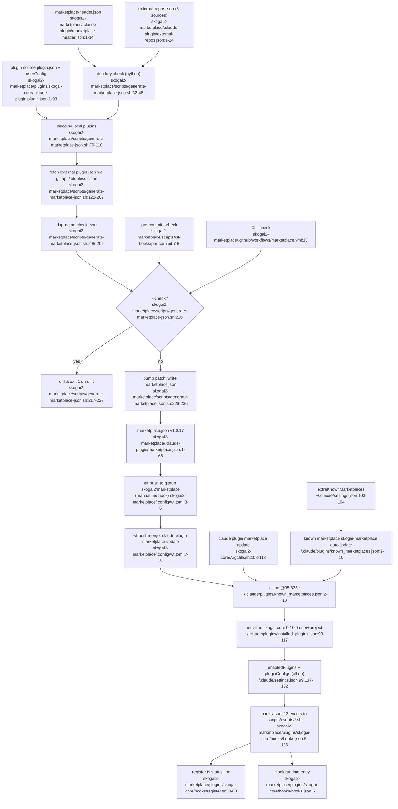
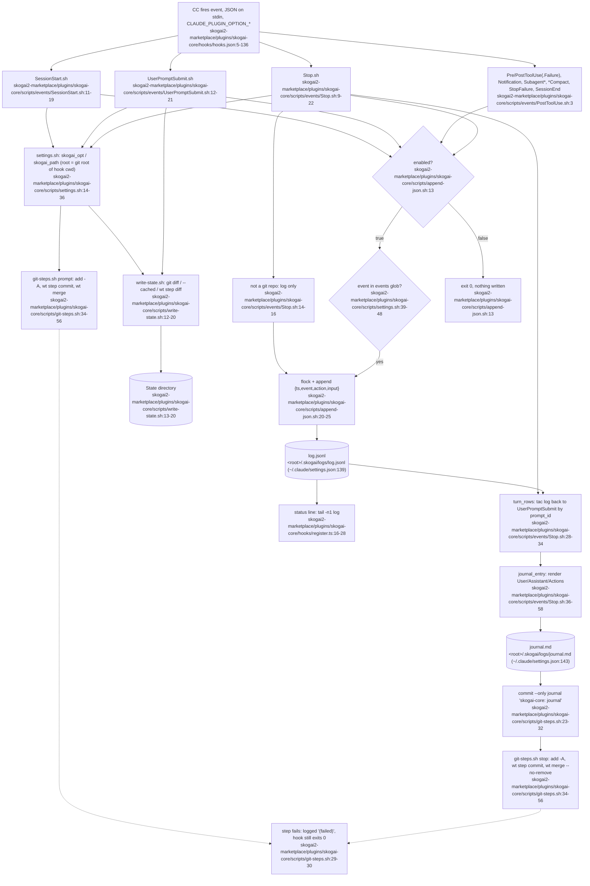
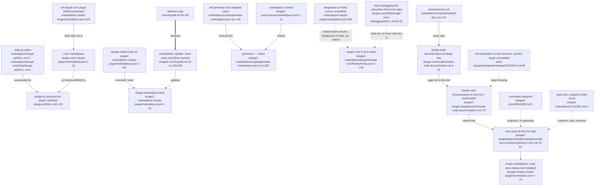
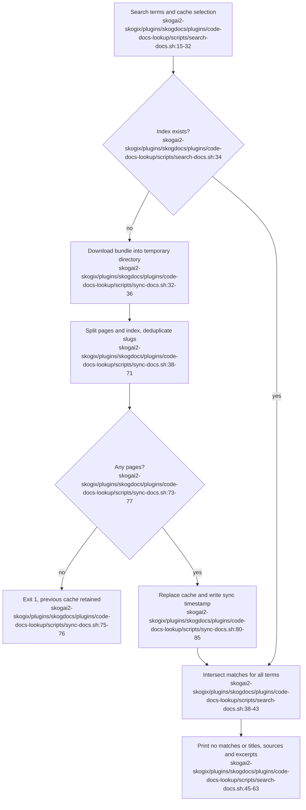

# S6 PLUGINS: marketplace, hooks, skills, docs lookup (Phase 1 flowchart)

Thread: S6 · 2026-11-14 · read-only on every repo (one exception, described in "Side effect found while mapping").

**Key findings:**

> The path runs: plugin source `skogai2-marketplace/plugins/skogai-core` → generator → `.claude-plugin/marketplace.json` → push to GitHub `skogai2/marketplace` → Claude Code clones it to `~/.claude/plugins/marketplaces/skogai-marketplace` and caches `skogai-core/0.10.0` → `hooks.json` fires `scripts/events/<Event>.sh` → `append-json.sh` writes `log.jsonl`, and on Stop `Stop.sh` writes the journal and `git-steps.sh` commits it.
>
> - **Live and verified:** the monorepo `~/Work` shows the commits `skogai-core: journal` on `.skogai/logs/journal.md`.
> - **Docs mirror:** no installed docs plugin was found in the inspected Claude state. The marketplace guidance explicitly directs agents to its committed `docs/` snapshot; absence of an installed plugin does not establish absence of use. The newest working tool is `skogai2-skogix` `code-docs-lookup`, but it is **not installed**. Its default-path cache `~/.cache/claude-code-docs` (synced 2026-11-01) is the only one with a recent sync stamp.

---

## Verification scope after provider handoff

The original inspection and installed-state observations below were recorded by the preceding Claude run on 2026-11-14. They are historical observations, not fresh runtime tests. The resumed Codex run read the inventory, fence reference, this report, and the exact sources listed below; it ran no hooks, generators, installers, sync scripts, or tests. Its only write was this report. Earlier side effects are retained transparently below.

Additional source reads: `skogai-jq/SKILL.md:1-65`, `skogai-jq/test-all.sh:1-51`; `skogai2-marketplace/plugins/skogai-core/scripts/settings.sh:1-48`, `write-state.sh:1-20`, `append-json.sh:1-25`, `events/Stop.sh:1-75`; `skogai2-marketplace/.config/wt.toml:1-8`; `skogai2-skogix/plugins/skogdocs/plugins/code-docs-lookup/scripts/search-docs.sh:1-63`, `sync-docs.sh:1-87`. Relative paths in the original source table resolve under `/home/skogix/Work/repos`; `…/skogai-core` means `skogai2-marketplace/plugins/skogai-core`, and `…/code-docs-lookup` means `skogai2-skogix/plugins/skogdocs/plugins/code-docs-lookup`.

Retirement, canonical docs ownership, and accidental-versus-intentional duplication remain owner questions. Old→new arrows below express the original investigator's inferred relationship, not independently proven commit ancestry. Installed metadata and journal commits do not prove every runtime branch works.

## Sources consulted

| Path | Lines |
|---|---|
| `PATHFINDER-2026-11-14/00-features.md` | 1-82 |
| `PATHFINDER-2026-11-14/skogfences-reference.md` | 1-126 |
| `skogai2-marketplace/.claude-plugin/marketplace.json` | 1-65 |
| `skogai2-marketplace/.claude-plugin/marketplace-header.json` | 1-14 |
| `skogai2-marketplace/.claude-plugin/external-repos.json` | 1-24 |
| `skogai2-marketplace/scripts/generate-marketplace-json.sh` | 1-239 |
| `skogai2-marketplace/scripts/git-hooks/pre-commit` | 1-9 |
| `skogai2-marketplace/.github/workflows/marketplace.yml` | 1-17 |
| `skogai2-marketplace/.config/wt.toml` | 1-8 |
| `skogai2-marketplace/CONVENTIONS.md` | 1-132 |
| `skogai2-marketplace/CLAUDE.md` | 1-35 |
| `skogai2-marketplace/TODO.md` | 1-21 |
| `skogai2-marketplace/apm.yml` | 1-12 |
| `skogai2-marketplace/mise.toml` | 1-6 |
| `skogai2-marketplace/.gitignore` | all |
| `skogai2-marketplace/docs/synced-at.txt` | all |
| `skogai2-marketplace/plugins/skogai-core/.claude-plugin/plugin.json` | 1-94 |
| `…/skogai-core/hooks/hooks.json` | 1-137 |
| `…/skogai-core/hooks/register.ts` | 1-61 |
| `…/skogai-core/scripts/settings.sh` | 1-48 |
| `…/skogai-core/scripts/append-json.sh` | 1-25 |
| `…/skogai-core/scripts/git-steps.sh` | 1-58 |
| `…/skogai-core/scripts/write-state.sh` | 1-20 |
| `…/skogai-core/scripts/events/*.sh` | all 13 |
| `skogai2-core/contracts/marketplace.toml` | 1-11 |
| `skogai2-core/Argcfile.sh` | 1-30, 95-165 (diffed identical to `core/Argcfile.sh` 95-165) |
| `marketplace/.claude-plugin/marketplace.json` | 1-80, plus `jq` listing of names and sources; skogai-core at 220, skoghooks at 262 |
| `marketplace/Makefile` | 1-4 |
| `marketplace/scripts/download-docs.sh` | 1-37 |
| `marketplace/scripts/generate-marketplace-json.sh` | 1-40, plus a diff against the skogai2 version |
| `marketplace/CLAUDE.md` | 79 |
| `marketplace/SKOGAI.md` | 1-15 |
| `marketplace/.gitmodules` | all |
| `skogai-core/.claude-plugin/marketplace.json` | 1-32 |
| `skogai-core/scripts/claude-code-documentation.sh` | 1-24 |
| `skogai-core/skills/skogai-hook-debugging/SKILL.md` | 1-60 |
| `skogai-core/CLAUDE.md` | 7-28 |
| `skogai-core/tests/` | ls |
| `skogai-jq/SKILL.md` | 1-25 |
| `skogai-jq/test-all.sh` | 1-40 |
| `skogai-jq/schemas/` | ls |
| `skogai2-skogix/.claude-plugin/marketplace.json` | 1-14 |
| `skogai2-skogix/plugins/skogdocs/.claude-plugin/marketplace.json` | 1-14 |
| `…/skogdocs/HANDOVER.md` | 1-60 |
| `…/code-docs-lookup/.claude-plugin/plugin.json` | 1-8 |
| `…/code-docs-lookup/scripts/sync-docs.sh` | 1-87 |
| `…/code-docs-lookup/scripts/search-docs.sh` | 1-40 |
| `…/code-docs-lookup/skills/claude-code-docs/SKILL.md` | grep at 3, 14, 31, 33, 40 |
| `…/agy-docs-lookup/scripts/sync-docs.sh` | 11-13 |
| `skogai2-skogix/.skogai/config/script_metadata.json` | 1-7 |
| `skogai2-skogai/.skogai/scripts/claude-code-documentation.sh` | 1-79 |
| `skogai2-skogai/.harness/features.json` | 55-61, 121-127 |
| `skogai2-docs/README.md` | 1 (the title is the whole file) |
| `skogai2-docs` git log | 2 commits, 2026-10-25 |
| `dot-skogai/scripts/claude-code-documentation.sh`, `dot-skogai/scripts/fetch/claude-code-documentation.sh` | symlinks into `~/.local/src/skills/extras/…`, **targets missing** |
| `skogai-nov10/SKOGAI.md` | 20 |
| `dash-skogai/fleet/garden/skogai/CONTEXT.md` | 68 |
| `dot-skogai/openwiki/concepts/docs-library.md` | 50 |

**Installed state (read-only):**

| Path | Lines |
|---|---|
| `~/.claude/plugins/known_marketplaces.json` | 1-46 |
| `~/.claude/plugins/installed_plugins.json` | 1-129 |
| `~/.claude/settings.json` | 93-152 (`enabledPlugins`, `extraKnownMarketplaces`, `pluginConfigs`) |
| `~/Work/.claude/settings.json` | 3 |
| `~/.claude/plugins/marketplaces/`, `cache/`, `data/` | ls |
| `~/.claude/plugins/marketplaces/skogai-marketplace` | git HEAD |
| `~/.local/src/marketplace` | remote and HEAD |
| `~/.codex/config.toml` | grep |
| `~/.cache/claude-code-docs/synced-at.txt` | all |
| `~/Work/.skogai/logs/` and `git log --stat -3` | — |

---

## Concrete findings

### A. Packaging: source → `marketplace.json` (skogai2-marketplace, live)

**1. Inputs** (`CONVENTIONS.md:27-36`):

- `marketplace-header.json` holds the top-level fields: `name: skogai-marketplace` and owner.
- Local plugins are discovered by `find plugins -mindepth 3 -maxdepth 3 -path "*/.claude-plugin/plugin.json"` (`generate-marketplace-json.sh:79`). Each is written as `source: "./plugins/<dir>"` (`:103-106`).
- External plugins come from `external-repos.json` (5 entries: loadout, codex, open-knowledge-plugin, context7, skogai-council). The generator fetches each one's `plugin.json` via `gh api` or a blobless `git clone` (`:167-179`). It falls back to a single `"./"` entry in the external repo's own `marketplace.json`, and then adds `strict:false` (`:183-198`).

**2. Guards:**

| Guard | Where |
|---|---|
| Duplicate JSON keys (python) | `:32-48` |
| Header must have `name` and `owner.name` | `:54-57` |
| Duplicate plugin names | `:205-206` |

Any failure → `die`, and `marketplace.json` is not touched.

**3. Output:**

- Entries are sorted by name (`:209`).
- Version: the patch number is bumped only when content changed (`:226-236`). Current: `1.0.17`.
- `--check` mode (`:216-224`) is called from:
  - `scripts/git-hooks/pre-commit:7-8`, but only when `core.hooksPath` is set.
  - CI `.github/workflows/marketplace.yml:15`.

**4. Publish:**

- `.config/wt.toml:7-8`: the `post-merge` hook runs `claude plugin marketplace update skogai-marketplace`.
- **Gap:** the hook comment says "publish it", but no hook runs `git push`. The update pulls from GitHub, so an unpushed merge refreshes nothing.

### B. Install (`~/.claude`, verified)

- `~/.claude/settings.json:103-104` (`extraKnownMarketplaces`) and `known_marketplaces.json:2-10` both point `skogai-marketplace` at `git https://github.com/skogai2/marketplace.git` with `autoUpdate: true`.
- Clone: `~/.claude/plugins/marketplaces/skogai-marketplace` at HEAD `05f833e` (2026-11-13). That equals local `repos/skogai2-marketplace` HEAD, so the published copy is current.
- `installed_plugins.json`:
  - `skogai-core@skogai-marketplace` 0.10.0, user scope plus project scope `/home/skogix/Work` (`:99-117`). Cache: `~/.claude/plugins/cache/skogai-marketplace/skogai-core/0.10.0`.
  - `skogai-council` 2026.10.13 (`:118-127`).
  - None of loadout, open-knowledge-plugin, codex or context7 is installed from this marketplace.
- **Installed marketplaces** (5): `skogai-marketplace` (skogai2/marketplace), `worktrunk`, `claude-plugins-official`, `thedotmack` (claude-mem), `cloudflare`.
- **Not installed:**
  - The old `skogai-market` (`skogai/marketplace`).
  - skogai-core's `core` marketplace.
  - `skogai2-skogix`'s `skogix` and `code-docs-tools` marketplaces.
- Leftovers in the cache and data dirs: `~/.claude/plugins/data/skogai-core-inline`, plus `cache/caveman` and `cache/ponytail`. These look like earlier `--plugin-dir` or inline runs.
- Second checkout: `~/.local/src/marketplace` is also a clone of skogai2/marketplace, at the older HEAD `2792b61`. `SKOGAI_MARKETPLACE_REPO_DIR` in `skogai2-core/Argcfile.sh:12` points at it.
- Codex: `~/.codex/config.toml` has **no** skogai marketplace, and there is no `~/.codex/plugins/marketplaces`. So the Codex half of `marketplace::update` and the `tools::codex::*` commands has nothing to act on.

### C. Hook runtime (`plugins/skogai-core` 0.10.0)

- **Settings:** `plugin.json:8-93` declares 14 `userConfig` options, all off by default. Claude Code exports them as `CLAUDE_PLUGIN_OPTION_<KEY>`.
  - `settings.sh:14-17` (`skogai_opt`) reads them, falling back to the same defaults.
  - `:24-29` (`skogai_path`) resolves relative paths against `$root`, the git root of the *hook's* `cwd`.
  - `:31-36` assigns `SKOGAI_ENABLED/EVENTS/LOG/JOURNAL/STATE` (without explicit `export`).
  - **The `SKOGAI_*` names share a namespace** with S1's `SKOGAI_*` env namespace (see "Duplication seen", item 6).
- **Values the owner actually set** (`~/.claude/settings.json:137-152`): `enabled`, `journal`, `write_state` and `status_line` are true, and **all six git steps are true** (`stage`, `commit` and `merge` × `prompt` and `stop`). The paths are overridden:
  - `log_path=.skogai/logs/log.jsonl`
  - `journal_path=.skogai/logs/journal.md`
  - `state_dir=.skogai/logs/state`
- **Dispatch:** `hooks.json:5-136` maps all 13 events to `${CLAUDE_PLUGIN_ROOT}/scripts/events/<Event>.sh`. `hooks.json:2-4` also loads `register.ts`, which only drives the status line: it registers nothing unless `enabled && status_line` (`register.ts:34`) and tails the log on `session.start`, `turn.start`, `tool.call` and `turn.complete` (`:41-60`).
- **Per event:**

| Event | Script | What it does |
|---|---|---|
| SessionStart | `SessionStart.sh:11-19` | `write-state.sh` if on, then log |
| UserPromptSubmit | `UserPromptSubmit.sh:12-21` | `git-steps.sh prompt` (add -A / wt step commit / wt merge), `write-state.sh`, then log |
| PreToolUse, PostToolUse, PostToolUseFailure, Notification, SubagentStart/Stop, Pre/PostCompact, StopFailure, SessionEnd | `<Event>.sh` | `exec append-json.sh` |
| Stop | `Stop.sh` | Outside git: log only (`:14-16`). Otherwise, if `journal` is on: `turn_rows` (`:28-34`) `tac`-scans the log back to the matching UserPromptSubmit by `prompt_id`; `journal_entry` (`:36-58`) renders `## <ts> · turn <id>` with User, Assistant and Actions and appends it to the journal. Then `git-steps.sh stop <root> <journal>` (`:62-68`), then `write-state.sh` (`:70-73`), then log (`:75`). |

- **`append-json.sh`:**
  - Finds the git root (`:11`).
  - Checks the switch and the event filter (`:13-14`).
  - Takes `flock` on the log, then appends `{ts,event,action,input}` (`:20-25`).
- **`git-steps.sh`:**
  - Commits `--only` the journal as `"skogai-core: journal"` (`:23-32`).
  - Then, as switched on: `git add -A` (`:34-37`), `wt step commit` (`:39-45`), `wt merge --no-remove` (`:50-56`).
  - A failure is logged as `(failed)`, never fatal.
- **`write-state.sh`:** writes `git-diff`, `git-diff-cached` and `wt-step-diff`. It runs `mkdir` on the state dir and puts a self-ignoring `.gitignore` in it (`:12-20`).
- **Terminal state, verified:** `~/Work/.skogai/logs/journal.md` (48 KB) and `log.jsonl` (694 KB). `git log` in `~/Work` shows `22c0276`, `1117c12` and `c0a8428`, all titled `skogai-core: journal` and touching only `.skogai/logs/journal.md`. There is also a stale `~/Work/.skogai/journal.md` (2026-11-13), which matches the plugin's *default* `journal_path`, from before the override.

### D. Old generation

- **`marketplace` (`skogai/marketplace`, last commit 2026-09-27 "wip: red-alert checkpoint"):**
  - `name: skogai-market`, 16 plugins. Local dirs and 3 submodules (`foreman`, `hush`, `razor`), all empty in this clone.
  - `Makefile:1-2` → `scripts/generate-marketplace-json.sh`, the ancestor of the skogai2 generator. It copied the full metadata (version, author, components) into entries; the skogai2 version deliberately dropped that (`skogai2 generate…:62-65`).
  - Hooks were the external plugin `skoghooks` (`marketplace.json:262`, `git-subdir skogai/skoghooks plugins/skoghooks`). `skogai/skoghooks` is **not in `mani.yaml`** and not cloned, so its source is unverified. **Owner clarification (2026-11-14): on hold for later, not retired**, because the owner considers current AI agents insufficiently capable of creating skoghooks.
  - Has its own `skogai-core` local plugin (`:220`, `./skogai-core`, skills and commands only).
  - Contains two stale `skogai-jq` copies: `marketplace/skogai-jq/` and `marketplace/skogai-core/skills/skogai-jq/`.
  - Has a docs mirror `docs/` (78 files) fed by `scripts/download-docs.sh:4-37`, which writes to `${CLAUDE_PLUGIN_DATA}/docs/` with a hard-coded page list. Nothing in the repo calls it as a hook. The docs say to "re-run the script" (`CLAUDE.md:79`).
- **`skogai-core` (`skogai/skogai-core`, active 2026-11-14):**
  - Its own marketplace `name: core` (`.claude-plugin/marketplace.json:1-32`) with `skogai-tests` and `skogai-core` (`strict:false`, skills `skogai-core` and `skogai-hook-debugging`).
  - No hooks directory remains. `skills/skogai-hook-debugging/SKILL.md:25-32` still describes a "core plugin" that logs hook input to `/tmp/<session>-session-start.json`: documentation of a retired hook implementation.
  - `CLAUDE.md:9` points to `plugins/skogai-jq/`, which doesn't exist (retired in `ad690d3`).
  - `tests/skogai-hooks/` still exists.
- **`skogai-jq` (canonical, commit `a8ed413` "Establish skogai-jq as canonical reusable skill"):**
  - About 70 transform dirs, `test-all.sh:16-30` (loops `*/test.sh`), and `schemas/`.
  - **No `.claude-plugin/` and no marketplace entry.** It isn't in `skogai2-marketplace`, and `~/.claude/skills` has no copy. **No marketplace installation path was found in the inspected manifests; direct skill installation remains possible.**
- **`skogai2-core/Argcfile.sh`** (byte-identical to `core/Argcfile.sh` for lines 95-165):
  - `marketplace::update` (`:108-113`) runs `claude plugin marketplace update` and `codex plugin marketplace update`. The `[[ "$argc_claude" ]]` lines (`:109`, `:111`) test variables that the `--no-claude` and `--no-codex` flags never set. They are no-ops, so both always run.
  - `tools::claude::{list,validate,update}` and `tools::codex::{add,upgrade,remove}` (`:121-158`) are `:` stubs.
  - The `@env` defaults are stale: `SKOGAI_MARKETPLACE_NAME=skogai-market` and `SOURCE=skogai/marketplace` (`:10-11`) name the *old* marketplace.
- **`skogai2-core/contracts/marketplace.toml:1-11`:** a draft contract. It already points at the new repo, `url=https://github.com/skogai2/marketplace`, check `generate-marketplace-json.sh --check`. Its source comment cites `~/skogai/.skogai/scripts/claude/cloud-environment.sh`.

### E. Docs mirrors (F14)

| # | Copy | Mechanism | State | Consumers |
|---|---|---|---|---|
| 1 | `skogai2-skogix/plugins/skogdocs/plugins/code-docs-lookup` | `sync-docs.sh:13-87`: `llms-full.txt` bundle split into pages plus `index.txt` and `synced-at.txt`, cache `-c` > `$CLAUDE_DOCS_DIR` > `~/.cache/claude-code-docs`. `search-docs.sh` and `show-doc.sh`, skill and `/ask` command. Tested (`HANDOVER.md:8-13`). | **Not installed.** Listed in `skogai2-skogix/.claude-plugin/marketplace.json:7-13` and `skogdocs/.claude-plugin/marketplace.json:7-13`. Neither marketplace is known to Claude Code. | Only itself and its tests |
| 1b | `~/.cache/claude-code-docs` | Output of #1 run without `-c` | 146 pages, synced 2026-11-01 | — |
| 2 | `skogai2-docs/claude-code/` | Committed snapshot (2 commits, 2026-10-25; 231 files). README is just a title. | Differs from 1b on every compared file (older) | No reference found outside itself |
| 3 | `skogai2-marketplace/docs/` | Committed snapshot (139 files), `synced-at.txt` 2026-10-09 | `TODO.md:11`: "the sync scripts were removed" | `CLAUDE.md:11` (read-only API reference for plugin work) |
| 4 | `marketplace/docs/` and `scripts/download-docs.sh` | Hard-coded page list to `${CLAUDE_PLUGIN_DATA}/docs` | Dormant (repo stale since 09-27) | `marketplace/SKOGAI.md:13` |
| 5 | `skogai-core/scripts/claude-code-documentation.sh` | Hard-coded page list to `./tmp/docs/claude-code` | Callable, no caller found | — |
| 6 | `skogai2-skogai/.skogai/scripts/claude-code-documentation.sh` | `llms-full.txt` gives the slugs, then each page `.md` is fetched, plus `OVERVIEW.md`, into `${1:-/tmp/claude-code-docs/}` | Ran once from `~/skogai/.skogai/scripts/…` on 2026-10-30 (`skogai2-skogix/.skogai/config/script_metadata.json:2-5`). `/tmp/claude-code-docs` is now empty or gone. | `skogai2-skogai/.harness/features.json:61,127`; `skogai-nov10/SKOGAI.md:20` (`skogcli script run claude-code-documentation tmp/docs/claude-code`, said to run from a worktree post-start hook) |
| 7 | `dot-skogai/scripts/{,fetch/}claude-code-documentation.sh` | Symlinks into `~/.local/src/skills/extras/scripts/…` | **Dangling**: targets missing | `dash-skogai/fleet/garden/skogai/CONTEXT.md:68` |
| 8 | `skogai-nov10/tmp/docs` | Named in the brief | **Does not exist** in the clone (`tmp/` absent; only `SKOGAI.md:20` mentions it) | — |

**Answer: "which docs mirror is actually used?"**

- **None is wired into a live, installed runtime path.**
- The only places that actually *read* a mirror:
  - `skogai2-marketplace/docs/`, as the static reference named in `CLAUDE.md:11` for plugin and hook authoring.
  - The context7 or `claude-code-guide` agent paths, which are external.
- The most complete and tested tool (#1) is uninstalled.

---

## Mermaid: live happy path (skogai2-marketplace → journal)

## Mermaid: hook runtime (one turn)

## Mermaid: old → new copies

---

## Side effects

| Where | Effect |
|---|---|
| Generator | `mktemp` file and dir (trap-cleaned, `:16-18`). Network: `gh api` or `git clone --filter=blob:none` of 5 external repos (`:167-179`). Writes `.claude-plugin/marketplace.json` (`:235`). |
| `wt` post-merge | Spawns `claude plugin marketplace update` in the background (`.config/wt.toml:8`). Network pull into `~/.claude/plugins/marketplaces/`. |
| Claude Code install | Clones into `~/.claude/plugins/marketplaces/`, `cache/<mkt>/<plugin>/<ver>`, `data/<plugin>-<mkt>/`. Writes `installed_plugins.json` and `known_marketplaces.json`. |
| Hooks (every event) | `mkdir -p` and `flock` append to `<git-root-of-cwd>/.skogai/logs/log.jsonl` (`append-json.sh:16-25`). |
| UserPromptSubmit and Stop (current config) | `git add -A`, `wt step commit` (which can call an LLM for the message, per wt config), and `wt merge --no-remove` **in the git root of the session's current cwd** (`git-steps.sh:34-56`). Stop also commits the journal (`:23-32`). |
| SessionStart, UserPromptSubmit and Stop | Overwrite the 3 diff files and create `.gitignore` only if absent in the state dir (`write-state.sh:12-20`). |
| Docs scripts | `curl` to code.claude.com, writing to `~/.cache/claude-code-docs`, `${CLAUDE_PLUGIN_DATA}/docs`, `./tmp/docs/claude-code` or `/tmp/claude-code-docs`, depending on the copy. `sync-docs.sh` runs `rm -rf "$CACHE"` before swapping in the new copy (`:81`). |
| Unix users and permissions | None in S6. The hooks run as whichever user runs Claude Code. These scripts do not enforce the skogfences user boundaries themselves: a hook fired from the human's session writes and commits inside whatever repo the cwd is in. |

### Side effect found while mapping (important)

`root` is computed from the hook's `cwd` (`append-json.sh:9-11`, `Stop.sh:11-14`, `UserPromptSubmit.sh:9-12`), and the git steps are all on. So any agent session that `cd`s into `~/Work/repos/<name>` gets:

1. `.skogai/logs/{log.jsonl,journal.md,state/}` written into that clone.
2. If a prompt or Stop fires while the cwd is there: `git add -A`, `wt step commit` and `wt merge` in that clone.

**Observed 2026-11-14 ~19:50:**

- 14 clones have new untracked `.skogai/` or `.skogai/logs` from the parallel Pathfinder threads: cloudflare, core, dash-skogai, dot-skogai, mise-plugin, podman, skogai2-cli, skogai2-core, skogai2-dash-skogai, skogai2-skogai-runner, skogai-nov10, skogai-routing, systemd, and marketplace.
- No hook commits landed in any clone since 18:00.
- This thread created `repos/marketplace/.skogai/logs/log.jsonl` (10 rows, all this session's) and removed it again. Its `git status` is clean.
- `skogai2-marketplace` also got rows from this session, but there `.skogai/logs/` is gitignored, so I left it alone (it also holds another session's rows).

This is an S6 → S4/S5 coupling the inventory didn't predict: **the hook journal uses the Git root resolved from the event cwd, rather than a fixed session-start root or agent home.**

## Error and fallback branches

- **Generator:** any fetch, parse or duplicate failure → `die`, and the file is untouched (`:25-28`, `:151`, `:177`, `:188`, `:193`, `:206`). If an external repo has no `plugin.json`, it falls back to the `"./"` entry and adds `strict:false` (`:183-198`).
- **Hooks:**
  - Master switch off → `exit 0` (`append-json.sh:13`, `Stop.sh:19`).
  - Not a git repo → log only (`Stop.sh:14-16`). Session and prompt skip the git work (`SessionStart.sh:11`).
  - Git or wt step failure → recorded as `(failed)` in the action string (`git-steps.sh:29-30`, `:43`, `:54`).
  - No `wt` → empty `wt-step-diff` (`write-state.sh:20`).
  - Status line errors are swallowed (`register.ts:27`).
- **Docs:** `sync-docs.sh` exits 1 when the bundle yields 0 pages, leaving the old cache intact (`:74-77`). `claude-code-documentation.sh` (skogai2-skogai) drops failed pages (`:70-75`). The old scripts ignore curl errors (`curl -sL` without `--fail`).

---

## External dependencies (S1–S7)

- **S1 ENV:**
  - `settings.sh` assigns `SKOGAI_ENABLED/EVENTS/LOG/JOURNAL/STATE` (without explicit `export`), a private reuse of the `SKOGAI_*` prefix that S1 owns. A collision is likely if S1 ever exports `SKOGAI_LOG` or the like.
  - `skogai2-marketplace/scripts/config/argc.sh` (layered frontmatter config, binname `skogai`, `CLAUDE.md:15`) belongs to S1; it was noted and not traced.
  - Plugin settings themselves live in `~/.claude/settings.json` `pluginConfigs` (user scope only, `CONVENTIONS.md:117-124`), outside every S1 scope.
- **S2 RUN:**
  - `git-steps.sh` depends on worktrunk `wt` (`step commit`, `merge`, `step diff`). The `wt post-merge` hook drives publishing.
  - herdr and work orders: `skogai2-skogai` features reference the docs script (`.harness/features.json:61`).
- **S3 DASH:**
  - `HANDOVER.md:31` notes that `PATH` in the `/skogai` Bash tool is `/usr/bin:/usr/local/bin`.
  - The docs script was run from `~/skogai/.skogai/scripts` (`script_metadata.json:2`).
  - S6 has no notion of agent users: all installs are in `~skogix/.claude`.
- **S4 DOT:** the hooks write `<root>/.skogai/logs/{log.jsonl,journal.md,state}`, which is the S6 → S4 edge. The `.skogai/` folder convention is assumed, not created by `dot-skogai`.
- **S5 FLEET:**
  - `skogai2-core` `marketplace::update` and `contracts/marketplace.toml` treat the marketplace as a fleet repo with a health check.
  - `mani.yaml` lacks `skoghooks`.
- **S7 SERVICES:** none.
- **Called by:** Claude Code, which fires the hooks, and worktrunk, which fires post-merge. No other SkogAI system calls the generator.

---

## Duplication seen

| # | Concern | Copies (file:line) | Read |
|---|---|---|---|
| 1 | Marketplace manifest | `skogai2-marketplace/.claude-plugin/marketplace.json:3`; `marketplace/.claude-plugin/marketplace.json:3`; `skogai-core/.claude-plugin/marketplace.json:2`; `skogai2-skogix/.claude-plugin/marketplace.json:2`; `skogai2-skogix/plugins/skogdocs/.claude-plugin/marketplace.json:2` | **Potential accidental overlap; owner intent unresolved.** Five SkogAI manifests, one registered locally. Only skogai2's is generated and checked. |
| 2 | Marketplace generator | `skogai2-marketplace/scripts/generate-marketplace-json.sh:1-239`; `marketplace/scripts/generate-marketplace-json.sh:1-243` | **Old → new evolution.** The older checkout is not installed here; retirement needs owner confirmation. |
| 3 | "skogai-core" plugin name | `skogai2-marketplace/plugins/skogai-core/.claude-plugin/plugin.json:2` (hooks); `marketplace/.claude-plugin/marketplace.json:220` (skills and commands); `skogai-core/.claude-plugin/marketplace.json:22` (skills) | **Accidental name collision**, with 3 different contents under one name. Only the first is installed. |
| 4 | Hook runtime | `skogai2-marketplace/plugins/skogai-core/hooks/hooks.json:5-136`; `marketplace/.claude-plugin/marketplace.json:262` (skoghooks, external); `skogai-core/skills/skogai-hook-debugging/SKILL.md:25-32` (describes a third, /tmp-based one) plus `skogai-core/tests/skogai-hooks/` | **Related hook implementations; replacement is not established.** The owner confirms skoghooks is on hold for later, not retired. The skogai-core skill and tests describe a different implementation; its lifecycle remains unconfirmed. |
| 5 | jq skill | `skogai-jq/SKILL.md:1-25` (canonical); `marketplace/skogai-jq/SKILL.md:3`; `marketplace/skogai-core/skills/skogai-jq/SKILL.md:3` (both differ from canonical); `skogai-core/CLAUDE.md:9` (dangling ref) | **Accidental.** The canonical copy has **no distribution path**. |
| 6 | `SKOGAI_*` resolution | `skogai2-marketplace/plugins/skogai-core/scripts/settings.sh:31-36` (`SKOGAI_ENABLED/LOG/…` from `CLAUDE_PLUGIN_OPTION_*`); `skogai2-marketplace/scripts/config/argc.sh` (per `CLAUDE.md:15`, `SKOGAI_*` overrides frontmatter); S1's `mise-plugin/hooks/mise_env.lua:14-18` (per `00-features.md`, not re-read) | **Accidental namespace sharing.** The plugin's variables are local shell vars, so the risk is naming, not runtime. |
| 7 | Marketplace update command | `skogai2-marketplace/.config/wt.toml:8`; `skogai2-core/Argcfile.sh:108-113`; `core/Argcfile.sh` (identical block 95-165); stubs `skogai2-core/Argcfile.sh:136,146-158` | **Accidental.** The wt hook is the one that works. The Argcfile names the old marketplace (`:10-11`) and has no-op flags. |
| 8 | Local marketplace checkout | `~/.claude/plugins/marketplaces/skogai-marketplace` (@05f833e); `~/.local/src/marketplace` (@2792b61, `skogai2-core/Argcfile.sh:12`); `~/Work/repos/skogai2-marketplace` (@05f833e) | Three clones of one repo. The `.local/src` one is behind and is what the Argcfile env points to. |
| 9 | CC docs fetch | `skogai2-skogix/…/code-docs-lookup/scripts/sync-docs.sh:13-87`; `skogai2-skogai/.skogai/scripts/claude-code-documentation.sh:9-79`; `skogai-core/scripts/claude-code-documentation.sh:4-24`; `marketplace/scripts/download-docs.sh:4-37`; `dot-skogai/scripts/{,fetch/}claude-code-documentation.sh` (dangling) | **Potential overlap; owner intent unresolved.** Similar page-list and bundle-fetch mechanisms; chronology alone does not prove lineage or retirement. |
| 10 | CC docs snapshot (committed) | `skogai2-docs/claude-code/` (231 files, 10-25); `skogai2-marketplace/docs/` (139, `synced-at` 10-09); `marketplace/docs/` (78) | **Accidental.** All stale against `~/.cache/claude-code-docs` (11-01). |
| 11 | Hook-debugging skill | `skogai-core/skills/skogai-hook-debugging/SKILL.md` = `marketplace/skogai-hook-debugging/SKILL.md` (md5 `2834462e…`) | Byte-identical copy. Also overlaps `skogai2-marketplace/.claude/skills/hook-development/`. |

---

## Confidence and gaps

**High confidence:**

- The generator → `marketplace.json` → GitHub → install → hooks → journal path. Each hop was read in source and confirmed in `~/.claude` state, and `~/Work`'s git log shows the journal commits.
- The installed-marketplaces list.
- That `code-docs-lookup` isn't installed.

**Medium:**

- "No caller" claims for the docs scripts rest on a grep of `*.md`, `*.toml`, `*.sh` and `*.json` under `repos/`. Callers in uncloned repos or in `~/.local/src` were not searched.

**Gaps:**

- `skogai/skoghooks` source (not catalogued, not cloned).
- The `loadout` and `open-knowledge-plugin` repos (external, not read).
- `skogai2-marketplace/scripts/config` and `frontmatter`, and `apm`/`APM.md` (not traced).
- `.claude/skills/{add-plugin,hook-development}` (not read).
- `skogai-core/skills/skogai-core` (the routing skill; S4 territory).
- Whether `wt step commit` calls an LLM here (wt config not read).
- The worktree post-start hook claimed in `skogai-nov10/SKOGAI.md:20` was not found in that clone.

---

## Open questions for owner

1. **Git steps scope.** `pluginConfigs` turns on `stage`, `commit` and `merge` on both prompt and stop, user-wide. Combined with the cwd-scoped root, that means any agent `cd` into a clone commits and merges there. Is that intended (journal everywhere), or should git steps apply only to the repo the session was started in?
   - *Answer:* pending (sent to the owner mid-thread).
2. **Canonical docs mirror.** Should `code-docs-lookup` (skogai2-skogix) be the one, published through `skogai2-marketplace/external-repos.json`? And are `skogai2-docs`, `skogai2-marketplace/docs/`, and the `claude-code-documentation.sh` copies dead?
   - *Answer:* pending.
3. **skogai-jq distribution.** It's canonical but has no `.claude-plugin`. Should it become a plugin in `skogai2-marketplace`, a skill linked into agent homes, or neither?
   - *Answer:* pending.
4. **skoghooks lifecycle.**
   - *Owner answer (2026-11-14):* “there is simply not a ai agent good enough to create skoghooks so they are \"on hold\" for later”. Treat skoghooks as **on hold, not retired or fully replaced**. This answer does not settle the old marketplace lifecycle or canonical docs mirror.
5. **skogai-core repo (`core` marketplace and skills).** Is it the continuing home for skills while skogai2-marketplace holds hooks? Or should its skills move into skogai2-marketplace?
   - *Answer:* pending.

## Mermaid: docs lookup and refresh

Source-derived path; not executed during this audit. Every path below is under `skogai2-skogix/plugins/skogdocs/plugins/code-docs-lookup/`.

The cache replacement is **not atomic**, despite the source comment: it removes the old directory before copying the new files. Download or zero-page failure preserves the old cache, but failure during replacement can leave it incomplete. Existing indexes suppress automatic refresh without an age check (`sync-docs.sh:27-29`).

The jq test entry point discovers sibling `*/test.sh`, runs each as a process, records success/failure, then exits 1 if any failed (`skogai-jq/test-all.sh:16-30,41-51`). It was read, not executed; child harness side effects were not audited. Skill use is direct jq execution with arguments and JSON input, rather than a hook call.
