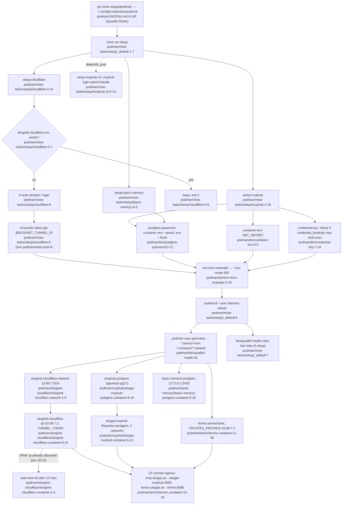
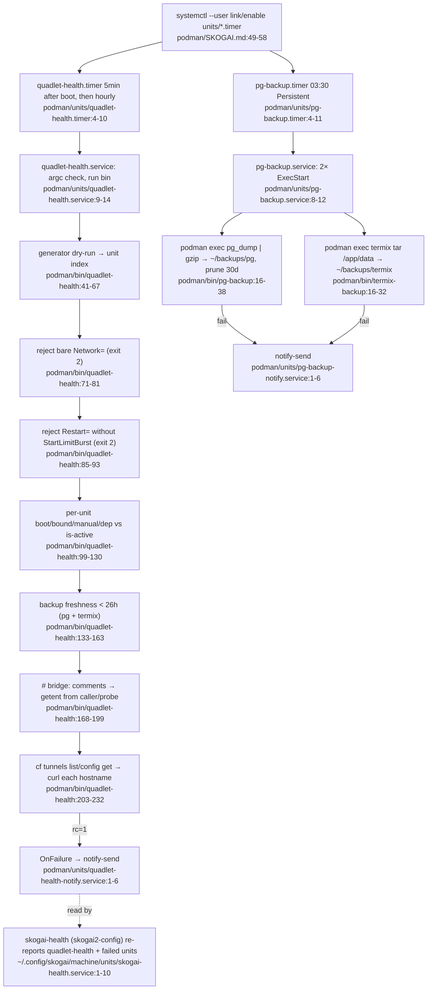
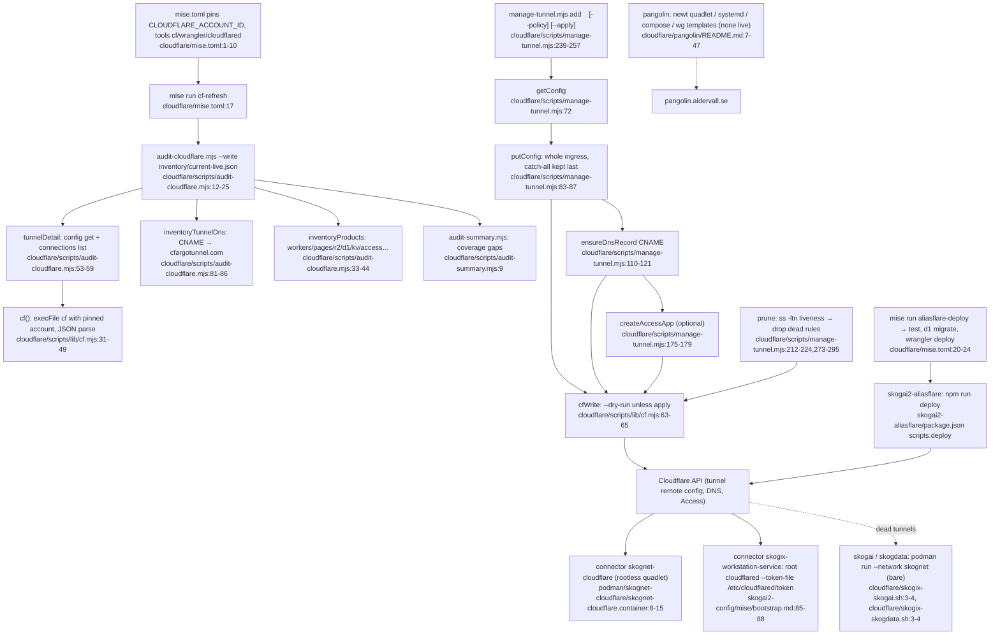
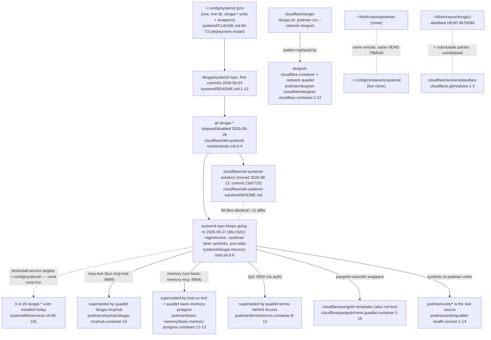

# S7 SERVICES — runtime services and edge (Phase 1 flowchart)

Thread: Pathfinder Phase 1, S7. Read-only on every repo. Written 2026-11-14 ~19:50 CET.

## TL;DR

- **One live implementation: `podman`.** Its repo is checked out twice: `~/.config/containers/systemd` is the live copy and `~/Work/repos/podman` is a second clone. Both are on the same remote (`skogai/podman`) and the same HEAD `7f9d540`. The quadlet generator reads the live clone. The timers and backup units are symlinked into `~/.config/systemd/user/` from that clone's `units/`.
- **`systemd` repo is a dead snapshot.** None of its 26 `skogai-*` units, nor any wrapper, is installed in `~/.config/systemd/user/` today. Its `bin/install-service` / `bin/diff-live` target paths that no longer exist. `cloudflare/old-systemd-solution/` is an *older* fork of the same tree. It was moved there 2026-08-13, while the systemd repo got commits up to 2026-09-27. 50 files are byte-identical between the two and 11 differ.
- **Edge:** three tunnel connectors run on the host, and only one of them is in a repo:
  1. `skognet-cloudflare` (rootless quadlet, podman repo). It routes `mcp.skogai.se` and `termix.skogai.se` into containers by name.
  2. `skogix-workstation-service`: root `/etc/systemd/system/cloudflared.service` with `--token-file /etc/cloudflared/token`. It is hand-placed and documented in `skogai2-config/mise/bootstrap.md`, with no owning repo for the unit.
  3. A user-level `cloudflared ... run` spawned by the T3 Code desktop app (pid 88370). That is outside S7.
- `cloudflare` repo = the control plane (`cf` wrappers: audit, manage-tunnel with dry-run/`--apply`). It is not a runtime. `pangolin/` holds only templates; nothing pangolin runs live.
- **LIVE INCIDENT (seen while mapping, not touched):** `skognet-cloudflare.service` has been **failed** since 18:22:58 (start-limit-hit). The cause is a podman IPAM error: `requested ip address 10.89.7.2 is already allocated to container ID 5996074a…`, a stale allocation from a container that no longer exists. As a result, `quadlet-health` → `tunnel: 0 connections`, `mcp.skogai.se 530`, `termix.skogai.se 530`, and `skogai-health` fails 2/19 (journalctl at 19:27 / 19:32).
- **Secrets in git (private repos):** a real Newt id/secret is in `cloudflare/pangolin/newt.quadlet.container:8-9` and `cloudflare/pangolin/NEWT.env`. Pangolin newt/olm `--id/--secret` are inline in `systemd/skogai-pangolin-new-start.sh:3` and `systemd/skogai-pangolin-olm.sh:3`, and identical copies sit in `cloudflare/old-systemd-solution/`. Both repos are `PRIVATE` (gh). Values are not reproduced here.

## Sources consulted

| Path | Lines |
|---|---|
| `podman/AGENTS.md`, `podman/SKOGAI.md` | all (SKOGAI.md 1-60 = Repository Guidelines, Quadlet Rules) |
| `podman/mise.toml` | 1-13 |
| `podman/mise-tasks/setup/{_default,cloudflare,mcphub,basic-memory,mcphub-cli}` | all (7, 10, 18, 5, 14 lines) |
| `podman/mise-tasks/mcphub/{dev,seed}` | all |
| `podman/bin/{env-from-example,container-env,credential-key,postgres-password}` | all |
| `podman/bin/quadlet-health` | 1-241 |
| `podman/bin/{pg-backup,termix-backup}` | 1-41, 1-35 |
| `podman/units/*` (6 files) | all |
| `podman/*/*.container`, `*.network`, `*.env.example` | all (env values redacted when read) |
| `podman/docs/networking.md` | 1-60 (+grep 159, 219) |
| `podman/PLAN.md` | grep: 3, 20-24, 53-55, 111-113 |
| `systemd/AGENTS.md`, `systemd/CLAUDE.md` | all |
| `systemd/services.json`, `systemd/lib/services.sh`, `systemd/bin/*` | all |
| `systemd/README.md` | 1-40 |
| `systemd/user/skogai-{mcp-hub,memory,ttyd,codex-web}.service` + wrappers | all |
| `systemd/user/*.wants/` | `ls -la` |
| `systemd/skogai-pangolin-{new-start,olm}.sh` | 1-3 (secrets redacted) |
| `cloudflare/AGENTS.md` | 1-200 |
| `cloudflare/mise.toml` | 1-24 |
| `cloudflare/scripts/lib/cf.mjs` | 1-77 |
| `cloudflare/scripts/manage-tunnel.mjs` | grep index 1-326; read 210-260 |
| `cloudflare/scripts/audit-cloudflare.mjs` | grep index 10-205 |
| `cloudflare/inventory/tunnels.yaml` | 1-116 (header says STALE 2026-08-14) |
| `cloudflare/TODO.md` | 1-60 |
| `cloudflare/pangolin/{README.md,newt.quadlet.container,newt.service,a.yml,docker-compose.yml,NEWT.env}` | all (secrets redacted) |
| `cloudflare/skogix-skogai.sh`, `skogix-skogdata.sh` | 1-4 |
| `cloudflare/old-systemd-solution/todo.md` | 1-40 |
| `cloudflare/old-systemd-solution/` vs `systemd/` | `diff -rq` + `cmp` per file + 3 sample `diff`s |
| `cloudflare/.gitmodules`, `git submodule status` | — |
| `cloudflare/migrations/0001_skogedge_registry.sql` | 1-8 |
| `skogai2-aliasflare/{wrangler.toml,package.json}`, `git log -5` | all / scripts |
| `skogai2-config/containers/podman.md` | 1-90 |
| `skogai2-config/mise/{bootstrap.md,secrets.md}` | grep: bootstrap 21, 28, 85-88, 122-123; secrets 51, 60 |
| `~/.config/skogai/machine/units/skogai-health.service` | 1-10 (= skogai2-config clone, remote `skogai2/config`) |
| `~/.config/systemd/user/skogai-t3.service` | 1-16 |
| Live | `systemctl --user list-units 'skogai*' 'gptme*' 'quadlet*' 'pg-backup*' 'termix*' 'basic-memory*' 'mcphub*' 'skognet*' --all`; `list-timers`; `podman ps -a`; `ls -la ~/.config/containers/systemd ~/.config/systemd/user{,/*.wants}`; `git -C ~/.config/containers/systemd remote/log`; `journalctl --user -u skognet-cloudflare -n 25`, `-u quadlet-health -n 40`, `-u skogai-health -n 25`; `ps` for cloudflared/newt/olm; `systemctl cat cloudflared.service` (token lines filtered) |

## Live inventory: which repo is the source of truth for each running thing

| Running unit / process | State 19:4x | Source of truth | Installed how |
|---|---|---|---|
| `skogai-mcphub.service` (+`-postgres`, `-network`) | active | `podman/mcphub/*` | quadlet generator reads `~/.config/containers/systemd` (live clone of `skogai/podman`) |
| `basic-memory-postgres.service` (+network) | active | `podman/basic-memory/*` | same |
| `termix.service` (+network) | active | `podman/termix/*` | same |
| `skognet-cloudflare.service` (+network) | **failed** (IPAM 10.89.7.2) | `podman/skognet-cloudflare/*` | same |
| `quadlet-health.{service,timer}` + notify | timer active / service failed | `podman/units/*` | symlinks in `~/.config/systemd/user/` → `~/.config/containers/systemd/units/` (`systemctl --user link`, `podman/SKOGAI.md` Monitoring) |
| `pg-backup.{service,timer}` + notify | timer active, last ok 03:37 | `podman/units/*` | same symlink pattern |
| `skogai-health.{service,timer}` + notify | failed (cascade from quadlet-health) | **skogai2-config** `machine/units/` (S1) | symlinks → `~/.config/skogai/machine/units/` |
| `skogai-t3.service` | disabled, inactive | none (hand-written in `~/.config/systemd/user/`) | — |
| system `cloudflared.service` (tunnel `skogix-workstation-service`) | active, root | unit file: none (hand-placed; copy at `~/.config/mise/files/cloudflared.service`, per `skogai2-config/mise/bootstrap.md:85-88`) | manual `/etc/systemd/system/` |
| user `cloudflared … run` pid 88370 | running | T3 Code desktop (parent pid 87123 `t3code`) | not S7 |
| any `systemd/user/skogai-*.service` (26) | **not installed** | `systemd` repo (dead) | — |
| `aliasflare` Worker | deployed on CF (not verified live this session) | `skogai2-aliasflare` HEAD `8b7b59d` = `cloudflare/workers/aliasflare` submodule pointer (submodule **not initialised** in `repos/cloudflare`) | `mise run aliasflare-deploy` |

## Diagram 1: podman happy path (fresh clone → serving a public hostname)

## Diagram 2: podman monitoring and backup loop (the timers that run every hour/night)

## Diagram 3: cloudflare control plane (`cf` wrappers), plus the edge connectors on the host

## Diagram 4: how the old and new copies relate

## Side effects

- **Files:** `podman/bin/env-from-example:17` writes `*.env` (umask 077). `mise-tasks/setup/mcphub:15-17` appends to the env file. `pg-backup:18-29` writes `~/backups/pg` (chmod 700) and prunes it with `find -delete`. `termix-backup:18-25` does the same in `~/backups/termix`. `mcphub/seed:4-9` writes `tmp/mcphub-dev/mcp_settings.json`. `audit-cloudflare.mjs` writes `inventory/current-live.json` (gitignored). The dead `systemd/lib/services.sh:94-101` would `install -Dm644` into `~/.config/systemd/user/` and `ln -sfn` wrappers.
- **Processes / exec:** `podman exec` into postgres (`pg_dump`, `psql` in `credential-key:13`) and into termix (`tar`). `podman run --rm --network container:<caller>` probe in `quadlet-health:187`. `mcphub` dev server (`mcphub/dev:10`) with a loopback `--require` shim.
- **Units:** `systemctl --user daemon-reload` (`setup/_default:6`). The timers are enabled by hand from `SKOGAI.md`. Restart caps of 10 starts per 300 s apply on every container.
- **Network:** `cf` API reads (quadlet-health, audit) and writes (manage-tunnel `--apply`). `curl` to each public hostname (quadlet-health:223). `cf auth login` is interactive (setup/cloudflare:8). `mcphub login` against `https://mcp.skogai.se` (setup/mcphub-cli:4-7).
- **Secrets:** tunnel token from `cf tunnels token get`. Postgres passwords and the mcphub credential key are recovered from running containers (`container-env`). The termix API key is loaded by `podman/mise.toml:7` (`_.file`, redact). The root token is `/etc/cloudflared/token`, root 0600, hand-placed (`skogai2-config/mise/secrets.md:51`).
- **Unix users/perms:** everything runs rootless as `skogix`, except the system `cloudflared` (root). None of S7 runs as an agent user. skogfences is not applied here: there are no `/skogai` paths, and services live in the human's `$HOME` (`~/.config/containers/systemd`, `~/backups`).

## Error and fallback branches (brief)

- `env-from-example`: it keeps an existing file and exits 1 when a KEY is missing from the example (`:7-14`).
- `postgres-password`: it exits 1 if the container and the .env disagree, or if the volume exists but its password is unknown (`:9-18`).
- `credential-key`: it refuses to mint a key while `credential_bindings` may hold rows (`:19-23`).
- `quadlet-health` exit codes: 2 for generator, bare-network or no-restart-cap problems; 1 for unit, backup, bridge, tunnel or hostname failures. Rows it cannot check print `skip`, e.g. when cf is not logged in or the caller is stopped (`:173-210`).
- `pg-backup`: a failed dump removes `.tmp` and skips pruning, then the loop continues with rc=1 (`:31-35`).
- `manage-tunnel`: every write is dry-run by default (`cf.mjs:63-65`). `add` refuses a duplicate hostname (`:244`).
- Live branch hit today: an IPAM stale allocation makes `skognet-cloudflare` exit 126 ten times → `start-limit-hit`. `quadlet-health` then reports the hostnames as 530.

## External dependencies (S1–S6)

- **Calls into S1 ENV:** mise (`[env]` in `podman/mise.toml:1-7`, `cloudflare/mise.toml:8-10` both pin `CLOUDFLARE_ACCOUNT_ID`), and mise shims for `argc`/`cf` inside units (`podman/units/quadlet-health.service:9-13`). skogai2-config owns the root cloudflared install (`skogai2-config/mise/bootstrap.md:85-88,122-123`) and the `skogai-health` timer that wraps quadlet-health.
- **Called by S1:** `skogai2-config/bin/health` runs `quadlet-health` as one of its 19 checks (journal: `containers FAIL quadlet-health`).
- **S4 DOT:** both `cloudflare` and `skogai2-aliasflare` carry `.skogai/journal` + `logs/skogai-core/log.jsonl` (S6 hooks write there). `systemd/.skogai` and `podman/.skogai` (untracked) exist too.
- **S6 PLUGINS:** `skogai-mcphub` serves `mcp.skogai.se`. It is the MCP hub that agents' plugins and CLIs log into (`setup/mcphub-cli`). `cloudflare` ships a `cf-manage` skill twice (`.claude/skills/` and `.agents/skills/`).
- **S3 DASH:** none in the live path. The old `systemd` units used `WorkingDirectory=%h/skogai` (`systemd/user/skogai-ttyd.service:10`, `skogai-mcp-hub.service:10`), the pre-skogfences home-dir layout.
- **S2 RUN / S5 FLEET:** no direct edge. `mani.yaml:27-41,77-78` catalogs podman, cloudflare and systemd.
- **Out-of-system:** T3 Code spawns its own user cloudflared. `basic-memory` runs on the host as a `uv tool` and talks to quadlet postgres on `127.0.0.1:5432`.

## Duplication seen

| Concern | Copies (file:line) | Read |
|---|---|---|
| podman repo checked out twice | `~/.config/containers/systemd` (live, remote `https://github.com/skogai/podman.git`) vs `~/Work/repos/podman` (remote `…/skogai/podman`). Same HEAD 7f9d540 | **Accidental-ish.** It is harmless while both clones track one remote, but edits in `repos/podman` do nothing until they are pushed and pulled live. Unit paths hardcode the live one (`podman/units/pg-backup.service:11-12`, `podman/termix/termix.container:24`). |
| whole skogai-* unit tree | `systemd/user/*` + `systemd/skogai-*-start.sh` vs `cloudflare/old-systemd-solution/user/*` + `*-start.sh`. 50 identical, 11 differ, e.g. `systemd/skogai-memory-start.sh:5-6` vs `cloudflare/old-systemd-solution/skogai-memory-start.sh:5-6`, `systemd/user/skogai-skogchat.service:10` vs `old-systemd-solution/user/skogai-skogchat.service:10` | **Accidental.** Two snapshots of one dead live directory. Neither is installed. |
| MCP hub service | `systemd/skogai-mcp-hub-start.sh:3-6` (bun `mcp-hub` :9999) vs `podman/mcphub/skogai-mcphub.container:10-21` (samanhappy/mcphub) | **Superseded.** The podman one is live; the systemd one is dead. |
| basic-memory | `systemd/skogai-memory-start.sh:6` (`uvx basic-memory mcp` :9904) / `old-systemd-solution/skogai-memory-start.sh:5-6` (:9999) vs `podman/basic-memory/basic-memory-postgres.container:9-15` (postgres only; app on host) | **Superseded.** Note that 9999 also collides with mcp-hub and skogchat in the old copy. |
| web terminal | `systemd/skogai-ttyd-start.sh:2` (ttyd :9002, no auth, `services.json:21-29` exposure cloudflare) vs `podman/termix/termix.container:8-36` | **Superseded.** |
| tunnel connector as a container | `cloudflare/skogix-skogai.sh:3-4`, `cloudflare/skogix-skogdata.sh:3-4` (`podman run --network skognet`, bare network) vs `podman/skognet-cloudflare/skognet-cloudflare.container:8-15` | **Superseded.** The bare `skognet` network breaks the podman repo's own rule (`podman/SKOGAI.md` Quadlet Rules, Networks). `cloudflare/TODO.md:37-46` still lists both tunnels as down. |
| tunnel connector, host-level | root `cloudflared.service` (hand-placed; `skogai2-config/mise/bootstrap.md:85-88`) vs rootless `skognet-cloudflare` quadlet | **Legitimate specialization** per `podman/docs/networking.md:16-18,27-31` (sudo/ssh side vs container-only world). The gap is that the root unit has no repo owner; it is commented out in skogai2-config. |
| pangolin connector | `systemd/skogai-pangolin-new-start.sh:3`, `systemd/skogai-pangolin-olm.sh:3` (+ identical old-systemd-solution copies) vs `cloudflare/pangolin/newt.quadlet.container:1-16`, `newt.service:1-18`, `docker-compose.yml`, `a.yml` (byte-identical to docker-compose.yml) | **Accidental.** Four or more ways to run the same connector, none of them live, all with secrets inline. |
| health check | `podman/bin/quadlet-health:35-238` (quadlet scope) vs `systemd/bin/check:8-11` + `services.json` healthchecks vs `skogai2-config/bin/health` (machine scope, calls quadlet-health) | quadlet-health ↔ skogai-health is **legitimate layering**, since one calls the other. `systemd/bin/check` is **dead**. |
| health/backup notify units | `podman/units/quadlet-health-notify.service:1-6`, `podman/units/pg-backup-notify.service:1-6`, `~/.config/skogai/machine/units/skogai-health-notify.service` | **Same pattern copied** (OnFailure → notify-send). Fine as is; could become one templated `notify@.service`. |
| unit symlinks recorded twice | live `~/.config/systemd/user/{pg-backup,quadlet-health}*` → podman `units/`, and `systemd/user/{pg-backup,quadlet-health}*` (same symlinks committed) | **Accidental.** The systemd repo captured podman's install state. |
| `CLOUDFLARE_ACCOUNT_ID` pin | `podman/mise.toml:3`, `cloudflare/mise.toml:10`, `cloudflare/scripts/lib/cf.mjs:31`, `podman/bin/quadlet-health:27` | **Accidental but tiny.** One value in four places. It belongs to S1 (one env plane). |
| Cloudflare inventory | `cloudflare/inventory/tunnels.yaml:5-8` (self-declared STALE 2026-08-14), `cloudflare/TODO.md:28-46`, `podman/docs/networking.md:27-31`, `podman/PLAN.md:111-113`, live `cf` | **Accidental drift.** Only live `cf` (via `cf-refresh` / quadlet-health) is truth. |
| `cf-manage` skill | `cloudflare/.claude/skills/cf-manage/SKILL.md`, `cloudflare/.agents/skills/cf-manage/SKILL.md` | Probably **legitimate** (Claude vs Codex/agents layout); not diffed. |
| aliasflare | `skogai2-aliasflare` (HEAD 8b7b59d) and `cloudflare/workers/aliasflare` submodule (pointer 8b7b59d, not initialised) | **Legitimate.** It is the same repo, used as a submodule. The 00-features note that "the owner's commits are vendored" is wrong: the fork carries owner fixes, e.g. `251bc13 fix: detect verification codes…`. |
| D1 migrations | `cloudflare/migrations/0001_skogedge_registry.sql` (SkogEdge `services` registry) vs `skogai2-aliasflare/migrations/0001_init.sql` | Different databases, **not duplication**. But the SkogEdge `services` table is yet another service registry, alongside `systemd/services.json` and quadlet files. |

## Confidence and gaps

- **High:** the podman flow, live unit states, the dead systemd repo (verified against live `~/.config/systemd/user`), old→new lineage dates, and the IPAM failure (journal text).
- **Medium:** the "11 differ" count includes 2 directory entries from `cmp`, so about 9 real file diffs. Only 3 were diffed by hand.
- **Not verified:** the aliasflare Worker's live deploy. `manage-tunnel.mjs` access/rm paths were not read in full. `audit-cloudflare.mjs` was read only through its grep index. I did not run `cf` to list the ingress of `skogix-workstation-service`. The hostnames come from `cloudflare/TODO.md:15-21` (termix moved off it per `podman/PLAN.md:24`; `mem.skogai.se → 127.0.0.1:37700` is on it). I did not read `systemd/README-old.md`, `cloudflare/inventory/{architecture-review,access,email,storage}.md`, or `podman/termix/README.md`, `podman/mcphub/README.md`, `podman/SECRETS.md`.
- **Not checked:** whether the cached `agents/{podman,systemd,cloudflare}.md` match current repo AGENTS.md. I also did not read `skogai2-config/bin/health` itself; its coupling comes from its journal output only.

## Open questions for owner

1. **systemd repo:** is it dead, to be archived? Today 0 of 26 units are installed. Or should some services (codex-web, opencode, gptme-webui, dolt…) come back, either as quadlets in podman or as plain user units?
2. **`cloudflare/old-systemd-solution/`:** delete it, since the systemd repo is the newer copy of the same thing?
3. **Root `cloudflared.service` (`skogix-workstation-service`):** which repo should own it, skogai2-config (S1, currently commented out) or podman/cloudflare?
4. **Live incident:** `skognet-cloudflare` is down (IPAM 10.89.7.2 held by gone container 5996074a). Should I hand off a fix thread, or will you take it? I did not touch it.
5. **Committed pangolin/newt secrets** (cloudflare + systemd, both private repos): should they be rotated and moved to env files?
6. **Two podman clones:** should `~/Work/repos/podman` become a symlink to, or the origin of, `~/.config/containers/systemd`, or stay a separate clone?

Answers: _pending, asked in thread._
