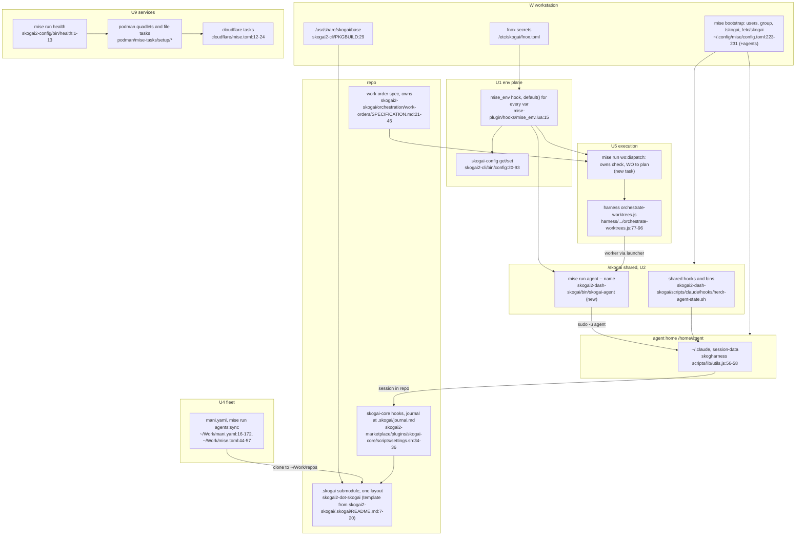

# 03 — Unified proposal

The design follows the owner's direction:

- **Compose across levels**, not winner-takes-all.
- **mise first**, and **mise tasks as the command interface**.
- **skogfences**: agents are unix users, `/skogai` is the shared ground, `.skogai` is base config plus the bootstrap submodule, and the human's `$HOME` is sacred.
- **harness** is the orchestration direction.
- **skoghooks** are on hold.

Simplest design wins. Most of the changes below are deletions or re-pointing, not new code. Each unified system has **one entry point**, and each level has **one owner**.

## The level table (the spine)

Every concern gets at most one implementation per level. This table is the contract that U1–U9 fill in.

| Level | Path | Owner repo | Who writes |
|---|---|---|---|
| W workstation | `/etc/skogai` (fnox, system config), `/usr/share/skogai` (base) | skogai2-config (mise bootstrap), skogai2-cli (package) | root via `mise bootstrap` |
| S shared ground | `/skogai` (setgid, `skogai` group) | **skogai2-dash-skogai** | group members |
| H human home | `/home/skogix` | skogai2-config, nvim-omarchy | skogix only |
| A agent home | `/home/<agent>` | skogai2-dash-skogai (launcher + skeleton) | that agent only |
| R repo | `<repo>/.skogai/` | skogai2-dot-skogai (layout + submodule) | session in that repo |
| C container | runner image | skogai2-skogai-runner | build |
| X edge | Cloudflare, Pangolin | cloudflare, podman | ops tasks |

---

## U1 — ENV plane: one resolver, every level (D2)

- **Component:** `mise-plugin` is the only thing that *computes* SkogAI env. Single entry point: the `mise_env` hook (`mise-plugin/hooks/mise_env.lua`).
- **Changes:**
  1. `mise_env.lua:15` routes `SKOGAI_CONFIG_DIR` through the existing `default()`, so a pre-set value wins. That makes "whatever you set it to" true at every level (W3).
  2. Delete the literal `SKOGAI_CONFIG_DIR` in `~/.config/mise/config.toml:93`. The plugin option `config_dir` is how a level sets it.
  3. One key→env rule: drop `-`, as the runner does. Fix `skogai2-cli/lib/config.sh:56-59` (W21).
  4. Rename the runner's `SKOGAI_LOG` to `SKOGAI_RUN_LOG` (W22).
  5. `whereami.sh` prefers `SKOGAI_HOST/OS/ARCH` (W23).
  6. Move `CLOUDFLARE_ACCOUNT_ID` into one mise `[env]` and drop the other 3 pins (X12).
- **Settings CLI:** `skogai2-cli` (`skogai-config`, "mise holds the values") is the one get/set/list CLI.
  - Delete `skogai2-marketplace/scripts/{config,frontmatter}/`, which is an uncalled copy (W4).
  - The runner's `best-argc-version/` stays frozen and is not extended (runner `AGENTS.md:20`).
- **Containers:** the runner image gets the same plugin, so the env inside C matches the env on H. One resolver, not a hermetic fork. Owner Q5 in S1 still stands; this is the recommendation.
- **Capability loss:** none.
- **Rejected:** a new per-level variable family (`SKOGAI_SYSTEM_DIR`, …). The plugin option plus `default()` is enough until a consumer actually needs two levels at once.

## U2 — Agent identity = unix uid (D1, the root cause)

- **Component:** `skogai2-dash-skogai`. Single entry point: `mise run agent -- <name> [cmd]`, which wraps one launcher, `skogai2-dash-skogai/bin/skogai-agent`.
- **Changes:**
  1. Declare the agent users and `/skogai` in mise `[bootstrap.users.*]` / `[bootstrap.*]` again. The old declaration is recorded at `skogai2-config/mise/bootstrap.md:137-140`. This is mise before custom.
  2. `admin/create-agents.sh` shrinks to only what mise cannot express, or is deleted.
  3. Delete `setup-coordination.sh:15-25` (W14) and `install-coordination.sh` (W1: it sets the forbidden `2775`).
  4. `skogai-agent` runs `sudo -u <agent>` with **one** env allowlist file (W15). It replaces `skogai2-skogix/bin/claude`, `bin/agy` and `codex/run`.
  5. Identity is `id -un`. Delete `SKOGAI_USER`-from-`CLAUDECODE` (`skogai2-dash-skogai/mise.toml:13`) and the `FNOX_PROFILE` proxy. `SKOGAI_AGENT_NAME` (`skogai2-core/scripts/context/context-start.sh:5`) reads the uid.
  6. Per-agent config moves to `/home/<agent>/.claude` etc., following skogfences ("their own home"). `/skogai` keeps only what agents *share*: shared hooks such as `herdr-agent-state.sh`, with the dash copy kept and the skogix copy deleted (W10), and shared bins.
  7. Remove every `/home/skogix/...` reference from agent settings (`skogai2-skogix/claude/settings.json:23,44,55,66,77`, `agy/settings.json:10-12`, `claude/shell/.zshrc:1`).
- **Effect on skogai2-skogix:** it becomes the human's personal repo and stops claiming `/skogai`.
- **Capability loss:** agents can no longer read the herdr plugins in `~/.config/herdr`. Those plugins must be installed under `/skogai` (shared) or per agent. This loss is acceptable and is the point of the change.
- **Order:** get it working first and harden afterwards, per the owner rule. Changing `/home/skogix` to `0750` comes *after* agents run as their own uid.

## U3 — Command interface = mise tasks (D3)

- **Component:** each repo's `mise.toml` / `mise-tasks/`. Single entry point: `mise run <task>`. Implementations (argc, node, bash) stay *behind* tasks, as cloudflare and podman already do.
- **Changes:**
  1. Wrap the plain entry points as tasks:
     - `skogai2-config/bin/{health,check-routes,check-coverage}`
     - `harness/.../orchestrate-worktrees.js`
     - `systemd/bin/*`, only if that repo survives (see U9)
  2. Delete the `gita`/`gptodo`/`skogcli` wrapper copies in `dash-skogai/bin` and `skogai-nov10/bin`. In `harness`, replace them with mise `[tools]` entries (`pipx:`/`uv:`) so no file remains (W16, X7).
- **Rejected:** a new `skogai` umbrella CLI. mise is the umbrella.

## U4 — Fleet registry = `mani.yaml` (D4)

- **Component:** `~/Work/mani.yaml`, the only registry that is read today. Single entry point: `mise run agents:sync` and the other existing tasks (`~/Work/mise.toml:44-57`).
- **Changes:**
  1. Drop `core` from the catalog and archive it (W5). Check `core/HANDOVER.md` first.
  2. Delete the `repo::*` block in `skogai2-core/Argcfile.sh:34-47` (W9) and the committed gita CSV snapshot.
  3. skogai2-core's `repo` module (repos.toml, contracts) either reads `mani.yaml` or is retired. Recommendation: read mani, since its contracts are the useful part.
  4. One clone root, `~/Work/repos`. `~/.local/src` stops being a second fleet root.
  5. One worktree root (see U5).
- **Capability loss:** gita's group views. mani has tags (`mani list projects -t`), which covers them.

## U5 — Work order → harness execution (D5)

- **Component:**
  - **Spec level (R):** `skogai2-skogai/orchestration/work-orders/SPECIFICATION.md` is the single WO format. It is the superset and keeps `owns`.
  - **Execution level:** `harness` `orchestrate-worktrees.js`, per owner direction.
  - **Single entry point:** `mise run wo:dispatch -- <wo>`. It checks that the `owns` sets are disjoint, maps WO → harness plan (`name→name`, body→`task`, `reads→seedPaths`), and runs harness.
- **Changes:**
  1. Replace the runner's `WORKORDERS.md:20-29` with a link to the spec, and rename `done/` to `completed/` (W7).
  2. One dispatch-prompt template referenced by both (W11).
  3. One worktree root, the harness default (sibling dirs) or `~/.herdr/worktrees`. Retract the hub's "authoritative" line (`skogai2-skogai/.skogai/rules/herdr-orchestration.md:21`) in favour of harness (Q2).
  4. Project name, which resolves Q3 without a network: `basename "$(dirname "$(git rev-parse --path-format=absolute --git-common-dir)")"`. It works offline, stays the same across worktrees, and replaces `gh repo view` (`get-project-name.sh:7`, `skogcli:2`) and `basename(cwd)` (X8).
  5. Routing: one checker, `skogai2-config/bin/check-routes` (tested), with one grammar. Delete `dash-skogai/bin/check-skogai-routes` and its task (W12).
- **Legit split kept:** herdr/tmux panes (human watching) vs headless `claude -p` are launcher modes of the same dispatch.
- **Capability loss:** harness enforces no `owns`, so the guarantee moves to the pre-dispatch check.

## U6 — Hooks and journal: one runtime per level (D6)

- **Component:**
  - **R (repo journal):** `skogai2-marketplace/plugins/skogai-core`. It is already off by default and configured through native mod settings with the log location, which matches the owner rule exactly. Single entry point: `hooks/hooks.json`.
  - **A (agent session data):** skogharness `$HOME/.claude/session-data`. Under U2, that `$HOME` is the agent's home, so the two stack.
- **Changes:**
  1. Configure `journal_path=doc/journal.md` through native mod settings, relative to the session-start repo, outside both disposable logs and the U7 submodule (W2). Keep log/state settings separate; do not reset the journal to the incompatible `.skogai/journal.md` default. Merging the 875-line `~/Work/.skogai/logs/journal.md` is the owner's call.
  2. Replace only journal-producing behavior in the vendored VV hooks in skogai2-skogai and the runner with plugin hooks. Preserve scope enforcement, git-identity checks, staged-secret scanning, the staging/commit gate, TaskCompleted checks, and lead-owned bookkeeping protection (see `agents/skogai2-skogai-runner.md:71`). Retire only the journal role of `.harness/claude-progress.txt`; retain any bookkeeping consumers. Remove a gate only after an equivalent replacement passes allow/deny tests.
  3. Git steps (stage/commit/merge) apply only to the session's start repo. This addresses S6 Q1, which was never answered; the safe default is to scope them.
  4. One lesson matcher in harness. Delete the other two. skoghooks stays on hold, inside `harness/marketplace/plugins/skoghooks`, which already exists, so the old marketplace entry is not needed. Fix the stale doc at `dot-skogai/SKOGAI.md:51,79` (X10).
- **Open (Q1):** if the owner prefers skogharness for R as well, swap the R owner. Two runtimes at R is not an option.

## U7 — `.skogai` layout and bootstrap = skogai2-dot-skogai (D7)

- **Component:** `skogai2-dot-skogai`, as the dot-skogai intent says. It holds the one layout doc and *is* the bootstrap submodule. Single entry point: `git submodule add <skogai2-dot-skogai> .skogai`, wrapped as `mise run skogai:init`.
- **Changes:**
  1. Copy the live layout from `skogai2-skogai/.skogai/README.md:7-20` in as the template, and mark the other two layouts historical (W19).
  2. `/usr/share/skogai/base` (skogai2-cli package, level W) provides defaults, and the submodule (level R) pins per project. The journal is parent-owned at `doc/journal.md`, outside this submodule; bootstrap must configure U6 accordingly and ensure that path is not ignored. Verify a journal-only parent commit leaves the submodule gitlink unchanged. No journal commits or pushes go to the shared template repository.
  3. Uninstall the stale `skogai-runner-git` package, which ships the deleted `main.sh` (X13).
- **Owner calls:** whether the old dot-skogai knowledge, memory and journal migrate or freeze; OpenWiki revive or delete; one decision store; renumbering one `adr-002` (W20).

## U8 — Plugins and docs (D8)

- **Component:** `skogai2-marketplace` (the only registered marketplace). Docs: `code-docs-lookup/sync-docs.sh` → `~/.cache/claude-code-docs`.
- **Changes:**
  1. Delete the `skogai2-skogai` docs fetcher; the other two go with their old repos.
  2. Delete the nested `skogdocs/.claude-plugin/marketplace.json` (W13).
  3. Publish `code-docs-lookup` via `external-repos.json`.
  4. `skogai2-docs` and `skogai2-marketplace/docs/` become pointers or go (owner call).
  5. Retire the old `marketplace` and `skogai-core` repos. skogai-jq is already canonical, and skoghooks lives in harness.

## U9 — Services = podman, health = one task (D9)

- **Component:** `podman` (quadlets plus file tasks) for services, and `mise run health` → `skogai2-config/bin/health` for health.
- **Changes:**
  1. Delete `cloudflare/old-systemd-solution/` (W6).
  2. Archive the `systemd` repo, which has 0 of 26 units installed. Anything to keep comes back as a quadlet or podman unit (S7 Q1).
  3. Replace the 3 notify units with one `notify@.service` and delete `a.yml` (W17).
  4. Root `cloudflared` goes to skogai2-config (W level).
  5. Hardening, afterwards: move the Pangolin `NEWT_SECRET` to fnox and rotate it.
- **Separate ops item:** the `skognet-cloudflare` IPAM incident is not part of this refactor.

---

## Retirement list (owner sign-off; all are generational)

Retire `core`, `dash-skogai`, `marketplace`, `skogai-core`, `skogai-routing`, `skogai-nov10`, `systemd`, and `cloudflare/old-systemd-solution/`. Each has a named successor above. Archive them, don't delete them, per the rule "never delete working dirs / unpushed work".

## Unified flowchart

